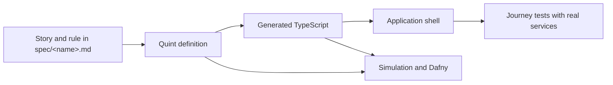

# The Network

The Network uses Eliza to help people find dates, friends, work, and things
to do. Four apps share one backend, one phone identity, one text line, and a
staff console. People aged 13 or older may join. Adults may match after
human review and consent.

[Product specification](spec/product/README.md) ·
[User stories](spec/product/stories.md) ·
[Flow models](spec/models/README.md) ·
[Stack](#the-stack) ·
[Quick start](#quick-start) ·
[Spec reference](SPEC.md) ·
[Commands](#commands)

The product specification combines the PRD, MVP plan, user stories, and founder
decisions. It contains launch scope and acceptance criteria.
Executable Vibestack rules live in `spec/<name>.md`. The action-based Quint
models under `spec/models/` cover flows as their decisions move into
generated state machines and policies.

## Why

Vibestack puts each story, its rules, and the formal behavior of those rules
in Markdown. A rule's Quint generates TypeScript and gives the checker a
model to investigate and prove. The check reports simulation failures,
missing reachability witnesses, differences between Quint and TypeScript,
proof obligations, and statements that need a product owner's review.



The same generated functions run in the application. HTTP, SQL, text
parsing, and the other I/O stay with the package that owns the boundary.
See the [pinned Vibestack README](tools/vibestack/README.md)
for the complete standalone guide, including the React and VibeLang stack,
Studio, examples, template setup and the packaged CLI.

## The stack

| Layer | Source and checks |
|---|---|
| Product | Stories and acceptance rules in [the product specification](spec/product/README.md). Product owners record approval in `spec/lock.json` with `pnpm run accept`. |
| Decisions | Quint in the [executable specs](SPEC.md#writing-a-spec) generates TypeScript. The checker simulates the model, compares TypeScript traces, and runs Dafny proof obligations. |
| Effects | The [backend health shell](packages/core/src/vibe/backendHealthShell.vibe) reads readiness and the [shutdown shell](packages/core/src/vibe/backendShutdownShell.vibe) drains listeners and tracked work. `pnpm run spec:sync` compiles both shells and their generated Effect adapters with the vendored VibeLang compiler. |
| Application | Node 26 serves the backend and console. Each package owns its existing HTTP, storage, and UI integration. The [Network agent guide](AGENTS.md) applies the upstream design guidance to these packages. |
| Conformance | The spec checker compares the app's observed state and effects with generated rules. The [command table](#commands) lists scoped journeys and the existing application test commands. |

## Quick start

Use Node 26, Corepack 0.35.0, and pnpm 10.24.0 for the application and
Vibestack. The Node patch version is in `.nvmrc`. Use Dafny 4.11 for proofs
and PostgreSQL 16 for local service and database tests.

```bash
corepack enable pnpm
pnpm install --frozen-lockfile
pnpm run spec:setup
pnpm run gen
```

Use the [platform runbook](docs/runbook-platform.md) to start the four
sites, API, and service against local Postgres with dry-run sends. Read
[AGENTS.md](AGENTS.md) for the Network workflow. Canonical skills live in
[`.claude/skills/`](.claude/skills/) and the tracked
[`.agents/skills/`](.agents/skills/) aliases support agent discovery.
Clients without repository discovery can open the applicable `SKILL.md`
and its referenced files directly.

## Studio

Run `pnpm run spec:studio` to inspect the executable rules and run their
checks. Studio edits land in the projection under `runs/vibestack/`. Apply
reviewed changes in the repository's `spec/` tree and restart Studio to
refresh the projection. Standalone Vibestack also runs application build
and start jobs, manages child specs, and shows a component catalog. The
[Studio guide](tools/vibestack/README.md#studio)
describes those controls.

## Tutorial

1. **Find the story.** Find the requirement in the
   [product specification](spec/product/README.md) and the associated
   [flow model](spec/models/README.md).
2. **Write the rule and Quint.** Add one checkable sentence under its story.
   Put its type definitions, pure guards, transition, or property in the
   rule's `quint` block. Follow the [format reference](SPEC.md#writing-a-spec).
3. **Sync.** Use the [sync skill](.claude/skills/sync/SKILL.md) and
   `pnpm run check`. Run `pnpm run spec:sync` to publish the resulting
   TypeScript under `packages/core/src/generated/`.
4. **Wire the decision.** Call the generated function from the app's
   existing HTTP, storage, or service entry point. Exercise the story through
   that entry point when behavior depends on the surrounding shell.
5. **Review.** Compare each changed rule with its Quint, report open
   obligations, and leave sign-off to the product owner.

For a production example, follow [the member age rules](spec/memberAge.md)
through the generated `joinableAge` and `matchableAge` functions to
[the shared age policy](packages/core/src/policy.ts). The policy checks that
its input is a number, then calls the generated decisions.

[Standalone walkthrough](tools/vibestack/README.md#build-your-project)

## Commands

The imported skills describe standalone Vibestack. Use these equivalents
from The Network root.

| In standalone Vibestack | In The Network | Purpose |
|---|---|---|
| `pnpm install` | `pnpm install --frozen-lockfile`, then `pnpm run spec:setup` | Install the app and the pinned toolchain. |
| `pnpm gen` | `pnpm run gen` | Generate the executable modules into `gen/`. |
| `pnpm check` | `pnpm run check` | Run the Vibestack checks on the executable spec inputs. |
| `pnpm studio` | `pnpm run spec:studio` | Open the spec editor on the local projection. |
| `spec watch` | `pnpm run spec:watch` | Repeat checks when the local projection changes. |
| `pnpm new <name>` | `pnpm run new <name>` | Scaffold a child spec. |
| `pnpm accept` | `pnpm run accept` | Product owner sign-off after a fresh check. |
| `pnpm selftest` | `pnpm run spec:selftest` | Exercise the vendored toolchain against its fixtures. |
| `pnpm demo` | `pnpm run spec:demo` | Run the standalone order example. |
| | `pnpm run spec:sync` | Generate the TypeScript snapshots and compile the serving VibeLang shell. |
| | `pnpm run spec:check-generated` | Compare checked-in TypeScript and VibeLang output with fresh generation. |
| | `pnpm run spec:conformance <module>` | Run one spec's simulation and compare it with the app through its driver or recorded trace. |
| | `pnpm run quint:check` | Exercise the action-based flows in `spec/models/`. |
| | `pnpm run typecheck`, `pnpm run test:integration`, `pnpm run test:e2e`, `pnpm run sim` | Check the application and the live-code seams. |

The spec checker uses an executable projection of `spec/` and the
conformance inputs under `test/`. The
[shared-line consent](spec/sharedLineConsentJourney.md),
[saved profile](spec/savedProfileJourney.md), and
[gateway turn receipt](spec/turnReceiptJourney.md) journeys run through
signed HTTP and isolated local Postgres databases on port 54339. Run
`pnpm run spec:conformance` with `sharedLineConsentJourney`,
`savedProfileJourney`, or `turnReceiptJourney`. Run
`pnpm run spec:conformance memberRequestJourney` to compare the request
and review flow through the dry-run ConsentNetwork harness. The checker saves
a minimal failing trace under `test/counterexamples/` and replays it on
later runs. Product prose, historical sources, and action-based flow
models stay in `spec/product/` and `spec/models/`. The review ledger,
`spec/lock.json`, records product owner approval and goes with the spec. See the [standalone stage definitions](SPEC.md#stages-of-pnpm-check)
and the [Network test policy](docs/tests-policy.md).

## What's here

| Path | What it is |
|---|---|
| `packages/core` | Shared contract: domain types, `Clock`, seeded RNG, the age policy (`policy.ts`), the outbound leak guard (`guard.ts`), the reply and opt-out parsers (`replies.ts`), the run-log schema, and the LLM clients (`llm.ts`) |
| `packages/engine` | The matching and opportunity engine (PRD 33) with one pack per app: filters, retrieval, generators, scoring, LLM judge passes, group composer, fairness, attention budget ([README](packages/engine/README.md)) |
| `packages/network` | The ConsentNetwork: human review before any member contact, consent-first probes, request fulfilment, safety and trust, the leak guard on every send, Postgres state. `service/` is the production service. `harness/` holds its simulations ([design](docs/network.md)) |
| `packages/sim` | The simulator: personas with hidden truth, the oracle, persona agents, the per-app worlds (`src/apps`) and the judge ([README](packages/sim/README.md)) |
| `packages/capital` | The network-capital ledger and its simulation |
| `packages/blooio` | The Blooio iMessage and SMS channel and its outbound queue ([README](packages/blooio/README.md)) |
| `packages/notify` | The single inbox and the delivery scheduler ([README](packages/notify/README.md)) |
| `packages/platform` | The shared backend for the four apps: people, phones, memberships, consent, blocks, login and the public API ([README](packages/platform/README.md)) |
| `packages/mcp` | The remote MCP server and its OAuth for agent-first sign-up ([README](packages/mcp/README.md)) |
| `packages/observatory` | The admin console, the simulator visualizer, the dev Postgres and the migrations ([design](docs/observatory.md)) |
| `packages/core/src/svc` | Byte-identical mirror of the Eliza service contract. The Eliza side is `@elizaos/plugin-network` in elizaOS/eliza |
| `sites/` | The four app sites and their `SKILL.md` files ([README](sites/README.md)) |
| `plugins/` | The Claude and OpenAI agent plugins, generated from `sites/` ([README](plugins/README.md)) |
| `deploy/` | The backend image, the Pages router, the backup job and the post-deploy check ([docs/deploy.md](docs/deploy.md)) |
| `evals/` | Hand-written corpora, scored by `pnpm run sim` |
| `scripts/` | `sim.ts` (the validation command), `relay-eval.ts`, `clef-fit.ts`, the dev servers and the synthetic-data scripts |
| `data/synthetic/v1` | 500 synthetic members with hidden truth ([README](data/synthetic/README.md)) |

## Application validation

Copy `.env.example` to `.env` for local work. See
[CONTRIBUTING.md](CONTRIBUTING.md) for variables and real-agent evidence.

```bash
node --import tsx --env-file-if-exists=.env packages/observatory/db/dev-pg.ts up
pnpm run typecheck
pnpm run sim
pnpm run test:integration
pnpm run test:e2e
```

The simulator runs offline by default. The integration and e2e suites
exercise real Postgres and HTTP. [Test policy](docs/tests-policy.md)

## The Eliza seam

The member conversation runs in Eliza, upstream in elizaOS/eliza (`plugins/plugin-network`). This repository has no plugin package and no eliza submodule. It talks to Eliza only over the signed contract mirrored in `packages/core/src/svc/contract.ts` and `svc-auth.ts`: `/internal/turn`, `/internal/turn-receipt`, `/internal/set-state`, `/internal/signals`, `/internal/updates` and `/internal/relay` on this backend, and `/api/internal/network/deliver` on Eliza Cloud.

## Slop bounty

This repository is a [Slop](https://slop.cash) bounty repository with a monthly pool of 1,000 USDC. Maintainers accept outcomes on GitHub. Slop scores accepted merges and pays the pool in USDC after maintainer review. Nothing is guaranteed or held in escrow.

Before you start, read [CONTRIBUTING.md](CONTRIBUTING.md). In short:

1. **First step: star and fork this repository** with your own GitHub account (required for project tracking). Work from your fork.
2. The [product specification](spec/product/README.md) defines the MVP.
3. Accepted: reproduced bug fixes, validation of the matching algorithm and the simulations, measured quality improvements (hill-climbing), security fixes, and tests that prove real behavior.
4. Not accepted: UI, style or copy changes, preference refactors, speculative features, busywork tests, mock-only proof, placeholders and unverified claims.
5. Evidence must use real LLM calls and real agent clients (Claude Code, Codex or ChatGPT, Hermes Agent, OpenClaw, Muse, Grok, elizaOS, Cursor and others).

AI coding agents: read [AGENTS.md](AGENTS.md).

## License

The vendored [Vibestack toolchain](tools/vibestack/) uses its upstream
[MIT license](tools/vibestack/LICENSE). Ask a maintainer about license terms
for The Network.
