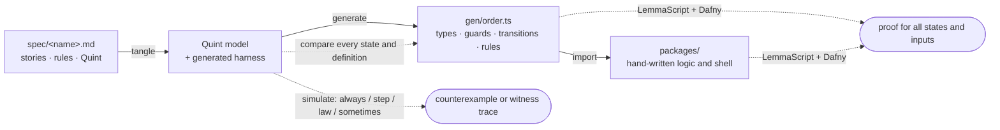
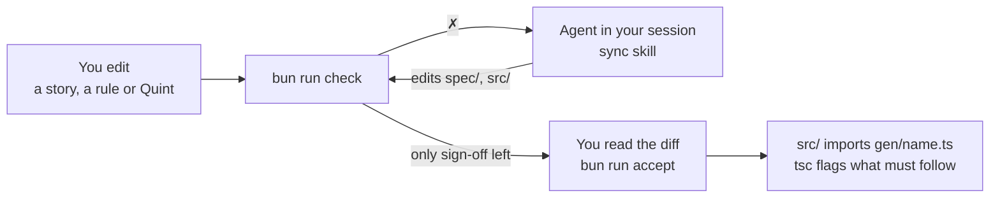

# The Network

The Network uses Eliza to help people find dates, friends, work, and things
to do. Four apps share one backend, one phone identity, one text line, and a
staff console. People aged 13 or older may join. Adults may match after
human review and consent.

[Product specification](spec/product/README.md) ·
[Flow models](spec/models/README.md) ·
[Quick start](#quick-start) ·
[Tutorial](#tutorial) ·
[Spec reference](AGENTS.md#spec-reference)

The product specification merges the PRD, MVP plan, and later founder
decisions. It includes launch scope, user stories, and acceptance criteria.
Generator-ready rules live in `spec/<name>.md`. The action-based Quint
models under `spec/models/` remain executable as the corresponding flows
move to Vibespec's pure state and policy definitions.

## Why

A Vibespec module puts each user story, its rules, and their formal
meaning together in Markdown. Quint is the input to code generation.

- **Generation.** Types, guards, transitions and rule checks in
  `gen/<name>.ts` come from the spec. Nobody edits them.
- **Simulation.** Thousands of random traces look for a reachable state that
  breaks a rule, and report the shortest one.
- **Proof.** Dafny checks each stated obligation for all states and inputs
  in the model. Hand-written logic can also have checked contracts.
- **Reviewed.** Every rule that changed is shown with its sentence and its
  Quint side by side, for product review.



The [starter example](tools/vibespec/spec/order.md) is an order checkout. Fill a
draft, submit, pay in instalments, hold, cancel, reopen.

| Order example | |
|---|---|
| Model | 10 transitions, 6 `always`, 1 `step`, 3 `sometimes` rules |
| Proved, spec | 72 obligations, all states and inputs |
| Proved, `src/ledger.ts` | 2 hand-written functions, 3 obligations |

## Quick start

Use Bun 1.4.2 for the application, Node 24 or later for the spec tools, and
Dafny 4.11 for proof. PostgreSQL 16 is required for local service and database
tests.

```bash
bun install --frozen-lockfile
bun run spec:setup
bun run gen
bun run spec:demo
```

The demo drives the starter checkout through drafting, submission,
installments, and rejection of events that the rules refuse. For a clean
starter project, use the upstream template and run `npm install`,
`npm run check`, and `npm run demo`. [Vibespec Starter](https://github.com/lalalune/vibespec-starter/generate)

## Studio

Run `bun run spec:studio` to open the local editor. It displays the product's
generator-ready modules, records edits, runs checks, and can hand sync work
to Claude Code or Codex. Start the starter's Studio with
`npm --prefix tools/vibespec run dev` for the order, dashboard, assistant, and
full-stack examples. Both use the same review process as the terminal.

Run `bun run spec:watch` to repeat checks after file changes.

## Tutorial

### 1. Read a spec

In [spec/order.md](tools/vibespec/spec/order.md), `##` is a story, `###` a rule, and the
`quint` block under a rule is its formal half.

````markdown
## Story: Check out

> As a shopper, I want to submit my order and pay it off in one or more
> payments, so that I do not need the whole amount at once.

### A payment never exceeds the balance

A payment is a positive amount toward a pending order. The payment that
clears the balance marks the order as paid.

```quint
pure def canPay(o: Order, amount: int): bool =
  o.status == Pending and amount > 0 and o.paid + amount <= o.due

pure def pay(o: Order, amount: int): Order =
  val paid = o.paid + amount
  { ...o, paid: paid, status: if (paid == o.due) Paid else Pending }
```

### A pending order still has a balance

```quint
pure def alwaysPendingHasBalance(o: Order): bool =
  o.status == Pending implies o.paid < o.due
```
````

There is no state machine to write. A definition's name and signature give
its role ([all of them](AGENTS.md#what-goes-in-the-quint-blocks)):

| You write | It is |
|---|---|
| `pure val initial: Order` | the initial state; its type is the state type |
| `pure def pay(o: Order, …): Order` | a transition, and an event `{ type: "pay", amount }` |
| `pure def canPay(o: Order, …): bool` | the guard of `pay` |
| `pure def alwaysX(o: Order): bool` | holds in every reachable state |
| `pure def stepX(before: Order, after: Order): bool` | holds across every transition |
| `pure def sometimesX(o: Order): bool` | some reachable state has it |
| `pure def lawX(…): bool` | true for every argument |

`gen/order.ts` gets the same definitions in TypeScript. Each transition
carries one obligation per rule, which Dafny proves:

```ts
/** Story: Check out / A payment never exceeds the balance (spec/order.md:73) */
//@ pure
export function pay(o: Order, amount: number): Order {
  //@ ensures (inv(o) && canPay(o, amount)) ==> alwaysPendingHasBalance(\result)
  //@ ensures (inv(o) && canPay(o, amount)) ==> stepNothingIsPaidOnHold(o, \result)
  // … one per always and step rule
  const paid = o.paid + amount;
  return { ...o, paid: paid, status: paid === o.due ? "Paid" : "Pending" };
}

export function parseEvent(x: unknown): Event | undefined  // untrusted input → event, or not
export function enabled(current: Order, event: Event): boolean
export function step(current: Order, event: Event): Order
export function inv(current: Order): boolean               // every always rule at once
```

### 2. Scaffold a domain module

```bash
bun run new tally
```

This writes `spec/tally.md`, a [starter spec](AGENTS.md#writing-a-spec)
that passes every stage but `review`: one story, a state, one guarded
transition, an `always` and a `sometimes` rule. Replace its story with yours.
Use the tally module in a scratch project to practice. The Network keeps the order example with the vendored tools.

### 3. Write a story; let the agent write the rules

Add a story in prose only:

```markdown
## Story: Start again

> As a user, I want to reset my tally to zero, so that I can count again.
```

Then ask the agent in your session (Claude Code, or any agent that reads
[AGENTS.md](AGENTS.md)) to sync. It follows the
[`sync` skill](.claude/skills/sync/SKILL.md):



Each kind of report asks for one translation:

| `bun run check` reports | The agent writes |
|---|---|
| story has no rules | rules, then their Quint |
| not formalized | Quint that says what the sentence says, and no more |
| prose changed | Quint, if the meaning moved |
| model changed | the sentence, to match the Quint |
| a trace breaks a rule | the missing reason, as a new rule |
| not proved | a proof, or the missing fact as a new rule |

For the story above it might write:

````markdown
### A tally that has counted something can be reset to zero

```quint
pure def canReset(t: Tally): bool = t.count > 0
pure def reset(t: Tally): Tally = { count: 0 }
```
````

It then stops and reports the rules it added, the rules the checks forced,
and anything it could not formalize or prove. It runs `bun run accept` only
when you ask.

### 4. When simulation finds a missing rule

Weaken `canSubmit` in the order example to `o.status == Draft`, and the
`always` stage finds the shortest trace to a broken rule:

```
✗ always    spec/order.md: a reachable state breaks "Story: Check out /
            A pending order still has a balance" (spec/order.md:93)
      initial                        -> {"status":"Draft","units":0,"due":0,"paid":0}
      {"type":"submit"}              -> {"status":"Pending","units":0,"due":0,"paid":0}
      last event: "Story: Check out / Only a non-empty draft can be submitted" (spec/order.md:63); its guard canSubmit let it through
      fallback: refuse submit when its result would break alwaysPendingHasBalance
      seed …; to simulate again: npx quint run gen/order.run.qnt …
```

The fix is the *reason*, written as a rule in the user's words. Rules found
this way say so: see "No more can be removed than the order holds" in
[spec/order.md](tools/vibespec/spec/order.md).

### 5. When a proof fails

A rule can hold on every trace and still not be provable, because the proof
starts from *any* state that satisfies the rules, reachable or not. Delete
"Drafts and cancelled orders hold no money" from the order example: every
trace still passes, but Dafny now considers a draft that is already paid,
and `submit` can no longer be proved to leave a balance.

[Three ways out](AGENTS.md#when-a-proof-does-not-go-through). First
decide whether the obligation holds in every state that satisfies the rules.
If you can name one where it does not, as with the paid draft here, no proof
can help.

1. **Prove it**, if it holds, in `spec/<name>.proof.dfy`, with Dafny lemmas
   only. The tools refuse anything that would assume rather than prove.
2. **State the missing fact** as a new `always` rule, if it does not. "An
   order on hold still has a balance" in the order example was found this way.
3. **Accept it as simulated only**, with `bun run accept -- unproved`, for a
   spec only: hand-written code must be proved. Your decision, never the
   agent's, and it lapses when the spec or its proof file changes.

### 6. Build on the generated code

Application code goes through `parseEvent`, `enabled` and `step`, as
[src/app.ts](tools/vibespec/src/app.ts) does:

```ts
dispatch(id: string, input: unknown): Order {
  const event = parseEvent(input);
  if (!event) throw new Rejected("not a well-formed event");
  const order = this.get(id);
  if (!enabled(order, event)) throw new Rejected(`${event.type} is not allowed …`);
  …
}
```

Logic Quint cannot express, such as a loop over an event log, is written in
TypeScript with [LemmaScript](https://github.com/midspiral/LemmaScript)
contracts and proved too. From [src/ledger.ts](tools/vibespec/src/ledger.ts):

```ts
export function replay(events: Event[]): Order {
  //@ ensures inv(\result)
  …
}
```

After changing a production module, run `bun run spec:sync` to publish the generated TypeScript used by the Bun workspace. Typecheck its callers.

### 7. Sign off

When only `review` items are left, read the diff of `spec/`, `src/` and `test/`, and
check that each rule's sentence and its Quint say the same thing. Then:

```bash
bun run accept
```

`accept` checks afresh and records what `review` lists in the lock files,
[all or nothing](AGENTS.md#review). Commit them with the spec.

## Commands

| Command | Purpose |
|---|---|
| `bun run gen` | Generate the top-level spec modules into `gen/`. |
| `bun run spec:sync` | Regenerate and publish the application copies in `packages/core/src/generated/`. |
| `bun run spec:check-generated` | Check that the published copies match generated output. |
| `bun run check` | Check model, simulation, replay, types, proof, configured tests, and review. The last line identifies the next action. |
| `npm run -s check -- --json` | Print the same stage results as JSON. |
| `bun run accept` | Record product sign-off after a fresh check. |
| `bun run accept unproved` | Record the named obligations as simulated only, at the user's direction. |
| `bun run new <name>` | Scaffold a module with one story and a guarded transition. |
| `bun run spec:studio` and `bun run spec:watch` | Open the local editor or rerun checks after edits. |
| `bun run quint:check` | Tangle and exercise the action-based models under `spec/models/`. |
| `bun run spec:demo` | Run the starter order example. |
| `npm --prefix tools/vibespec run check:dashboard` | Run the dashboard example checks. |
| `bun run spec:selftest` | Exercise the starter pipeline against its fixtures. |
| `npm --prefix tools/vibespec run build` | Build the starter's packaged `spec` CLI. |
| `npx spec init` | Set up a different package after installing the starter package there. |

The CLI exits 0 on success, 1 for a failed check or error, and 2 for invalid
arguments. Remove the local `.spec-cache/` directory to rerun without cached
results.

## What `bun run check` checks

Stages run cheapest first. `✓` passed, `✗` failed, `-` skipped: blocked by a
`✗` above, or (`types`) there is no `tsconfig.json` and no source or tests to typecheck.

| Stage | Question | Strength |
|---|---|---|
| `model` | Is the spec well-typed and inside the supported subset? | exact; anything unsupported is refused by name |
| `always` | Does a reachable state break an `always` rule, a step break a `step` rule, or a sampled argument break a law? | 10,000 random traces; a failure comes with the shortest trace and its seed |
| `sometimes` | Can each `sometimes` goal be reached? Does each guard allow its event in some reachable state? | a witness trace is a proof; a failure means searches of 20, 40 and 100 events found none (200,000 traces at depth 20, with proportionally fewer at larger depths). [Guards never seen to refuse](AGENTS.md#writing-good-rules) are listed, not failed |
| `replay` | Does the generated TypeScript mean what the Quint means? | 400 sampled traces and every witness: every state, every law, and every definition the simulator can evaluate. The rest are listed |
| `types` | Does the application fit the generated contract? | exact |
| `proof` | Does every transition preserve every `always` and `step` rule, does every law hold, and does hand-written logic meet its `//@` contract? | all states, all inputs, counted per obligation under a fixed resource limit. What Dafny cannot prove alone is proved in a proof file (`spec/<name>.proof.dfy`: lemmas only, checked to add nothing but proof), or listed; a listed obligation passes only once the user records it in `spec/unproved.lock.json`, for that text of the unit |
| `tests` | Does the shell work with the real services around it? | whole user journeys, where the checks above cannot see ([AGENTS.md](AGENTS.md#tests)) |
| `review` | Does every story have rules and every rule Quint? Has every new or changed story, rule and `//@` contract been reconciled? | exact |

## What lives where

| Path | Role |
|---|---|
| `spec/product/` | Product stories, requirements, rollout scope, and source decisions. |
| `spec/<name>.md` | Vibespec module with stories, rules, and Quint. |
| `spec/<name>.lock.json` | User-reviewed stories and rules. The accept command writes it. |
| `spec/src.lock.json` | User-reviewed `//@` contracts in `src/`, when present. |
| `spec/<name>.proof.dfy` and `src/<path>.proof.dfy` | Optional lemmas for obligations Dafny needs help to prove. |
| `spec/unproved.lock.json` | Explicit user acceptance of simulated-only obligations, tied to unit text. |
| `spec/models/` | Action-based flow models and source-branch formal coverage history. |
| `gen/<name>.ts`, `gen/<name>.qnt`, `gen/<name>.run.qnt` | Generated TypeScript, tangled Quint, and the harness. Git ignores this directory. |
| `gen/traces/`, `gen/proof/`, `.spec-cache/` | Trace and proof outputs, logs, and cached results. |
| `packages/core/src/generated/` | Published TypeScript used by the application and deployment builds. Regenerate these files through `spec:sync`. |
| `.claude/skills/` | The sync workflow and the design rules. |
| `tools/vibespec/` | The complete pinned starter, including generator, proof library, Studio, examples, fixtures, and writeup. |
| `.github/workflows/vibespec.yml` | Generated-code freshness on spec changes. Dispatch the workflow for the full Vibespec check. |

See the [starter file map](tools/vibespec/README.md#what-lives-where) for the
role of each compiler, generator, proof, simulation, and test file.

## A larger example

`tools/vibespec/examples/dashboard` is a synthesized team task dashboard with made-up names
and data: tasks live in a shared spreadsheet that people also edit by hand, a
chat app carries commands and notifications, and a web page shows the state.

| Spec | Models | Rules | Proved |
|---|---|---|---|
| `kernel.md` | Arithmetic library | 10 laws | 10 obligations |
| `tracker.md` | One project's sheet: guarded dashboard edits, unguarded hand edits | 20 transitions; 10 `always`, 4 `step`, 4 `sometimes` | 282 obligations |
| `projects.md` | The registry of projects | 4 transitions; 2 `always`, 1 `step`, 1 `sometimes`, 1 law | 15 obligations |
| `src/columns.ts` | Hand-written logic | `//@` contracts | 4 obligations |

Every obligation is proved for all states and inputs.

Modelling an owners cell as a list, not a set, exposed a case a set cannot
express: a name typed twice. The rule "A person named twice in a cell is told
once" covers it, and `src/notify.ts` sends each person one message.

Two more examples exercise different boundaries:

- [Shared to-do list](tools/vibespec/examples/fullstack/README.md): an HTTP server, browser
  client and a model of two tabs exchanging messages over an unreliable network.
- [Assistant](tools/vibespec/examples/assistant/README.md): trusted senders, a bounded agent
  turn, late replies and a bill payment that requires the person's confirmation.

## Proof scope and assumptions

Dafny obligations range over the modeled states and inputs: the initial state satisfies every `always`
rule, every transition preserves every `always` and `step` rule, every law
holds, and hand-written `//@ ensures` hold, except for obligations listed in
`spec/unproved.lock.json` (spec units only; hand-written code must be proved)
and those resting on them, which every proof line lists. The order example has
none. Proof files add only lemmas, and those are proved too
([what they may use](AGENTS.md#proof-files)).

The checks rely on these boundaries:

- **The prose.** Whether the Quint under a rule means what the sentence above
  it says is a judgement. The `review` stage makes sure someone made it.
- **The generator** (`tools/vibespec/tools/gen.ts`, `tools/vibespec/tools/gen/`). Simulation checks the Quint model; the proof checks the
  TypeScript. `replay` ties the two together on sampled traces only.
- **The shell**, LemmaScript, Dafny and Quint. Run the Network integration and e2e commands separately to exercise real boundaries.
- **Built-ins.** The proofs assume that built-ins such as `Math` and
  `Array.prototype` are not modified at run time, anywhere in the process.
- **Preconditions.** A `//@ requires` that can never hold makes a contract
  vacuous: everything after it is proved. That is why contracts are reviewed,
  through `spec/src.lock.json`.
- **Numbers.** The proofs treat `number` as an unbounded integer. The
  generated `parseEvent` admits only safe integers, but nothing stops sums of
  them from passing 2^53, where JavaScript arithmetic is no longer exact.
- **The working directory.** Anyone who can edit `gen/`, `.spec-cache/` or the
  tools can make `check` say what they like. `accept` ignores the cache, and
  continuous integration starts without `.spec-cache/`, which is not in git.

## FAQ

**Do I need to know Quint or Dafny?** To read a spec, a little Quint: it
reads like typed functional pseudocode, and each block sits under the
sentence it formalizes. Dafny you rarely see; when a proof needs help, the
agent writes the lemmas.

**What can a spec express?** Records, variants, lists, sets, maps, integers,
strings and booleans, with folds instead of loops. Anything outside the
subset is refused by name ([supported Quint](AGENTS.md#supported-quint)).

**What about I/O, HTTP and storage?** That is the shell, written by hand
around the generated core and covered by tests.

**Which agent?** Claude Code loads the skills in `.claude/skills/` directly.
Any other agent reads [AGENTS.md](AGENTS.md).

**Can I check harder than simulation?** Yes: run the Apalache model checker
on the generated harness, exhaustively up to a depth
([checking harder](AGENTS.md#checking-harder)).

## What's here

| Path | What it is |
|---|---|
| `packages/core` | Shared contract: domain types, `Clock`, seeded RNG, the age policy (`policy.ts`), the outbound leak guard (`guard.ts`), the reply and opt-out parsers (`replies.ts`), the run-log schema, and the LLM clients (`llm.ts`) |
| `packages/engine` | The matching and opportunity engine (PRD 33) with one pack per app: filters, retrieval, generators, scoring, LLM judge passes, group composer, fairness, attention budget ([README](packages/engine/README.md)) |
| `packages/network` | The ConsentNetwork: human review before any member contact, consent-first probes, request fulfilment, safety and trust, the leak guard on every send, Postgres state. `service/` is the production service. `harness/` holds its simulations ([design](docs/network.md)) |
| `packages/sim` | The simulator: personas with hidden truth, the oracle, persona agents, the per-app worlds (`src/apps`) and the judge ([README](packages/sim/README.md)) |
| `packages/capital` | The network-capital ledger and its simulation |
| `packages/blooio` | The Blooio iMessage and SMS channel and its outbound queue ([README](packages/blooio/README.md)) |
| `packages/notify` | The single inbox and the delivery scheduler ([README](packages/notify/README.md)) |
| `packages/platform` | The shared backend for the four apps: people, phones, memberships, consent, blocks, login and the public API ([README](packages/platform/README.md)) |
| `packages/mcp` | The remote MCP server and its OAuth for agent-first sign-up ([README](packages/mcp/README.md)) |
| `packages/observatory` | The admin console, the simulator visualizer, the dev Postgres and the migrations ([design](docs/observatory.md)) |
| `packages/core/src/svc` | Byte-identical mirror of the Eliza service contract. The Eliza side is `@elizaos/plugin-network` in elizaOS/eliza |
| `sites/` | The four app sites and their `SKILL.md` files ([README](sites/README.md)) |
| `plugins/` | The Claude and OpenAI agent plugins, generated from `sites/` ([README](plugins/README.md)) |
| `deploy/` | The backend image, the Pages router, the backup job and the post-deploy check ([docs/deploy.md](docs/deploy.md)) |
| `evals/` | Hand-written corpora, scored by `bun run sim` |
| `scripts/` | `sim.ts` (the validation command), `relay-eval.ts`, `clef-fit.ts`, the dev servers and the synthetic-data scripts |
| `data/synthetic/v1` | 500 synthetic members with hidden truth ([README](data/synthetic/README.md)) |

## Application validation

Copy `.env.example` to `.env` for local work. See
[CONTRIBUTING.md](CONTRIBUTING.md) for variables and real-agent evidence.

```bash
bun run packages/observatory/db/dev-pg.ts up
bun run typecheck
bun run sim
bun run test:integration
bun run test:e2e
```

The simulator runs offline by default. The integration and e2e suites
exercise real Postgres and HTTP. [Test policy](docs/tests-policy.md)

## The Eliza seam

The member conversation runs in Eliza, upstream in elizaOS/eliza (`plugins/plugin-network`). This repository has no plugin package and no eliza submodule. It talks to Eliza only over the signed contract mirrored in `packages/core/src/svc/contract.ts` and `svc-auth.ts`: `/internal/turn`, `/internal/turn-receipt`, `/internal/set-state`, `/internal/signals`, `/internal/updates` and `/internal/relay` on this backend, and `/api/internal/network/deliver` on Eliza Cloud.

## Slop bounty

This repository is a [Slop](https://slop.cash) bounty repository with a monthly pool of 1,000 USDC. Maintainers accept outcomes on GitHub. Slop scores accepted merges and pays the pool in USDC after maintainer review. Nothing is guaranteed or held in escrow.

Before you start, read [CONTRIBUTING.md](CONTRIBUTING.md). In short:

1. **First step: star and fork this repository** with your own GitHub account (required for project tracking). Work from your fork.
2. The [product specification](spec/product/README.md) defines the MVP.
3. Accepted: reproduced bug fixes, validation of the matching algorithm and the simulations, measured quality improvements (hill-climbing), security fixes, and tests that prove real behavior.
4. Not accepted: UI, style or copy changes, preference refactors, speculative features, busywork tests, mock-only proof, placeholders and unverified claims.
5. Evidence must use real LLM calls and real agent clients (Claude Code, Codex or ChatGPT, Hermes Agent, OpenClaw, Muse, Grok, elizaOS, Cursor and others).

AI coding agents: read [AGENTS.md](AGENTS.md).

## License

The vendored Vibespec Starter uses the [MIT license](tools/vibespec/LICENSE).
Ask a maintainer about license terms for The Network.
