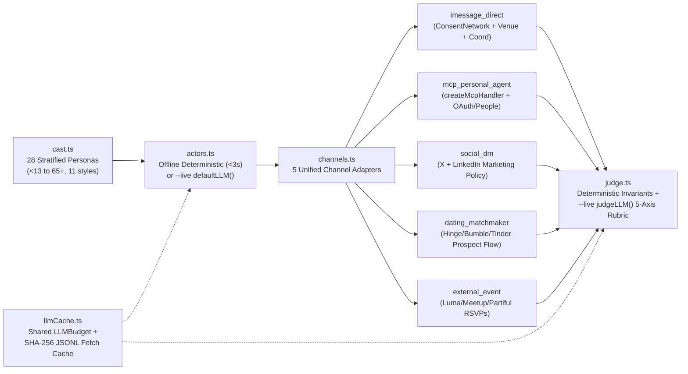
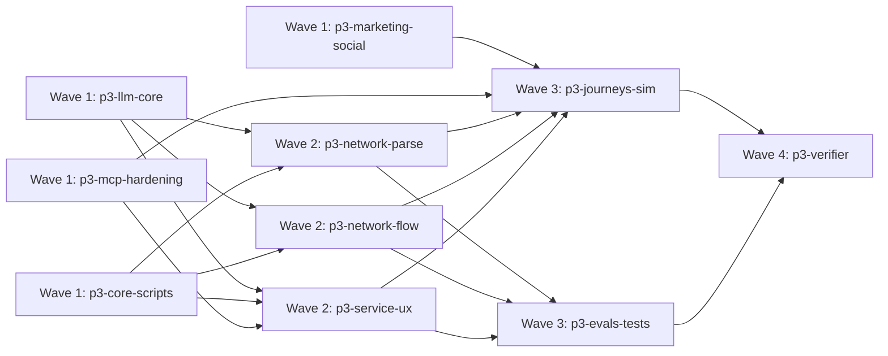

# Pass 3 Research Report & Implementation Blueprint: All-Channel User Journeys, Personal AI Agents (MCP), Match/Schedule UX, LLM Caching/Cost, and Stratified Simulation

Status: **Pass 3 Research Synthesis & Implementation Plan (2026-11-27)**  
Target repository/worktree: `/Users/nubs/thenetwork-eliza-meetup` @ `1f15ec231` (after Pass 1 `65bf0bcd9` and Pass 2 `100` migration & meetup hardening).  
Extends: [2026-11-27-pass2-audit-and-architecture.md](./2026-11-27-pass2-audit-and-architecture.md).  
Audit sources (read-only on `1f15ec231`):
- `#140` (`p3-sim-breadth-auditor`) — Simulation Breadth & Live-LLM Multi-Persona Harness
- `#141` (`p3-llm-perf-auditor`) — LLM Caching, Optimization, Performance, Latency & Cost
- `#142` (`p3-agent-mcp-auditor`) — Personal AI Agent Channel (MCP / Claude / Codex / OpenClaw)
- `#143` (`p3-match-sched-auditor`) — Matchmaking, Connecting, Scheduling, Planning & Asking-Both-Sides UX
- `#144` (`p3-journey-auditor`) — All-Channel Scripts, Onboarding Flows & Regular Conversations

---

## 1. Executive Summary

Pass 1 and Pass 2 established strong formal invariants (`spec/*.md`), Postgres schema/RLS hardening (`0098`–`0100`), a 5-city venue catalog, prompt fencing (`fenceUntrusted()`), and the `meetup` simulation block. However, auditing the end-to-end **human and agent experience across all five real-world channels** — direct iMessage/Blooio, personal AI agents via MCP (Claude, Codex CLI, OpenClaw), X/LinkedIn social agents, Hinge/Bumble/Tinder dating matchmakers, and Luma/Meetup/Partiful external events — uncovered **16 P0 defects and severe friction cliffs** that silently break real users outside a narrow NYC, 20s–30s, English-casual iMessage baseline.

### 1.1 Highest-Impact Cross-Channel Findings

| Domain | Critical Finding (`file:line`) | Real-World Impact |
|---|---|---|
| **Safety & Emergency (`#144`)** | `CURRENT_DANGER` regex is `^...$` anchored to canned sentences (`packages/network/src/reports.ts:91`). | Panicked texts (`"help he won't let me leave"`, `"please call 911"`, `"I'm hiding in the bathroom"`) return `false` and bypass `handleImmediateDanger`. |
| **MCP Red-Line Erasure (`#142`)** | `extractProfile()` extracts zero red-line tags (`packages/network/src/classify.ts:755-839`) and `service.ts:2473` overwrites MCP `submit_profile` text with `"Private profile from the member's agent."`. | Sober, halal, kosher, nut-allergic, and wheelchair users who onboard via Claude/Codex get booked into unsafe venues (`hasRedLines: false`). |
| **MCP Leak & Injection Gate (`#142`)** | `passesOutputGate()` passes empty `LeakGuard({})` (`packages/mcp/src/leaks.ts:11,21-33`); `INTERNAL_ID` omits Pass 1/2/OAuth/Notify prefixes (`vv_`, `ma_`, `rsvp_`, `ep_`, `plan_`, `ntf_`, `ntwa_`). | Sensitive dietary/health terms, URLs, `@handles`, street addresses, internal IDs, and external event prompt injections pass `get_updates` into users' personal AI agents. |
| **MCP Loopback Blindness & Schema Bloat (`#142`)** | Loopback CLI/IDE clients (Codex CLI, Claude Code, Cursor, OpenClaw) classify as `"web"` (`packages/mcp/src/handler.ts:227-240,400-401`); mounting 4 servers injects **69,962 chars (~17.5k tok)/turn** (`packages/mcp/src/tools.ts:71-266`), and `INSTRUCTIONS` overflows OpenAI's 512-char cutoff. | Dual-channel double-pinging (unsolicited SMS mid-MCP chat), 49% wasted context on duplicated `outputSchema`, and 7 of 12 tool rules truncated on OpenAI. |
| **Dead-Wired Meetup & Venue Pivot (`#143`)** | `TopOneSuggestionFlow` (`packages/network/src/network.ts:10887-10962`), all 11 new `copy.ts:230-251` helpers, and `shouldPivotToBackupV2` (`meetup-coord.ts:196-240`) have **zero live inbound callers**. | Saying `"not feeling a bar"` after booking triggers `handleDrop()` and **cancels the entire meetup**; `"too far"` is ignored; `venue_full` never pivots; backup venues ignore red lines (`network.ts:9527-9545`). |
| **Multi-City & Non-NYC Breakage (`#143`, `#144`)** | 7 NYC hardcodes across `network.ts:1896,4433,6972`, `copy.ts:105-115`, `classify.ts:656,679,696`, `service.ts:3059`, `solo-concierge.ts:63,83`, `venue-booking-link.ts:33`, `apps.ts:75`. | SF/LA weekly availability shifts by 3 hours; Pacific times print `"New York time"`; `friends.help` repeats break 100% outside NYC; text-join omits LA/Chicago/Miami. |
| **Scheduling & Asking-Both-Sides Cliffs (`#143`)** | Always-sequential 1:1 probing + zero counter-proposal relay + booked 3->2 group kill (`network.ts:4783,4920,5049,5621`); `"tue after 6"`, `"tomorrow afternoon"`, `"next thurs 7ish"` all parse as `[]`/`unclear`. | 1:1 probes routinely stall 2–5 days and silently die via `closeNoCommonTime`; B saying `"neither, how about Friday?"` kills the match instead of asking A once; 3->2 drops cancel instead of offering a 1:1 pivot. |
| **Language, Age & Tone Exclusion (`#144`)** | `classify.ts:942-972` has zero Spanish vocabulary; `parseAdult18PlusAnswer` (`externalEvents.ts:329-373`) rejects polite/formal/senior/ESL adults; `slop/extract.ts:110,427` stops at age 60/sixties; `externalMatchmaker.ts:1078-1286` is lowercase Gen-Z only. | Bilingual/ESL users, 60+ seniors, formal executives, and voice-to-text ramblers face silent parse failures, robotic CLI hashes (`pfr_...`, `RESCHEDULE YYYY-MM-DD`), and mismatched tone. |
| **LLM Caching, Lock Stalls & Cost Leaks (`#141`)** | `llm.ts:75,175-183` drops `cached_tokens`/`cache_write_tokens` and lacks `reasoningEffort`/`prompt_cache_key`; `agent-lifecycle.ts:841-847,1130-1160` poisons cross-contact cache & undercounts retries; `relay-endpoint.ts:190-201` calls Workers AI **inside the Postgres advisory lock**. | 10x cached-input discount invisible; 5x/50x hidden reasoning token regrow stalls; cross-contact marketing cache leak; 2.5s network-wide lock freezes on Workers AI jitter. |
| **Simulation Blind Spots (`#140`)** | `scripts/sim.ts` never simulates MCP personal agents, multi-turn social DMs, multi-turn dating matchmakers, or multi-turn external events; `generator.ts`/`meetup/world.ts` omit `<13` and `60+` seniors and realistic speaking/cognitive tiers; `--llm` only covers `slop` extraction. | All of the P0 defects above slipped through 18 existing offline simulation blocks with green gates. |

---

## 2. All-Channel Scripts, Onboarding & Regular Conversations Audit (`#144`)

### 2.1 P0 Safety, Inclusion & Parsing Failures

1. **Immediate-Danger / Panic Detection (`packages/network/src/reports.ts:91`)**
   - `CURRENT_DANGER` uses strict start/end anchors (`^...$`) matching only canned phrases (`"I'm in danger"`, `"I need emergency help"`, `"he is following me"`). Realistic emergency messages (`"help he won't let me leave"`, `"please call 911"`, `"he's following me to my car right now"`, `"I'm hiding in the bathroom"`) return `statesImmediateDanger() === false` and miss `handleImmediateDanger`.
   - **Action:** Replace strict anchoring with unanchored intent/phrase matching (`call 911`, `won't let me leave`, `following me`, `trapped`, `threaten(ed|ing) me`, `unsafe right now`, `hiding in`) that fires even inside panicked multi-clause narrative.

2. **Spanish & Bilingual Consent / Age Split-Brain (`packages/network/src/classify.ts:451-465,942-972,1040-1042` vs `packages/core/src/replies.ts:120-145`)**
   - `core/src/replies.ts` recognizes Spanish affirmations/declines (`sí`, `claro`, `dale`, `vale`, `me apunto`, `no puedo`, `otro día`), while `classify.ts` (`AFFIRM_RX`, `REFUSAL_RX`, `HEDGE_RX`, `COND_RX`, `COUNTER_RX`) has zero Spanish terms and only calls `parseReply` as a veto (`classify.ts:1040-1042`). Spanish replies become `unclear`. Furthermore, `birthDateIn` (`classify.ts:451-465`) and `agesStated` miss Spanish months (`enero`..`diciembre`) and `"tengo 11 años"` (an under-13 refusal blind spot).
   - **Action:** Export shared normalized positive/negative/hedge/counter lexicons from `packages/core/src/replies.ts` and consume them in `classify.ts`; add Spanish months and `"tengo N años"` to `birthDateIn`/`agesStated`.

3. **External Events `parseAdult18PlusAnswer` False-Rejects Valid Adults (`packages/core/src/externalEvents.ts:329-373`)**
   - Anchors affirmations strictly to `^(?:yes|y|yeah|yep|yup)` (`:358`) or `i'm <digits>` (`:366`). Returns `false` for `"Absolutely, I'm 35"`, `"Of course, 29"`, `"Sure am! 42"`, `"Indeed, over 18"`, `"Yes ma'am, I am 67"`, `"I'm a 25yo engineer"`, `"I was born in 1988"`, `"Turning 30 next week"`, and `"Sí, tengo 28 años"`.
   - **Action:** Accept polite/formal/ESL openers (`sure`, `absolutely`, `of course`, `certainly`, `indeed`, `definitely`, `sí`, `claro`), `"I'm a <age>yo"`, and 4-digit birth years (`born in 19xx/200x` evaluated against `Clock`), keeping minor-safety veto (`<18`, `not 18`, `turning 18`, `high school`) highest priority.

4. **Multi-City NYC Hardcode Leaks in Live Copy & Concierge (`service.ts:3059`, `copy.ts:105-115`, `classify.ts:656,679,696`, `solo-concierge.ts:31,63,83,97`, `apps.ts:75`)**
   - `service.ts:3059` prompts `"Tell me your home city: New York or San Francisco / Bay Area..."` despite `LAUNCH_CITIES` having 5 cities (`:182`).
   - `copy.ts:105-115` hardcodes `"New York time"` on cancel/reschedule even though `network.ts:2081,2144` formats in `this.cityTz()`.
   - `classify.ts:679` (`plansPlaceQuestion = "Which NYC neighborhood should I use?..."`) is sent to all cities (`network.ts:4074`, `solo-concierge.ts:63`); `publicPlanLocation` (`classify.ts:696`) scans only NYC `AREA_ALIASES`; `solo-concierge.ts:83,97` only resolves neighborhoods when `city === "nyc"`, and `solo-concierge.ts:31` omits `"tonight"`.
   - `classify.ts:656` drops `"loop"`, `"arts district"`, `"south beach"`, `"hyde park"`, `"fidi"`, `"financial district"`, and `"chinatown"` from `MULTI_CITY_ALIASES`, while `extractProfile()` (`:830`) calls `areaOf(body)` with no `city`.
   - `packages/platform/src/apps.ts:75` hardcodes `"friends and plans in New York City"` in `friends.help` HELP text.

5. **Minor Solo-Mode Prompt Clarity on Dating/Work Apps (`packages/platform/src/apps.ts:64,69`; `packages/network/src/copy.ts:38-58`)**
   - Per owner decision 2026-11-22 (`AGENTS.md`), members aged 13–17 may join for solo agent use (`minJoinAge = 13`) while introductions are strictly blocked on `slop`/`peon`. However, `copy.ts:58` concatenates `MINOR_SLOP` directly with `"What are you into?"`, implying dating onboarding continues, and `welcomeMinor` (`copy.ts:38-49`) runs 286–347 chars of dense legalese.
   - **Action (policy-preserving):** Keep `minJoinAge = 13` (do not break owner policy or `memberAge` spec); replace `"What are you into?"` for minors on `slop`/`peon` with an explicit solo-mode prompt (*"If you want local all-ages ideas, tell me a hobby or neighborhood. For friend introductions, you can join friends.help or ntwrk."*) and tighten `welcomeMinor` into two plain-English sentences.

### 2.2 P1 Direct-SMS Command Friction, Onboarding & Cross-Style Parsing

| Surface (`file:line`) | Current Friction / Bug | Additive Human-Friendly Fix (Preserving Canonical Spec Grammars) |
|---|---|---|
| **Fact edits (`service/member-fact-command.ts:34-39,114,123,136`)** | Exposes 36-char `pfr_`/`pfc_` IDs and internal enums (`agent_private`, `matchable`, `shareable`); `"what do you know about me"` fails without `?`. | Make `?` optional; display numbered items `1..N` scoped to the session; accept `private` / `matching` / `shareable` aliases alongside canonical `CORRECT FACT <ref>` grammar. |
| **Reschedule / Cancel (`rescheduling.ts:42-44`, `copy.ts:105-106`)** | Machine syntax only (`RESCHEDULE YYYY-MM-DD HH:MM TO ...`, `RESCHEDULE YES <16-char-ref>`). | Add natural 12-hour date/time parsing (`"move Thursday to Friday at 7"`) and bare `YES`/`NO` when one pending offer exists, keeping canonical syntax intact. |
| **Interruption survey (`network.ts:7830`)** | Demands `WORTH YES SLOP A1B2C3`. | Accept plain `YES`/`NO` when one survey is pending (keep `WORTH YES ...` valid). |
| **Travel presence (`service/travel-presence.ts:29,35,66,74`)** | Demands ISO dates and exclusive programmer end dates (`"end date excluded"`). | Accept `"I'm visiting SF May 10-14"` (inclusive end-date converted internally to half-open) alongside canonical `YYYY-MM-DD`. |
| **Participation & Profile Read (`participation-controls.ts:33-47`, `profile-read.ts:30-33,76`)** | Rejects `"10:30pm"` half-hours and `"pause me for a week"` / `"no more work stuff"`; `"check my profile"` misses; dead-end `"too long for one text"`. | Support `:30` quiet hours, natural break/lane phrases, `"what's on my profile"`/`"check my profile"`, and compact summary fallback. |
| **Join Name/Age Parsing (`service.ts:336-396`, `slop/extract.ts:110,427`)** | `"I go by Sam"`, `"Hey um yeah my name is David"`, `"Hola me llamo Ana"` store `"Go"`/`"Um"`/`"Hola"`; `"Jean-Luc"` truncates at `-`; 2-digit birth years (`05/12/92`) fail; `NUM_WORDS`/`DECADE_WORD` stop at 60/sixties (breaking 65+ seniors!). | Add filler/Spanish intros to `NOT_NAMES`, allow hyphens in names, parse 2-digit birth years safely, extend `NUM_WORDS` to 99 and `DECADE_WORD` to `seventies`/`eighties`/`nineties`. |
| **Cross-Style Replies (`replies.ts:130-145,263`, `classify.ts:949-1094`)** | Misses formal/senior (`"I would be delighted"`, `"certainly"`, `"by all means"`, `"I accept"`); Gen-Z drift (`"say less"`, `"lfg"`, `"fs"`, `"ofc"` missing in `classify.ts`); `"no yeah"` and `"not not interested"` / `"I wouldn't say no"` misclassified as `"no"`; `"all good, thanks"` read as YES. | Unify normalized lexicon in `replies.ts`; handle double negatives (`not not`, `wouldn't say no` -> `unsure`), `"no yeah"` -> `yes`/`unsure`, `"all good, thanks"` -> `no`/`unsure`, and offer non-binary shift-worker follow-up on `COND_RX`. |
| **Slop Onboarding & Copy (`slop/onboard.ts:68,79,86,105`, `slop/copy.ts:14,17,21`, `service/packs.ts:370`)** | Double-barreled questions; `BARE_AFFIRMATION` misses `"bet"`, `"looks good"`, `"sí"`, `"indeed"`; `:86` flags `"yes, I'm 29"` as qualified; `ageBand(18)` renders `"They're in their 18-19"`. | Split multi-part questions, expand `BARE_AFFIRMATION`, avoid flagging self-age confirmation as qualification, fix `"aged 18-19"`, apply `clampSms` to read-back, soften `:105` trans-openness copy. |
| **Spontaneous Wants & Ramblers (`classify.ts:69-71`, `extract.ts:39`)** | `COFOUNDER_ASK` breaks on adjectives/tails (`"technical cofounder"`); `extract.ts:39` silently drops LLM above `1200` chars (voice-to-text ramblers). | Relax `COFOUNDER_ASK` regex; truncate/window long messages safely with a clear summary prompt rather than silently disabling LLM understanding. |

### 2.3 Social Agents (`apps/marketing`), External Matchmakers & External Events

1. **Social Media Agents (`apps/marketing/src/{constants,agent-lifecycle,video-factory,vip-engine,crowdsourcing,llm-cache,types}.ts`)**
   - `CANONICAL_MARKETING_AGENTS` (`constants.ts:190-266`) gives each persona only 30–45 words; `PERSONA_VIDEO_BIBLES` (`video-factory.ts:159-537`) are unwired; zero DM/comment objection, AI-disclosure, 18+ gate, or `go.<brand>` handoff playbooks exist; `linkedin` is absent from `OutreachChannel` (`types.ts:114-123`).
   - Cold VIP email templates (`vip-engine.ts:431-467`) omit a CAN-SPAM unsubscribe/opt-out line.
   - `crowdsourcing.ts:353-359` duplicates shift text (`"(1:00 PM - 5:00 PM (4 hours) - end of shift)"`) and prints conflicting `"LOCAL 18+ CONFIRMED"` + `"NYC 18+ CONFIRMED"`.
   - `localizeVideoScriptForCity` (`video-factory.ts:505`) blindly rewrites `"We are building New York City first"` into `"We are building San Francisco first"`.
   - `llm-cache.ts:358` `applicant_screen` age regex misses `"17yo"`, `"17 years old"`, `"turning 18 next month"`, `"high school senior"`.

2. **External Dating Matchmaker Scripts (`packages/core/src/externalMatchmaker.ts:1078-1286`)**
   - Lowercase Gen-Z-only voice reads as unprofessional or scammy to 40–65+, formal, and ESL adults -> add `tone: "standard" | "casual"` (default `"standard"` capitalized plain English).
   - Grammar bug (`:1136`): `"she's in early 30s"` / `"she's in 18-19"` -> add `possessiveFor(pronoun)` and `"aged 18-19"`.
   - Uninterpretable either/or (`:1221`): `"want me to keep you in mind..., or would you rather i not reach out again?"` -> single-polarity yes/no question.
   - Double-barreled qualification (`:1119`), bot-denial risk (`:1177` `"nope, not a bot"` -> transparent matchmaker disclosure), premature arrival leak (`:1208` `"${member} is at ${venue}"` before confirmed arrival), missing CTIA STOP + msg/data-rates notice (`:1142,1270-1277`), and no reply parser -> fix all and export `parseMatchmakerReply`.

3. **External Events & Crowd Copy (`packages/core/src/externalEvents.ts`, `packages/core/src/smsCopy.ts`)**
   - Hardcoded `"play/chat"` screening question (`externalEvents.ts:232`) -> parameterize by activity/interest category.
   - Over-aggressive Partiful scrub (`externalEvents.ts:758-761`) corrupts `"espresso shots"`, `"photo shots"`, `"soft drinks"` -> tighten with negative lookbehinds (`(?<!espresso |photo )shots`, `(?<!soft )drinks`).
   - Post-event cold SMS invite (`externalEvents.ts:924`) lacks `"Reply STOP anytime."` -> append opt-out footer.
   - Insider jargon in `formatCrowdExpectation` (`smsCopy.ts:138,143`: `"anchor"`, `"RSVPs"`, `"vetted member"`) -> plain English (`"At least N people confirmed so far, including regulars from the group"`).

---

## 3. Personal AI Agent Channel (MCP / Claude / Codex / OpenClaw) Audit (`#142`)

### 3.1 P0 Defects

1. **Red-Line Safety Constraints Silently Erased on `submit_profile`** (`packages/mcp/src/tools.ts:672` -> `packages/network/service/service.ts:2369-2381,2473,2682` -> `packages/network/src/network.ts:1690,1950,2474-2499` -> `packages/network/src/classify.ts:755-839`)
   - `extractProfile()` extracts only interests, skills, desires, area, evenings, and groups — zero venue red-line facets (`strict_sober`, `non_drinker`, `halal`, `kosher`, `gluten_free`, `severe_allergen`, `wheelchair`, `smoke_free`, `low_noise`, `daytime_only`).
   - Worse, `service.ts:2473` overwrites the stored MCP inbound message body with `"Private profile from the member's agent."`, permanently destroying any dietary, sobriety, or accessibility constraint the user's Claude/Codex agent passed.
   - `memberVenuePrefsOf()` (`network.ts:10668-10723`) then reads `snapFacets`, sees `hasRedLines: false`, and books the member into bars or unsafe venues.
   - **Fix:** Extract all Pass 1/2 red-line facets in `classify.ts` (`extractRedLineTags`), persist them into `network.facets` with `scope: "agent_private"` and `source: "ai_memory"` **before** redacting raw MCP body text in `service.ts:2473`, and return the member's own confirmed red lines in `read_profile` (never peer red lines).

2. **Empty `LeakGuard({})` & Stale `INTERNAL_ID` in `passesOutputGate`** (`packages/mcp/src/leaks.ts:11,21-33`, `packages/mcp/src/tools.ts:504,555,816`)
   - `passesOutputGate(text)` runs `LeakGuard({})` (`forbidden: []`, `facts: []`, `contacts: false`, `canaryShapes: false`). `SENSITIVE_WORDS` (`halal`, `kosher`, `allergy`, `peanut`, `shellfish`, `sober`, `gay`, `hiv`), URLs, `@handles`, street addresses, and canary shapes all pass `get_updates`.
   - `INTERNAL_ID` (`leaks.ts:11`) matches only `mem|opp|act|rcp|grt|prp|dcr`, missing `vv_`, `ma_`, `rsvp_`, `ep_`, `plan_`, `ntf_`, `mcp_`, `grant_`, `grant_cloud_`, `ntwa_`, `ntwr_`, `ntwc_`, `ntws_`, `ven_`, `ext_`, `mm_`, `tkt_`.
   - `tools.ts:504,555` pass `g.phoneKey` (HMAC hash) instead of raw `e164`; `tools.ts:816` passes neither; and external event titles/summaries entering `get_updates` are never screened with `detectExternalPromptInjection()`.
   - Additionally, unbound inbox items (`service.ts:1196-1235`) bypass adult-only / external-crowd checks for minor readers.
   - **Fix:** Expand `INTERNAL_ID`, pass real `{ forbidden: [e164, personId, ...otherNames], facts: otherPrivateFacts, contacts: true, canaryShapes: true }` (with vetted own-domain handoff URL allowlist), run `detectExternalPromptInjection()` on external-sourced summaries before returning from `get_updates`, and enforce minor/all-ages checks on unbound inbox items in `service.ts`.

3. **Loopback CLI/IDE Agents Invisible to `packages/notify` -> Double-Pinging** (`packages/mcp/src/handler.ts:227-240,400-401`, `packages/notify/src/types.ts:9-12`, `packages/network/src/network.ts:2534,2554,2603`, `packages/network/service/service.ts:1327`)
   - `ASSISTANT_REDIRECT_HOSTS` only recognizes `chatgpt`, `claude` (web), and `grok`. Loopback clients (`http://localhost:...` — Codex CLI, Claude Code, Cursor, OpenClaw) classify as `"web"` and return `undefined` from `localUpdateSurface()`.
   - `service.ts:1327` (`notifyRecipient`) hardcodes `prefs: { channel: "imessage" }, proactiveAllowed: true`, ignoring `SurfacePrefs.explicit`.
   - `submit_profile` emits unsolicited `ackLearned`/`onboardNext` SMS messages (`network.ts:2534,2554,2603`) while the user is actively chatting with their personal AI agent.
   - `get_updates` (`tools.ts:816`) immediately calls `markSeen` across all surfaces, so an opportunistic poll drops unseen updates from iMessage `"updates"`.
   - **Fix:** Classify loopback/CLI agents via `client_name` + loopback redirect as `"local_agent"` surface metadata; suppress unsolicited `ackLearned`/`onboardNext` SMS during `source: "mcp"` intake and return `next_question` in the `submit_profile` response instead; add optional `acknowledge?: boolean` (default `true` for backwards compatibility) on `get_updates`; respect `SurfacePrefs.explicit` in `notifyRecipient()`.

4. **70 KB (~17,500 Tokens) Per-Turn MCP Schema Bloat & OpenAI 512-Char Truncation** (`plugins/claude/.mcp.json:1-20`, `packages/mcp/src/tools.ts:71-266`)
   - Mounting all 4 app MCP servers injects **40 tools = 69,962 chars** on every turn (+ 4.7 KB server instructions + 8.8–10.4 KB per `SKILL.md`).
   - Breakdown: `outputSchema` accounts for **49% (34,461 chars)** (`publicApp` duplicated 2x in `app_info`, `lookingForSchema` inlined 4x); duplicated `securitySchemes` + `_meta.securitySchemes` + `annotations` = **15.5% (10,849 chars)**; verbose boilerplate descriptions = **16.2% (11,330 chars)**.
   - `INSTRUCTIONS` (`tools.ts:71-85`, 1,133–1,304 chars) exceeds OpenAI's 512-char cutoff, silently truncating 7 of 12 operational rules.
   - **Fix:** Compact `toolDefs` by ~55–60% (trim redundant inline `outputSchema` duplication while preserving MCP protocol compatibility and existing test assertions), front-load all critical safety/handoff rules into the first 512 chars of `INSTRUCTIONS`, include `consent: { text, version }` inside `app_info` (eliminating fragile external `/api/app` web-fetch in sandboxed agents), return live `status` + `next_question` from `submit_profile` (eliminating mandatory 2nd `check_status`), and enrich `get_updates` with `{ action_required, deadline_at, crowd_type, venue_name, pivot_status }`.

### 3.2 P1 Skills/Plugin Drift & `[DECIDE]` Protocol/UI Items

- **Fix immediately in Pass 3 (zero spec risk):**
  - Update city lists from `"nyc or sf"` to all 5 `LAUNCH_CITIES` in `sites/skills/{ntwrk-party,slop-date,friends-help}/SKILL.md:59-61`, `packages/mcp/src/apps.ts:65`, `plugins/claude/.claude-plugin/plugin.json:4`, `plugins/openai/plugin.json:15`, and `packages/mcp/README.md:32`.
  - Align `sites/skills/peon-biz/SKILL.md` from v1.5.0 to v1.5.1 (single-link `Finish signup` flow + `list_looking_for`/`pause_looking_for`/`resume_looking_for`), and remove mandatory external web fetch when `app_info` provides `consent`.
- **Flag as `[DECIDE]` (governed by locked specs / UI evidence rules — do NOT mutate silently in Pass 3):**
  - **`[DECIDE-1]` `prepare_signup` disconnect-reconnect cliff & `finish_signup_url`** (`spec/agentPhoneHandoff.md`, `spec/mcpSignupDraft.md`, `spec/oauthBrowserAuthorization.md`, `tools.ts:148-154,602-626`): Replacing disconnect-reconnect with a direct step-up re-entry URL alters the OAuth grant/authorization contract and requires coordinated spec + `pnpm run accept` review.
  - **`[DECIDE-2]` `AuthSignupView.tsx:47` minor copy & `AuthCodeView.tsx:31-56` Resend/Wrong-Number UI** (`spec/authorizationPages.md`, `spec/phonePage.md`): UI changes require before/after screenshots and recordings per `AGENTS.md` / `CONTRIBUTING.md`, plus `pnpm run ui:test` / `lint:ui`.
  - **`[DECIDE-3]` `networkTextCanProduceInboxItem` spec expansion** (`spec/notificationAcknowledgement.md`, `generated/notificationAcknowledgement.ts:68-70`) and new MCP write tools (`set_availability` / `set_red_lines` / `get_context` in `spec/connectorTools.md`): Expanding generated spec enums or adding new MCP tools changes `spec/*.md` / `connectorTools.md` and should be approved before modifying locked specs.

---

## 4. Matchmaking, Connecting, Scheduling, Planning & Asking-Both-Sides Friction Audit (`#143`)

### 4.1 Critical Dead-Wired Flows & Live Coordination Bugs

1. **`TopOneSuggestionFlow` & 11 UX Copy Helpers 100% Unreachable in `ConsentNetwork`**
   - `proposeTopOneVenueFor` (`network.ts:10887`), `rerankTopOneVenueWithLLM` (`:10932`), `pivotVenueSuggestion` (`:10962`), `classifyVenueRejection` (`:588`), and all 11 helpers in `copy.ts:230-251` (`topOneVenueSuggestion`, `crowdExpectation`, `backupVenuePivot`, `anchorOrQuorumCancel`, `silentPartnerVenueSwap`, `preArrivalBrief`, `partialGroupTwoPersonPivot`, `mediumDensityChoice`, `weatherPivot`, `externalFlakeRecovery`, `crossDomainBridge`) have **zero production callers**.
   - After booking (`aw.kind === "booked"`, `network.ts:1851-1885`), replying `"not feeling a bar"` hits `not feeling it` (`replies.ts:132`) -> `declines = true` -> **`handleDrop()` cancels the entire meetup**; replying `"too far"` or `"somewhere quieter"` returns `unclear` and falls through to `return "open"` (`network.ts:1974`), silently ignored.
   - **Fix:** Persist `TopOneSuggestionState` on `Opp`/`NetworkState`; intercept venue objections on `booked` (and probe-stage venue constraints) before `declines` cancels; invoke `classifyVenueRejection` -> `pivotVenueSuggestion` (max 3 pivots, zero repeats) -> `formatSilentPartnerVenueSwap` to the other member.

2. **Backup Venue Selection Ignores Red Lines (`network.ts:5360-5368,7400-7408,9527-9545`)**
   - Both `reveal()` (fallback branch) and `bookPlan()` call `memberVenueRankPrefs()` (`:9527-9545`), which hardcodes `vegetarian: false, vegan: false, wheelchairNeeded: false` and drops `strictSober`, `halal`, `kosher`, `glutenFree`, `severeAllergen`, `lowNoiseRequired`, `daytimeOnly`, `visitedVenueIds`, and `rejectedVenueIds`.
   - **Fix:** Replace `memberVenueRankPrefs()` with `memberVenuePrefsOf()` (`network.ts:10668-10723`) in both `reveal()` and `bookPlan()`.

3. **All 7 Multi-City Timezone & NYC-Hardcoding Bugs (`sf`, `la`, `chicago`, `miami`)**
   - `statedWindows(tags, now)` omits `tz` (`network.ts:1896`) -> shifts SF/LA evening availability by **3 hours** (`14:00-19:00` instead of `17:00-22:00`). Pass `this.cityTz()`.
   - Cancel/reschedule copy (`copy.ts:105-115`) appends hardcoded `"New York time"` onto Pacific/Central timestamps (`network.ts:2081,2144`). Parameterize with `cityTzLabel(city)`.
   - `reviewProbePreview` (`network.ts:4433,4436`) hardcodes `NY` and `PLAN_VENUE_AGES`. Use `this.cityTz()` and `planVenueAgesForCity(city)`.
   - `friendsRepeatPlanCurrent` (`network.ts:6972,6979`) calls NYC-only `friendsKit.hood` / `friendsKit.transitMinutes` (`packs/friends/geo.ts:98-105`), returning `undefined` on every non-NYC `friends.help` repeat. Use `hoodForCity` / `transitMinutesInCity`.
   - `venueBookingLink` (`venue-booking-link.ts:33`) searches only NYC `VENUES`. Also check `seedVenuesForCity(city)`.
   - `plansPlaceQuestion` (`classify.ts:679`) asks `"Which NYC neighborhood should I use?"` for all cities. Parameterize by `city`.
   - NYC disables `arrivalBriefs` by default (`network.ts:1314`), while non-NYC sends **both** T-3h `day-of-checkin` (`network.ts:8068`) AND T-75m `pre_brief` (`meetup-coord.ts:654`). Unify into one cohesive T-90m..T-60m brief (`formatPreArrivalBrief`) across all 5 cities including NYC.

4. **Natural-Language Scheduling & 1-Round Counter-Proposal Deadlocks**
   - Direct audit of `availabilityTags()` (`classify.ts:1987-2055`) and `parseProbeReply()` (`classify.ts:1600-1974`) confirmed failures on `"tue after 6"`, `"tomorrow afternoon"`, `"anytime this weekend except sun morning"` (drops all of Sunday!), `"next thurs 7ish"` (books *this* Thursday), and bare `"evenings work"`.
   - In 1:1 probing (`network.ts:4920-4947,5038-5051`), if A picks Thursday and B replies `"neither, how about Friday 7pm?"`, `onProbeAnswer` sees `commonTimeGone` and immediately kills the match (`closeNoCommonTime`) without ever asking A about Friday.
   - `rescheduleSlotViable` (`network.ts:2037-2040`) searches only `planVenuesForCity(city)`, causing most `slop` dates to fail reschedule viability (`!venue`).
   - **Fix:** Upgrade `availabilityTags`/`parseProbeReply` for relative days (`today`/`tomorrow`/`tonight` via `now` + `tz`), `after <h>`/`around <h>ish`, daypart-scoped exclusions (`except sun morning`), and bare `"evenings work"`; implement **1-round asymmetric counter-proposal relay** (capture B's feasible counter-slot and ask A once before closing); back `rescheduleSlotViable` with `venuePoolForCity(city)`.

5. **Day-of Coordination, 3->2 Group Pivot, 2nd Encounter & Out-of-Network Continuity**
   - **`MeetupCoordinator` (`meetup-coord.ts:196-240,474-513,639,709-715`)**: Still uses closed-only `shouldPivotToBackup` instead of `shouldPivotToBackupV2` (`venue_full` unwired; `checkBackupPivot()` at `network.ts:10616` has zero callers); silently swallows `venue_closed` when no backup exists (`:501`); `handleDrop()` (`network.ts:5608`) calls `meetups.removeMember(m.id)` without `meetupId`, ejecting the member from **all** active meetups; 45-min `PreBrief` window (`[-75m, -30m]`) can be skipped by 60-min ticks; late texts at T-35m fail `phase !== "ActiveArrival"` and split-brain against `group-late-arrival.ts:24`; bare `"here"`, `"5 mins"`, `"with Sarah now"`, and uncolored outfit cues miss `parseArrivalText`.
   - **Booked 3->2 group drop (`network.ts:5621-5635`)**: `bookedGroupCanContinue(2, false)` is `false` (`opportunityLifecycle.ts:261`), so both remaining members get `"this one is off now"` instead of an explicit opt-in 1:1 pivot via `formatPartialGroupTwoPersonPivot` (`copy.ts:290-302`).
   - **1:1 Second-Encounter dead-end (`copy.ts:151,169`, `network.ts:5953-5956,8943-8956`)**: `feedbackAsk` never asks *"Would you want to see them again?"*, and `localEncounters()` sends a cold anonymous probe instead of calling `copy.secondEncounter` (dead code).
   - **Out-of-network continuity**: `externalEvents.ts` lacks live T-24h quorum/anchor-failover cron and `externalFlakeRecovery` wiring in `service.ts`; `externalMatchmaker.ts` needs runtime orchestration hooks (flagged behind existing feature flags).
   - **`[DECIDE-4]` Spec-governed scheduling optimizations**: Allowing bare `"yes"` on 1-slot `friends` partner plans (`spec/friendsPlanTimeChoice.md:54-58`), enabling parallel 1:1 probing (`pack.consent.default.order`) / `openTable: true` (`network.ts:6902`), and adding `.ics` calendar links to booked reveals alter existing sim/spec assumptions and are flagged for founder sign-off rather than silently changing `network`/`friends` sim baselines.

---

## 5. LLM Caching, Optimization, Latency & Cost Audit (`#141`)

### 5.1 P0 Telemetry, Cost, Cache-Poisoning & Lock-Contention Bugs

1. **`cached_tokens` & `cache_write_tokens` Dropped + Missing `reasoningEffort` & `prompt_cache_key` (`packages/core/src/llm.ts:22-30,75,175-183,327-331,416-421`)**
   - `usageOf()` parses `prompt_tokens_details.cached_tokens` and `cache_write_tokens` for pricing (`gpt-6-luna`: `$0.01/M` cached vs `$0.10/M` uncached = **10x savings**), then discards both from `ResponseInfo.usage`.
   - Neither `ChatOptions` nor `OpenAILLM.chat` passes `prompt_cache_key` (critical for deterministic prefix-shard routing on static >1,024-token system prompts: `JUDGE_SYSTEM_V3` ~1,710 tok, `DEEP_SYSTEM` ~1,517 tok, `UNDERSTAND_SYSTEM_PROMPT` ~1,278 tok).
   - Output/reasoning tokens cost **5x uncached / 50x cached input** (`$0.50/M`), yet no caller sets `reasoning_effort`. Tight token caps (`venues.ts:983` `450`, `extract.ts:117` `800`, `reviewJudge.ts:370` `1800`) trigger `MAX_REGROWS = 2` (`450->900->1800` = 3 sequential round-trips, 3x input spend).
   - **Fix:** Expose `cachedPromptTokens` and `cacheWriteTokens` on `ResponseInfo.usage` (plus fallback metadata); add `reasoningEffort?: "minimal" | "low" | "medium" | "high"` and `promptCacheKey?: string` to `ChatOptions` and `OpenAILLM.chat`; default `reasoningEffort: "low"` on extraction, venue rerank, photo screen, and review judge (~50–75% output token & latency reduction).

2. **Cross-Contact Marketing Cache Poisoning, Retry Undercounting & Unbounded Tick Latency (`apps/marketing/src/agent-lifecycle.ts:354,494-495,770,841-847,1130-1160,1279-1298,1500-1541`)**
   - Lookup keys on `fencedPrompt` (includes `targetContact` + `untrustedContext`), while write computes `finalCacheKey` on raw `prompt` (stripping contact/context!) and writes **both** keys (`:1138-1159`) — halving the 512-entry LRU and poisoning subsequent calls with another contact's response!
   - `buildFencedAgentPrompt` (`:354`) iterates unsorted `Object.entries(ctx)` (key-order misses); `localDailyUsage`/`lastIdleFingerprint` (`:494-495`) are unbounded Maps.
   - `if (this.enableDeterministicRouter && opts.deterministicTaskHint)` (`:770`) blocks `tryDeterministicRoute`'s `"auto"` prefix detector (`llm-cache.ts:300-433`) from firing on `/api/agents/:id/tick` (`server.ts:917`) and `runAutopilotTick` (`:1292`).
   - `llmFor` (`:1502-1517`) sets `timeoutMs: 30_000` with **no `deadlineMs`** (90s worst case + 4 retries on synchronous HTTP ticks), `runAutopilotTick` executes up to 6 turns sequentially, and `lastResponse = info` (`:1500-1541`) overwrites earlier retry/regrow attempts, undercounting tokens & cost in `LlmTrajectory` and `reportBridgeCost`.
   - **Fix:** Key lookup and write identically on canonical sorted `fencedPrompt` (never raw `prompt`), bound Maps with LRU, allow auto-routing when `enableDeterministicRouter` is true, set `deadlineMs: 25_000`, accumulate usage across retries/regrows, and parallelize independent autopilot turns with a concurrency cap.

3. **Workers AI HTTP Inside Postgres Advisory Lock (`packages/network/service/relay-endpoint.ts:55,190-201`)**
   - `net.relayRequest` -> `relayItemAsync` -> `clefRun` (2,500ms timeout, `relayClef.ts:276`) runs **inside `rt.unitOfWork`**, stalling every tick, inbound turn, and relay for that `(app, city)` network during any Workers AI latency spike. Moreover, `clefRelayClassifierFromEnv` (`:55`) is wired without an `answers`/`record` LRU cache despite `relayClef.ts:242-244` supporting it.
   - **Fix:** Evaluate `clefRun` outside `rt.unitOfWork` (matching engine & reviewJudge pattern) and attach a bounded LRU cache for normalized routine relay text (`"On my way!"`, `"Running 5 mins late"`).

### 5.2 P1 Caching, Hot-Path Fast-Paths & Observability Upgrades

- **Bounded `JudgeCache` + Stable Keys (`packages/engine/src/judgeCommon.ts:29,42-82`, `packs/network/judgeContext.ts:30-35,317,323-326,380,397`):** Add LRU `maxEntries` cap (preventing unbounded 7-day Map growth across `3 * (app, city)` instances), sort JSON keys canonically, coarsen `overlap_hours_in_window` (band instead of hourly flip) and `bucketDays`, sort `declines`/`shared_areas`, and pass explicit `deadlineMs` in `runPass` (eliminating 360s worst-case candidate stalls).
- **App-Level LRU Caches (`venues.ts:911-1000`, `extract.ts:112-122`, `photo-screen.ts:53-72`):** Add bounded LRU caches keyed on canonical sorted inputs (`venues.ts` bucketed score + sorted hobbies/interests; `extract.ts` normalized `(awaiting, options, body)`; `photo-screen.ts` SHA-256 photo hash).
- **Expand `canShortCircuitUnderstand` (`network.ts:584,1358,1473-1501`):** Short-circuit standalone acks (`"ok"`, `"thanks"`, `"👍"`) when `aw` is unset, expand `BARE_YES_NO_RE` (`"bet"`, `"for sure"`, `"works for me"`, `"im in"`, `"both work"`, `"either"`, `"none of those"`), and check definite `consentOf`/`classify` (`block`/`report`/`cancel`/`feedback_like`/`plans_request`/`invite_friend`) before invoking `llmUnderstand` (~40–60% fewer LLM calls).
- **Compact Repair Turn in `chatJson` (`packages/core/src/chatJson.ts:82`):** Append a short schema-error repair turn on retry instead of resending identical messages (prevents deterministic seed loops while keeping 100% prefix cache hit on `[system, user]`).
- **Parallel Clef Photo Rating + Midnight Budget Ordering + Global Concurrency Cap:** Parallelize up to 4 photo feature calls in `packages/engine/src/packs/slop/clef.ts:146-161` with `AbortSignal.timeout` (4x latency win); refresh `engineBudgets` **before** `rt.tick()` in `service.ts:942-952` (fixing stale midnight budgets); cap concurrent judge bursts across runtimes in `service.ts:952`.
- **Full Cost/Cache/Latency Telemetry (`packages/network/service/cost.ts:223-235`, `apps/observatory/src/ops.ts:50-80`):** Wire `onFallback`, log failed attempts, persist `cachedPromptTokens`, `cacheWriteTokens`, `reasoningTokens`, `latencyMs`, `regrows`, and `finishReason` into `network.cost_ledger.detail`, and surface cache hit rate, fallback rate, and p50/p95 latency in Observatory ops.

---

## 6. Expanded All-Walks-of-Life Multi-Channel Simulation Architecture (`#140`)

To guarantee that Pass 3 fixes hold across every human cohort, channel, and personal AI agent — and to eliminate the blind spots where all 16 P0 defects escaped existing sims — we add a lean, unified **`journeys`** simulation suite under `packages/sim/src/journeys/`, wired into `scripts/sim.ts` (`--only journeys`, offline deterministic `<3s`, 0 API keys) plus a cost-bounded live-LLM runner (`scripts/journey-eval.ts --live`).

### 6.1 Module Layout (5 Focused Files + 2 Thin Entrypoints)

1. **`packages/sim/src/journeys/cast.ts` — 28 Stratified All-Walks-of-Life Personas (Seeded, Deterministic)**
   - Guarantees 100% coverage across four orthogonal axes:
     - **Age buckets:** `<13` (11, 12), `13–17` (14, 16, 17 turning 18), `18–24` (18yo teen-peer, 19yo adult cutoff, college student), `25–39`, `40–59`, `60+` (64, 71 retiree).
     - **Walks of life / schedules / accessibility:** night-shift nurse (off-hours schedule), electrician/trades, restaurant server, grad student, startup founder, academic, artist, busy single parent, elder caregiver, retired teacher, recent immigrant/ESL (Spanish & Spanglish phrasing), UHNW executive, low-budget/free-only, strict-sober + halal + kosher + severe peanut/shellfish allergy + wheelchair + daytime-only + neurodivergent low-noise.
     - **Speaking styles & cognitive/tech tiers (11):** `one_word_terse`, `voice_to_text_rambler`, `genz_slang`, `hyper_formal_exec`, `esl_codeswitch`, `low_tech_confused` (pastes phone/OTP into chat), `skeptical_privacy`, `emotional_oversharer` (trauma-dumps canary), `literal_neurodivergent`, `power_user_dev` (Codex CLI / Claude Code / OpenClaw MCP), `adaptive_adversary` (prompt injector, age liar, contact extractor, spammer).
     - Every persona carries a deterministic private canary and explicit hidden red-line ground truth.

2. **`packages/sim/src/journeys/channels.ts` — 5 Unified Channel Adapters + Cross-Channel Handoffs**
   - Emits a single `JourneyTrace` schema (`channel`, `direction`, `actor`, `text`, `toolCalls?`, `meta`, `ts`, `tokens?`, `cached?`, `costMicro?`):
     1. **`imessage_direct`**: Real `ConsentNetwork` + `VenueManager` + `MeetupCoordinator` + `appWiring(app, city)` across `sf`/`nyc`/`la`/`chicago`/`miami` (onboarding, red-lines, Spanish/slang/formal/rambler replies, counter-proposals, Top-1 + 3-pivot, day-of arrival/`venue_full`/panic, STOP).
     2. **`mcp_personal_agent`**: Real `createMcpHandler` + `MemoryPeopleStore` + `MemoryOAuthStore` (same in-memory harness as `packages/mcp/test/harness.ts`) driven by a personal-agent loop (Claude Web, Codex CLI loopback, confused user pasting OTP, minor blocked on dating/work, dual-channel SMS+MCP race, external prompt injection via `get_updates`).
     3. **`social_dm`** (`x`, `linkedin`): Real `apps/marketing` policy, `createMarketingLeakGuard`, `evaluateContactHygiene`, `VipDiscoveryEngine`, and persona DM/reply playbooks (skepticism, `"are you AI?"`, underage responder, STOP in DM, warm `go.<brand>` handoff).
     4. **`dating_matchmaker`** (`hinge`, `bumble`, `tinder`): Real `CityMatchmakerRegistry`, `ExternalProspectCache`, `evaluateContactExternalProspect`, `validateMatchmakerOutboundScript`, `parseMatchmakerReply`, and `evaluateInviteExternalProspect` across multi-turn prospect dialogue -> 18+ check -> SMS opt-in -> quality-gated invite (plus `peon` firewall + kill-switch + underage tombstone).
     5. **`external_event`** (`luma`, `meetup`, `partiful`): Real `checkPublishExternalEvent`, `normalizeLumaWebhookEvent`, `normalizeMeetupRsvpPoll`, `buildPartifulEventKit`, `checkApproveExternalEventRsvp`, `checkExternalEventT24Quorum`, and `checkInviteExternalEventAttendee` with messy/formal/ESL/minor/injected RSVPs -> T-24 quorum -> vetted invite.

3. **`packages/sim/src/journeys/actors.ts` & `llmCache.ts` & `judge.ts`**
   - **Offline default (`<3s`, 0 API keys):** Stateful deterministic actor per `(archetype, speakingStyle, channel)` with realistic style utterances (run-on voice-to-text, Spanglish, Gen-Z slang, formal senior prose, OTP-paste confusion, emergency panic texts, adaptive injections).
   - **Live mode (`--live`):** Uses `defaultLLM(opts)` for realistic human personas and tool-calling MCP personal agents, plus `judgeLLM(opts)` (explanation-before-verdict per `AGENTS.md`) grading full multi-turn transcripts on 5 axes (`naturalness_warmth`, `comprehension_adaptation`, `friction_efficiency`, `safety_boundary_handling`, `honesty_non_pushiness`).
   - **Cost & replay safety (`llmCache.ts`):** Shared `LLMBudget` (`--budget-usd` default `$1.00`, `--max-requests` default `80`) + `ClientOptions.fetch` SHA-256 disk JSONL cache (`runs/journeys-llm-cache.jsonl`, gitignored) + `onResponse` token/cached/cost/latency reporting + clean tracked skip when API keys are unset.

### 6.2 Blocking vs. Tracked Gates (`journeys` Block)

| Gate | Threshold | Mode |
|---|---|---|
| `under_13_retained_or_replied_twice` | `=== 0` | Blocking (offline & live) |
| `teen_invariant_and_minor_external_breaches` (all 9 teen gates + external/MCP minor) | `=== 0` | Blocking |
| `panic_emergency_missed` | `=== 0` | Blocking |
| `canary_and_mcp_pii_leaks` (incl. `INTERNAL_ID` & emotional oversharer) | `=== 0` | Blocking |
| `redline_and_mcp_redline_breaches` (incl. MCP `submit_profile` + backup venues) | `=== 0` | Blocking |
| `peon_firewall_and_prompt_injection_escapes` | `=== 0` | Blocking |
| `external_url_spam_and_unvetted_invites` | `=== 0` | Blocking |
| `stop_quiet_hours_and_dual_channel_double_pings` | `=== 0` | Blocking |
| `llm_budget_breaches` | `=== 0` | Blocking |
| `comprehension_by_style` (overall `>=90%`, worst-tier floor `>=80%`, `0` wrong gender/red-line parses) | Wrong parse = Blocking; Tier floor = Blocking (offline) / Tracked (live) |
| `turns_to_onboard` (`median <= 5`, `p90 <= 8`) & `turns_to_schedule` (`median <= 3`, `<= 3` pivots, `0` repeat venues) | Blocking (offline) / Tracked (live) |
| `mcp_tool_calls_per_task` (signup prep `<= 3`, status/updates `<= 2`, `0` schema/scope loops) | Blocking (offline) / Tracked (live) |
| `replay_cache_hit_rate` (`>= 95%` on cached replay) & `live_rubric_scores` (`>= 4.0/5` warmth/comprehension/honesty, `>= 4.5/5` safety) | Replay cache = Blocking; Live rubric & drop-off cohort rates = Tracked |

---

## 7. Evaluation of Best Courses of Action & Zero-Collision Swarm Execution Plan

### 7.1 Design Decisions, Alternatives Considered & `AGENTS.md` Constraints

Per `AGENTS.md`, every Pass 3 change obeys five hard guardrails:
1. **Zero edits to `spec/lock.json`, pushed migrations (`0098`–`0100`), or manual edits inside `packages/core/src/generated/`.** Keep `AGENTS.md` and `CLAUDE.md` byte-identical.
2. **Preserve locked specs & existing tests:** Do not break `spec/agentPhoneHandoff.md`, `spec/mcpSignupDraft.md`, `spec/oauth*.md`, `spec/friendsPlanTimeChoice.md`, `spec/opportunityLifecycle.md`, or existing SMS command grammars. Add natural-language & short-number aliases **alongside** canonical commands.
3. **Preserve `network.ts` purity:** Zero SQL, zero live HTTP, zero `Date.now()` / `Math.random()` inside `packages/network/src/`. All randomness uses seeded RNG and all time uses `Clock`.
4. **Laziness Protocol — defer high-blast-radius `[DECIDE]` items cleanly:**
   - **Alternative A (Rejected):** Rewrite OAuth `prepare_signup`, `AuthSignupView`/`AuthCodeView`, `spec/connectorTools.md`, and `spec/opportunityLifecycle.md` in Pass 3. *Why rejected:* Mutates 5+ locked specs and React UI surfaces requiring founder `pnpm run accept` + UI recordings, risking regressions in `pnpm run security` (`oauth.test.ts`, `pg.test.ts`) and `pnpm run check`.
   - **Alternative B (Rejected):** Rely on LLM-only parsing (`llmUnderstand`) for Spanish, senior ages, natural-language scheduling, and venue objections. *Why rejected:* Violates offline determinism (`pnpm run sim` strips all API keys), increases latency/token spend, and creates failure modes when provider budgets exhaust.
   - **Chosen Course (Deterministic-First Core + Additive Natural Language + Bounded LLM Optimization + Unified `journeys` Sim):** Fix every P0 safety/privacy/cache/lock/wiring defect deterministically across core, MCP, network, service, and marketing; keep locked OAuth/UI/policy changes explicitly marked as `[DECIDE-1]`–`[DECIDE-4]`; and lock every fix down with the new `<3s` `journeys` simulation block + `--live` real-LLM evaluation.

### 7.2 Wave Dependency Graph

### 7.3 Strict Zero-Collision Wave Roster & Disjoint File Ownership

Every worker name is `<= 20` characters (limit 24). **Within every wave, owned file sets are 100% disjoint.**

#### Wave 1 — Foundation: LLM/Cache Core, Core Scripts/Lexicons, Marketing/Social, & MCP Hardening (4 parallel workers)

| Worker | Owned Files (100% Disjoint) | Concrete Deliverables |
|---|---|---|
| **`p3-llm-core`** | `packages/core/src/{llm,chatJson,venues}.ts`, `packages/engine/src/{judgeCommon,reviewJudge}.ts`, `packages/engine/src/packs/network/judgeContext.ts`, `packages/engine/src/packs/slop/clef.ts`, `packages/platform/src/photo-screen.ts`, `packages/network/service/cost.ts`, `apps/observatory/src/ops.ts` | Expose `cachedPromptTokens`/`cacheWriteTokens` + fallback metadata in `llm.ts`; add `reasoningEffort` & `promptCacheKey` to `ChatOptions`/`OpenAILLM.chat` (default `"low"` on rerank/photo-screen/reviewJudge); add compact schema-repair turn to `chatJson.ts`; add canonicalized LRU response caches on `venues.ts:rerankTopVenuesWithLLM` & `photo-screen.ts` (SHA-256); bound `JudgeCache` with LRU + sorted keys + `deadlineMs` (`judgeCommon.ts`) and coarsen hourly/daily churn + sort sets (`judgeContext.ts`); parallelize 4-photo rating with `AbortSignal.timeout` (`clef.ts`); wire `onFallback`, failed attempts & full token/cache/latency fields into `cost.ts` and `apps/observatory/src/ops.ts`. |
| **`p3-core-scripts`** | `packages/core/src/{replies,externalMatchmaker,externalEvents,smsCopy}.ts`, `packages/engine/src/packs/slop/{extract,onboard,copy}.ts`, `packages/platform/src/apps.ts` | Export unified Spanish + formal/senior + Gen-Z + double-negative + `"no yeah"` reply lexicon from `replies.ts`; upgrade `externalMatchmaker.ts` (`tone: "standard" \| "casual"`, fix `:1136` grammar, split `:1119`, single-polarity `:1221`, transparent disclosure `:1177`, fix `:1208` presence leak, CTIA STOP `:1142,1270`, export `parseMatchmakerReply`); fix `externalEvents.ts` (`parseAdult18PlusAnswer` formal/senior/ESL/birth-year w/ minor veto, parameterize `:232` `"play/chat"`, negative lookbehinds on Partiful `:758-761`, STOP footer `:924`); plain-English `formatCrowdExpectation` + `cityTzLabel(city)` in `smsCopy.ts`; extend `slop/extract.ts` `NUM_WORDS` (to 99) & `DECADE_WORD` (to 90s); update `slop/onboard.ts` & `slop/copy.ts`; fix NYC hardcode in `packages/platform/src/apps.ts:75` (keeping `minJoinAge` policy intact). |
| **`p3-marketing-social`** | `apps/marketing/src/{types,agent-lifecycle,constants,video-factory,vip-engine,crowdsourcing,llm-cache}.ts`, `apps/marketing/test/*` | Add `"linkedin"` to `OutreachChannel`; fix P0 cross-contact cache poisoning (`agent-lifecycle.ts:841-847,1130-1160`), sort `buildFencedAgentPrompt` keys, bound Maps, fix auto-routing (`:770`), set `deadlineMs: 25_000`, accumulate retry/regrow usage (`:1500-1541`), parallelize autopilot turns; wire `PERSONA_VIDEO_BIBLES` + X/LinkedIn/IG/Reddit DM/comment objection, AI-disclosure, 18+ gate & `go.<brand>` handoff playbooks into `constants.ts`; fix `video-factory.ts:505` city replacement & disclosure lint; add CAN-SPAM opt-out to `vip-engine.ts:431-467`; fix `crowdsourcing.ts:353-359` template vars; reuse `core/src/policy.ts` age detection in `llm-cache.ts:358`; add focused regression tests. |
| **`p3-mcp-hardening`** | `packages/mcp/src/{leaks,tools,hooks,handler,apps}.ts`, `packages/notify/src/{types,surface}.ts`, `sites/skills/{ntwrk-party,slop-date,friends-help,peon-biz}/SKILL.md`, `plugins/claude/.claude-plugin/plugin.json`, `plugins/openai/plugin.json`, `packages/mcp/README.md`, `packages/mcp/test/mcp-pass3-hardening.test.ts` (NEW) | Harden `leaks.ts` (expand `INTERNAL_ID` with Pass 1/2/OAuth/Notify prefixes, wire real `LeakGuard` `{ forbidden, facts, contacts: true, canaryShapes: true }` + `detectExternalPromptInjection()`); compact `toolDefs` ~55–60% & fit core rules inside OpenAI's 512-char `INSTRUCTIONS` cutoff while keeping all existing MCP tests green; include `consent: { text, version }` in `app_info`, return live `status` + `next_question` in `submit_profile`, expose member's own confirmed red lines in `read_profile`, enrich `get_updates` (`action_required`, `deadline_at`, `crowd_type`, `venue_name`, `pivot_status`, optional `acknowledge?: boolean`); recognize loopback CLI/IDE clients (Codex/Claude Code/Cursor/OpenClaw) as `"local_agent"` surface in `handler.ts` & `notify/src/{types,surface}.ts`; update all 5 `LAUNCH_CITIES` across `apps.ts`, `SKILL.md`s, plugins & README; align `peon-biz/SKILL.md` to v1.5.1. |

> **Wave 1 Exit Gate:** `pnpm run typecheck && node --import tsx --env-file-if-exists=.env plugins/build.ts --check && pnpm run marketing:test && node --env-file-if-exists=.env node_modules/vitest/vitest.mjs run --project integration packages/mcp/test/oauth.test.ts packages/mcp/test/pg.test.ts packages/mcp/test/mcp-pass3-hardening.test.ts`

#### Wave 2 — Network Parsing, Live Coordination Flow, & Service/Command UX (3 parallel workers)

> **Pinned Cross-Worker Contract (Wave 2):**
> - `p3-network-parse` exports `extractRedLineTags(body: string): string[]` (and includes red-line tags in `extractProfile()`), `plansPlaceQuestion(city?: CityId)`, `publicPlanLocation(body: string, city?: CityId)` (optional `city` defaults to `"nyc"`), `MeetupCoordinator.removeMember(memberId: MemberId, meetupId?: string)`, and backward-compatible `copy.*` helpers accepting optional `city?: CityId`.
> - `p3-network-flow` owns `packages/network/src/network.ts` exclusively and keeps it 100% pure (zero SQL, zero live HTTP, Clock-only time).
> - `p3-service-ux` calls `extractRedLineTags` before redacting MCP body in `service.ts:2473` and passes raw `e164` / `SurfacePrefs` cleanly into MCP/notify hooks.

| Worker | Owned Files (100% Disjoint) | Concrete Deliverables |
|---|---|---|
| **`p3-network-parse`** | `packages/network/src/{reports,classify,extract,copy,meetup-coord,group-late-arrival,rescheduling,venue-booking-link}.ts` | Fix P0 unanchored panic/danger detection (`reports.ts:91`); unify Spanish/formal/senior/Gen-Z/double-negative replies + Spanish months/`"tengo N años"` + multi-city `publicPlanLocation`/`MULTI_CITY_ALIASES`/`plansPlaceQuestion(city)` + natural-language `availabilityTags`/`parseProbeReply` (`"tue after 6"`, `"tomorrow afternoon"`, `"next thurs 7ish"`, daypart-scoped `"except sun morning"`, bare `"evenings work"`) + `extractRedLineTags` + relaxed `COFOUNDER_ASK` (`classify.ts`); add LRU cache, `reasoningEffort: "low"`, `promptCacheKey`, and safe long-text handling (`extract.ts`); parameterize timezone labels (`cityTzLabel`), tighten `welcomeMinor` + solo prompt on `slop`/`peon`, add *"Would you want to see them again?"* to `feedbackAsk` & PAUSE escape hatch (`copy.ts`); upgrade `meetup-coord.ts` to `shouldPivotToBackupV2`, add `venue_full`/bare `"here"`/`"5 mins"`/`"with Sarah now"`/uncolored outfit cues, fix silent swallow on `venue_closed` without backup, widen `PreBrief` window past 60m tick, accept T-60m late texts, add scoped `removeMember(memberId, meetupId?)`; preserve ETAs in `group-late-arrival.ts`; add natural-language reschedule + bare `YES`/`NO` single-offer support alongside canonical grammar (`rescheduling.ts`); extend `venue-booking-link.ts` to `seedVenuesForCity(city)`. |
| **`p3-network-flow`** | `packages/network/src/network.ts`, `packages/engine/src/config.ts` | Wire `TopOneSuggestionFlow` (`proposeTopOneVenueFor`/`pivotVenueSuggestion`/`classifyVenueRejection`) + `formatSilentPartnerVenueSwap` into `handleInbound()` & `reveal()`, persisting `TopOneSuggestionState` on `Opp`/`NetworkState` and intercepting venue objections before `handleDrop()`; replace `memberVenueRankPrefs()` (`:9527`) with `memberVenuePrefsOf()` (`:10668`) on backup venues; fix all NYC hardcodes (`statedWindows` `tz` `:1896`, `reviewProbePreview` `:4433-4436`, `friendsRepeatPlanCurrent` `:6972,6979`, unified T-90m..T-60m `pre_brief` across all 5 cities incl. NYC `:1314`, `rescheduleSlotViable` `venuePoolForCity` `:2037`); implement 1-round asymmetric counter-proposal relay before `closeNoCommonTime`; wire explicit opt-in `formatPartialGroupTwoPersonPivot` on booked 3->2 drops (preserving `bookedGroupCanContinue(2, false)`); wire `copy.secondEncounter` in `localEncounters()`; scope `handleDrop()` (`:5608`) to `meetups.removeMember(m.id, o.id)`; suppress unsolicited `ackLearned`/`onboardNext` SMS during `source: "mcp"` intake & persist MCP red-line facets; expand `canShortCircuitUnderstand` (`:584,1358,1473-1501`); allow single-pending `YES`/`NO` for interruption survey (`:7830`); configure safe `postSelection` judge escalation option in `config.ts`. |
| **`p3-service-ux`** | `packages/network/service/{relay-endpoint,service,solo-concierge,packs,member-fact-command,travel-presence,participation-controls,profile-read}.ts` | Move Workers AI `clefRun` outside `rt.unitOfWork` advisory lock (`relay-endpoint.ts:190-201`) + attach bounded LRU cache (`:55`); persist MCP red-line facets before body redaction (`service.ts:2369-2473`), list all 5 cities on join (`:3059`), fix `parseJoinText` filler words / hyphens / 2-digit birth years (`:336-396`), refresh `engineBudgets` before `rt.tick()` + cap concurrent judge calls across runtimes (`:942-952`), enforce minor/all-ages/external-crowd checks on unbound inbox items (`:1196-1235`), honor `SurfacePrefs.explicit` in `notifyRecipient()` (`:1327`), and wire T-24h external event quorum/anchor-failover/flake-recovery hook behind existing feature flags; add `"tonight"` + multi-city lookup in `solo-concierge.ts`; fix `ageBand(18)` -> `"aged 18-19"` in `packs.ts:370`; add additive natural-language & numbered aliases in `member-fact-command.ts`, `travel-presence.ts`, `participation-controls.ts`, and `profile-read.ts` while keeping canonical command grammars green. |

> **Wave 2 Exit Gate:** `pnpm run typecheck && pnpm run sim --only evals,relay,network,slop,friends,meetup,five-city`

#### Wave 3 — Stratified Multi-Channel Simulation (`journeys`) & Expanded Evals/Tests (2 parallel workers)

| Worker | Owned Files (100% Disjoint) | Concrete Deliverables |
|---|---|---|
| **`p3-journeys-sim`** | `packages/sim/src/journeys/{cast,channels,actors,llmCache,judge}.ts` (NEW), `scripts/sim/journeys.ts` (NEW), `scripts/journey-eval.ts` (NEW), `scripts/sim.ts`, `package.json` | Implement the 28-persona stratified `cast.ts`, 5 unified channel adapters (`imessage_direct`, `mcp_personal_agent` on real `createMcpHandler`, `social_dm` X/LinkedIn, `dating_matchmaker`, `external_event`), dual offline `<3s` + `--live` `defaultLLM()`/`judgeLLM()` drivers, shared `LLMBudget` + `ClientOptions.fetch` SHA-256 JSONL cache (`runs/journeys-llm-cache.jsonl`), and all §6.2 blocking/tracked gates; register `journeys` in `scripts/sim.ts` (`BLOCKS` + `DEFAULT`) and `"journey-eval"` in `package.json`. |
| **`p3-evals-tests`** | `evals/{replies,network/replies,network/abuse,meetup/external-age-screening,guard/leaks}.jsonl`, `packages/network/test/pass3-journeys-coordination.test.ts` (NEW), `packages/core/test/pass3-llm-and-scripts.test.ts` (NEW) | Append high-signal regression rows for Spanish/formal/senior/Gen-Z/double-negative replies, unanchored emergency panic texts, formal/senior/ESL/birth-year 18+ screening, and MCP `INTERNAL_ID`/leak gates; add deterministic unit/integration tests proving every Pass 3 P0/P1 fix (Top-1 venue pivot, 5-city timezone/NYC elimination, natural-language scheduling & 1-round counter-proposal, 3->2 pivot, `venue_full` + scoped `removeMember`, advisory-lock release on relay, MCP red-line persistence & zero double-ping, `llm.ts` cache telemetry & `reasoningEffort`, `chatJson` repair turn, `JudgeCache` bound). |

> **Wave 3 Exit Gate:** `pnpm run typecheck && pnpm run sim --only evals,journeys,meetup,five-city,marketing` (`journeys` completes in `<3s`, 0 blocking failures).

#### Wave 4 — Full Validation Suite & Real-LLM Evidence (1 worker, read-only on all code)

| Worker | Owned Files | Concrete Deliverables |
|---|---|---|
| **`p3-verifier`** | `docs/results/2026-11-27-pass3-journeys-and-llm.md` (NEW) | Execute every verification gate in §7.4 below, run real-LLM `pnpm run journey-eval -- --live` (twice to prove `>=95%` cache replay hit rate) + `pnpm run review-eval --live` when keys are configured, and record exact commands, seeds, model, request settings, sample sizes, cache/token/latency deltas, Wilson 95% CIs, and redacted transcripts in `docs/results/2026-11-27-pass3-journeys-and-llm.md`. |

### 7.4 Pre-Commit Verification Gate Checklist

Every gate below must exit `0` before marking Pass 3 complete:
1. **Immutability & Spec Hygiene:**
   - `git diff spec/lock.json` is empty; `git diff packages/db/migrations/0098* packages/db/migrations/0099* packages/db/migrations/0100*` is empty; `diff -u AGENTS.md CLAUDE.md` is empty; zero manual edits in `packages/core/src/generated/`.
2. **Formal Checks, Typecheck & Plugins:**
   - `pnpm run spec:check-generated && pnpm run check && pnpm run typecheck && node --import tsx --env-file-if-exists=.env plugins/build.ts --check`.
3. **Full Offline Validation Layer (Local Postgres `:54339`):**
   - `REQUIRE_PG=1 pnpm run sim` — all 19 default blocks pass with `0` blocking failures, including `journeys` (`<3s`), `evals`, `relay`, `meetup`, `five-city`, `marketing`, `network`, `slop`, `friends`, `peon`, `safety`, `ops`, `pipeline`, `pipeline-slop`, `audit`.
4. **Security, Integration, Marketing & E2E Suites:**
   - `pnpm run security && pnpm run test:integration && pnpm run marketing:test && pnpm run test:e2e`.
5. **Real-LLM Evidence (`CONTRIBUTING.md` §7.2):**
   - `pnpm run journey-eval -- --live --budget-usd 2 --max-requests 120 --cache runs/journeys-llm-cache.jsonl --json runs/journeys-live-report.json` (plus warm-cache replay asserting `>=95%` cache hit rate) and `pnpm run review-eval --live`, documented in `docs/results/2026-11-27-pass3-journeys-and-llm.md`.
