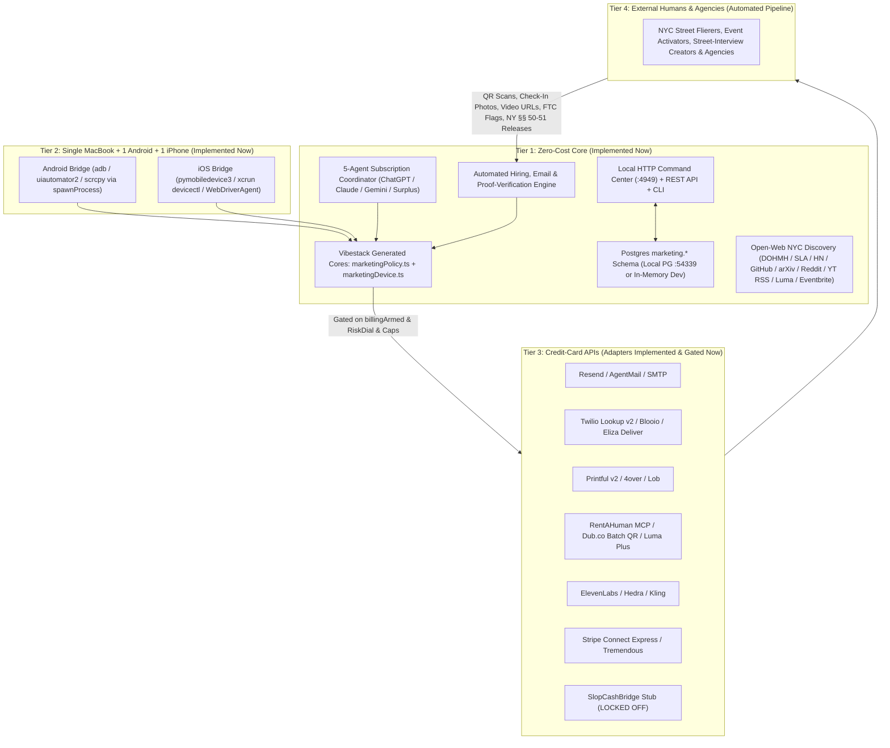
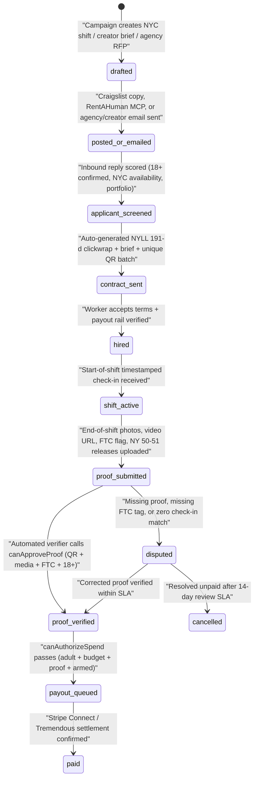

# Technical Product Requirements Document (PRD): `@thenetwork/marketing`

- **Application Path:** `apps/marketing` (`@thenetwork/marketing`)
- **Database Schema:** Isolated PostgreSQL schema `marketing.*` (`apps/marketing/db/schema.sql`, applied via `packages/db/migrate.ts` as repeatable `9004_marketing_schema`)
- **Formal Verification:** Vibestack specs `spec/marketingPolicy.md` & `spec/marketingDevice.md` -> generated TypeScript in `packages/core/src/generated/marketingPolicy.ts` & `packages/core/src/generated/marketingDevice.ts`, plus whole-flow Quint model `spec/models/marketing_campaign.md`
- **Runtime Stack:** Node 26 + `tsx` + `pnpm` + Vitest (`@thenetwork/core/runtime/postgres.ts` `SQL`, `@thenetwork/core/runtime/process.ts` `spawnProcess`, `@thenetwork/core/runtime/http.ts` `serve`)
- **Runtime Entrypoints:** `pnpm run marketing` (HTTP Command Center + REST API + orchestrator on `127.0.0.1:4949`) and `pnpm run marketing:cli` (CLI controller)
- **Companion Docs:** [README.md](README.md) · [STRATEGY.md](STRATEGY.md) · [NYC-STREET-TEAMS-AND-AGENCIES.md](NYC-STREET-TEAMS-AND-AGENCIES.md) · [SLOP-CASH-INTEGRATION.md](SLOP-CASH-INTEGRATION.md)

---

## 1. Purpose, Boundaries & Non-Goals

`apps/marketing` is a runnable, formally verified marketing orchestration application inside The Network monorepo (`eliza-research/thenetwork`). It coordinates our five branded agents (`Chadwick`, `Sloane`, `Peon`, `Venn`, `The Operator / Eliza`), manages local physical phones attached to a single MacBook, discovers NYC opportunities from free open-web sources, hires and pays real NYC street teams, event activators, agencies, and street-interview YouTubers/creators with zero internal human labor, and enforces strict spend, age, consent, and proof invariants.

### 1.1 Hard System Boundaries

1. **Zero edits to the four public landing sites (2026-10-19 rule):** `apps/site` (`ntwrk.party`, `slop.date`, `peon.biz`, `friends.help`) remains untouched. The Marketing Command Center serves strictly on loopback (`127.0.0.1:4949`) or behind staff Zero-Trust access.
2. **Zero-cash `packages/capital` wall (2026-11-23 rule):** `apps/marketing` never reads or mutates `packages/capital` balances to issue cash or crypto. All marketing budgets, contractor escrow, and spend tracking live in `marketing.*`.
3. **`slop.cash` disabled in code (`MARKETING_SLOP_CASH_ENABLED=0`):** `apps/marketing` includes the `marketing.slop_cash_hooks` schema table and the typed `SlopCashBridge` stub, hard-blocked by `inv_slop_cash_disabled` and `canAuthorizeSpend` until future founder approval. See [SLOP-CASH-INTEGRATION.md](SLOP-CASH-INTEGRATION.md).
4. **Zero gimmicky hardware:** Street operations use real humans, serialized printed fliers with unique batch QR codes, in-person event activators, and creator street-interview videos only. No novelty wearables or portable print gadgets exist anywhere in `apps/marketing`.
5. **Deterministic time and formal safety:** All pure policy and device decisions live in `spec/marketingPolicy.md` and `spec/marketingDevice.md`, published by `pnpm run spec:sync` into `packages/core/src/generated/marketingPolicy.ts` and `packages/core/src/generated/marketingDevice.ts`. Application code reads time only via injected `Clock` (`packages/core/src/clock.ts`) — never bare `Date.now()` or `Math.random()`.

---

## 2. 4-Tier Phased Implementation Architecture

`apps/marketing` is engineered in four cleanly layered tiers so the full app boots and runs at **$0** today, controls real local phones on a single MacBook today, and activates credit-card APIs and paid NYC human hiring simply by adding env keys and arming billing.



### 2.1 Tier 1 — Zero-Cost Runnable Core (Implemented Now)

Runs completely free on a developer MacBook using local Postgres (`:54339`, `pnpm run db:migrate`) or an ephemeral in-memory dev store for instant testing:
- **Generated Policy & Device Cores (`packages/core/src/generated/`):** Pure TypeScript generated from `spec/marketingPolicy.md` and `spec/marketingDevice.md` via `pnpm run spec:sync`, paired with whole-flow verification in `spec/models/marketing_campaign.md`.
- **5-Agent Subscription Coordinator (`apps/marketing/src/agent-lifecycle.ts`):** Drives `Chadwick`, `Sloane`, `Peon`, `Venn`, and `The Operator / Eliza` using existing ChatGPT, Claude, Gemini, or Surplus subscriptions.
- **Zero-Cost Open-Web NYC Discovery (`apps/marketing/src/discovery.ts`):** Queries free unauthenticated public feeds (NYC Open Data DOHMH venues, NYS SLA liquor licenses, HN Algolia, GitHub NYC builders, arXiv Atom API, Reddit NYC feeds, YouTube channel RSS feeds, Luma & Eventbrite NYC listings) to build normalized `DiscoveredLead` queues at `$0` API cost.
- **Automated Hiring & Proof Engine (`apps/marketing/src/crowdsourcing.ts`):** Generates Craigslist NYC gig copy, RentAHuman task briefs, vetted NYC agency RFP emails, and YouTuber/creator outreach drafts; parses applicant replies against a strict 18+ screening rubric; generates NYLL § 191-d clickwrap agreements; and verifies submitted proofs before queuing payouts.
- **HTTP Command Center + REST API + CLI (`apps/marketing/src/server.ts`, `apps/marketing/src/cli.ts`):** Full local observability and control plane built on `@thenetwork/core/runtime/http.ts` (`serve`).

### 2.2 Tier 2 — Single MacBook + 1 Dedicated Android + 1 Dedicated iPhone (Implemented Now)

Physical mobile publishing avoids emulator bans (`MEETS_STRONG_INTEGRITY` and Apple App Attest) without requiring an expensive multi-Mac rack on Day 1:
- **Starter Hardware:** 1 existing MacBook + 1 unlocked retail Android (e.g., Google Pixel 6a/7a, bootloader locked, USB debugging enabled) + 1 unlocked retail iPhone (e.g., iPhone SE 3 / 13 mini, iOS 18+, prebuilt `WebDriverAgent`). Both phones run with **Wi-Fi OFF** on separate cellular carrier SIMs (`~$15/mo` each).
- **Device Bridge (`apps/marketing/src/devices/bridge.ts`):** Executes local USB diagnostics and UI automation via `@thenetwork/core/runtime/process.ts` (`spawnProcess`) for Android (`adb devices -l`, `adb shell dumpsys battery`, `uiautomator2`, `scrcpy`) and iOS (`xcrun devicectl list devices`, `pymobiledevice3`, prebuilt `WebDriverAgent` at `http://127.0.0.1:8100/status`).
- **Proved Safety Envelope (`spec/marketingDevice.md`, `inv_device_safety_envelope`):**
  - Battery must be within **`35% <= batteryPct <= 80%`** before dispatching an active session.
  - Device temperature must be **`0°C <= tempC <= 41°C`** (actions abort and enter cooldown above `41°C`).
  - Monotone daily warm-up cap (`warmupDailyCap(warmupDay)`): day `< 1` -> `0`, `<= 3` -> `5`, `<= 7` -> `12`, `<= 14` -> `25`, `<= 30` -> `50`, else `80`.
  - Mutual-exclusion lease: at most one `leaseHolder` may control a phone at any time (`!leasedByOther`).
  - **Zero CAPTCHA bypass:** Any login challenge, CAPTCHA, or 2FA prompt immediately sets device status to `needs_takeover` and alerts the Command Center for human intervention.

### 2.3 Tier 3 — Paid Credit-Card APIs & Purchases (Adapters Implemented & Gated Now)

Every billable external service sits behind a uniform `PaidAdapter` interface in `apps/marketing/src/adapters/paid.ts`:

```ts
export interface PaidAdapter<TInput, TResult> {
  readonly id: string;
  readonly tier: 3 | 4;
  readonly requiredEnv: readonly string[];
  readiness(env: Record<string, string | undefined>): "ready" | "dry_run" | "missing_credentials";
  estimateCostCents(input: TInput): number;
  dryRun(input: TInput): Promise<AdapterReceipt<TResult>>;
  execute(input: TInput, leaseId: string): Promise<AdapterReceipt<TResult>>;
}
```

**Fail-Closed Dispatch Gate:** Before any adapter calls `execute()`, the registry calls generated `canAuthorizeSpend(...)` from `packages/core/src/generated/marketingPolicy.ts` (`inv_tier_billing_gate`, `inv_budget_never_exceeded`, `inv_slop_cash_disabled`):
1. Required env keys AND `MARKETING_LIVE_BILLING === "1"` must be present (otherwise safely returns a dry-run receipt).
2. Campaign `billingArmed === true` AND `riskDial !== "lockdown"`.
3. `amountCents > 0`, `amountCents <= perTaskCapCents`, `dailySpentCents + amountCents <= dailyCapCents`, AND `monthlySpentCents + amountCents <= monthlyCapCents`.
4. Atomic reservation row written to `marketing.budget_ledger` with a unique `idempotency_key`.

| Adapter ID | Service / Provider | Required Env Keys | Role in `apps/marketing` |
| :--- | :--- | :--- | :--- |
| `email` | Resend / AgentMail / SMTP | `RESEND_API_KEY` or `AGENTMAIL_API_KEY` | Transactional notifications, two-way applicant/creator/agency threads, clickwrap delivery |
| `sms_voice` | Twilio Lookup v2 / Blooio | `TWILIO_ACCOUNT_SID`, `TWILIO_AUTH_TOKEN` or `BLOOIO_API_KEY` | Carrier-type check (blocks VoIP/burner fraud); opted-in member updates only (never cold SMS) |
| `rentahuman` | RentAHuman.ai MCP | `RENTAHUMAN_API_KEY` | Books, tracks, approves, or disputes NYC street-team & courier tasks (`https://rentahuman.ai/api/mcp`) |
| `print_fliers` | Printful v2 / 4over / Lob | `PRINTFUL_API_KEY` or `FOUROVER_API_KEY` or `LOB_API_KEY` | Prints per-shift unique-QR fliers and partner venue coaster/tabletop kits |
| `qr_links` | Dub.co | `DUB_API_KEY` | Mints unique `go.<brand>/<batch>` short links and QR targets per shift/creator/venue |
| `events` | Luma Plus | `LUMA_API_KEY` | Publishes curated NYC event pages and anti-flake deposit RSVPs |
| `media_video` | ElevenLabs / Hedra / Kling | `ELEVENLABS_API_KEY` / `HEDRA_API_KEY` / `KLING_API_KEY` | Optional AI voiceovers and short-form video cutdowns for branded social channels |
| `payouts` | Stripe Connect Express / Tremendous | `STRIPE_SECRET_KEY` or `TREMENDOUS_API_KEY` | Direct USD bank or gift-card payouts for NYC street workers, creators, and agencies (`$500/yr` W-9 gate) |
| `slop_cash` | `SlopCashBridge` Stub | `MARKETING_SLOP_CASH_ENABLED` (default `0`) | **Hard-disabled stub** (`inv_slop_cash_disabled`). Always fails closed with `SlopCashDisabledError`. |

### 2.4 Tier 4 — Automated External Human, Street-Team, Creator & Agency Pipeline

Tier 4 orchestrates real NYC humans from initial job posting to verified fiat payout with zero internal staff handling day-to-day recruiting:



Full vendor lists, NYC street-team agency contacts, hourly/shift pricing, YouTuber outreach scripts, and copy-paste email templates live in [NYC-STREET-TEAMS-AND-AGENCIES.md](NYC-STREET-TEAMS-AND-AGENCIES.md).

---

## 3. Subscription-Connected 5-Agent Lifecycle Manager

`apps/marketing/src/agent-lifecycle.ts` manages the complete lifecycle of **Chadwick**, **Sloane**, **Peon**, **Venn**, and **The Operator / Eliza** without locking the system to a single API billing account.

### 3.1 Supported Subscription Providers & Connection Modes

Each agent record binds to a primary subscription provider and an ordered failover provider across **ChatGPT**, **Claude**, **Gemini**, and **Surplus**:

| Provider | Subscription Tier | Supported Connection Modes (`auth_mode`) | Typical Use |
| :--- | :--- | :--- | :--- |
| **`claude`** | Claude Pro / Max | `cli` (`claude` CLI), `mcp` (Connector), `oauth`, `browser`, `api` | Long-form BD negotiation, agency RFPs, nuanced creator briefs |
| **`chatgpt`** | ChatGPT Plus / Pro / Team | `cli` (`codex` CLI), `mcp` (Connector), `oauth`, `browser`, `api` | Fast campaign drafting, Craigslist reply screening, social hooks |
| **`gemini`** | Gemini AI Pro / Ultra | `cli` (`gemini` CLI), `mcp`, `oauth`, `browser`, `api` | Multimodal proof review assistance (image/video metadata checks), NYC local research |
| **`surplus`** | Surplus Intelligence (`gpt-6-luna`) | `api` (`packages/core/src/llm.ts`) | Repo-standard LLM fallback when personal subscriptions are unavailable or rate-limited |

### 3.2 Lifecycle State Machine & Failover Rules

1. **Session & Quota Tracking:** Every agent has a `daily_turn_cap` (e.g., `60` turns/day) and `turns_used_today`, reset daily. Generated `canDispatchAgentTurn(...)` enforces `inv_agent_subscription_cap`: no turn dispatches if `turnsToday >= dailyTurnCap`, if `agentPaused`, `rateLimited`, or `!sessionHealthy`, or if `lockdown`.
2. **Automatic Provider Failover:** If an agent's primary subscription returns a quota/rate-limit window, the lifecycle coordinator transitions the primary slot to `cooldown`, switches to `failover_provider`, preserves the persona prompt and campaign context, and resumes without dropping tasks.
3. **Mandatory Safety Middleware:** Every agent output passes through `@thenetwork/core`'s `LeakGuard` before storage or external dispatch. Any turn targeting a contact with `stopped === true` is blocked by `inv_stop_fence_respected`.

---

## 4. PostgreSQL Schema (`marketing.*`)

The schema lives in `apps/marketing/db/schema.sql` (idempotent, applied by `packages/db/migrate.ts` as repeatable `9004_marketing_schema` after `9003_notify_retention`, keeping `platform.*`, `network.*`, and `capital` tables untouched). It defines 11 tables with DB-level check constraints mirroring our Vibestack and Quint safety invariants, plus least-privilege `REVOKE ... FROM PUBLIC` and `GRANT ... TO network_service` matching `packages/notify/db/schema.sql`:

| # | Table | Purpose & Key Invariant Constraints |
| :-: | :--- | :--- |
| 1 | `marketing.campaigns` | NYC-first (`$10,000` = `1_000_000` cents) and multi-city campaigns; enforces `reserved_cents + spent_cents <= monthly_budget_cents`, `billing_armed = false` default, `slop_cash_enabled = false` default. |
| 2 | `marketing.agents` | 5 subscription-connected branded agents (`chadwick`, `sloane`, `peon`, `venn`, `operator`) across `chatgpt | claude | gemini | surplus`, daily turn caps, and failover providers. |
| 3 | `marketing.devices` | Tier 2 local hardware slots (`macbook`, `android`, `ios`) with battery %, temperature °C, warm-up stage/day, action caps, and single-owner leases. |
| 4 | `marketing.channels_and_accounts` | Social, email, gig-platform, QR, and print accounts mapped to agents/devices with warm-up caps. |
| 5 | `marketing.humans` | External humans, applicants, street workers, event activators, creators, agencies, printers, venues, VIPs, age verification, NYLL § 191-d contract flag, and global `STOP` / `banned` fence. |
| 6 | `marketing.tasks` | Street shifts, event activations, creator videos, agency bookings, print orders, and future `oss_dev_bounty`. Enforces `worker_age_years >= 18` when hired/paid for Tier 4, `proof_verified = true` before `paid`, positive paid amounts, and `payout_rail = 'slop_cash'` restricted to `oss_dev_bounty`. |
| 7 | `marketing.proofs` | Submitted proofs (GPS check-in hashes, public video URL, QR scans, verified signups, FTC `#Ad` disclosure, NY Civil Rights Law §§ 50-51 signed release counts). |
| 8 | `marketing.outreach_messages` | Outbound/inbound emails, Craigslist relays, agency RFPs, creator briefs, and proof reminders with `leak_check_pass` and STOP-blocked status audit. |
| 9 | `marketing.attribution_events` | Serialized QR scans, shortlink clicks, verified 18+ signups, and release signatures linked to `qr_batch_code` and `campaign_id`. |
| 10 | `marketing.budget_ledger` | Append-only spend circuit-breaker ledger (`dry_run`, `reserve`, `commit`, `release`, `refund`) with positive `amount_cents` and unique `idempotency_key`. |
| 11 | `marketing.slop_cash_hooks` | Disabled-by-default integration metadata enforcing `enabled = true or hook_state = 'disabled_stub'`. |

---

## 5. Package Layout, REST API, Command Center & CLI

### 5.1 Workspace Layout (`apps/marketing/` + `spec/`)

```text
spec/
├── marketingPolicy.md                       # Vibestack pure policy & budget rules
├── marketingDevice.md                       # Vibestack pure device safety envelope rules
└── models/
    └── marketing_campaign.md                # Whole-flow Quint model (8 safety invariants)

packages/core/src/generated/
├── marketingPolicy.ts                       # Generated by `pnpm run spec:sync` (do not hand-edit)
└── marketingDevice.ts                       # Generated by `pnpm run spec:sync` (do not hand-edit)

apps/marketing/
├── package.json                             # @thenetwork/marketing
├── db/
│   └── schema.sql                           # Repeatable 9004_marketing_schema DDL (packages/db/migrate.ts)
├── src/
│   ├── index.ts                             # Public exports
│   ├── types.ts                             # Shared domain types
│   ├── store.ts                             # MemoryMarketingStore + PgMarketingStore (@thenetwork/core/runtime/postgres.ts)
│   ├── agent-lifecycle.ts                   # ChatGPT/Claude/Gemini/Surplus 5-agent coordinator & failover
│   ├── discovery.ts                         # Tier-1 $0 open-web NYC discovery (DOHMH, SLA, HN, GitHub, arXiv, Reddit, YT RSS, Luma, Eventbrite)
│   ├── nyc-seed.ts                          # Ready-to-run NYC Month-1 seed ($10,000 split, 5 agents, Tier-2 slots, agencies, printers, 5 email templates)
│   ├── crowdsourcing.ts                     # Automated Craigslist / RentAHuman / agency / creator screening, NYLL § 191-d & proof engine
│   ├── slop-cash-bridge.ts                  # Disabled slop.cash stub (MARKETING_SLOP_CASH_ENABLED=0)
│   ├── devices/
│   │   └── bridge.ts                        # Local MacBook Android (adb/scrcpy) & iOS (devicectl/pymobiledevice3/WDA) bridge via spawnProcess
│   ├── adapters/
│   │   └── paid.ts                          # Tier-3 credit-card plug-and-play paid adapter registry + dry-run fallback
│   ├── server.ts                            # Local HTTP Command Center + JSON REST API (:4949) via @thenetwork/core/runtime/http.ts
│   └── cli.ts                               # pnpm run marketing:cli
└── test/
    └── marketing.integration.pg.test.ts     # Vitest + Postgres integration tests covering all 8 invariants
```

### 5.2 JSON REST API (`http://127.0.0.1:4949`)

| Method & Path | Purpose | Generated Core Guard Called |
| :--- | :--- | :--- |
| `GET /api/health` | Service health, DB mode, `riskDial`, `billingArmed`, `slopCashEnabled` | — |
| `GET /api/campaigns` / `POST /api/campaigns` | List or create city campaigns (default NYC `$10,000` cap) | `canAuthorizeSpend` |
| `POST /api/campaigns/:id/risk-dial` | Set `conservative`, `balanced`, `blitz`, or `lockdown`; arm/disarm billing | `inv_tier_billing_gate` |
| `GET /api/agents` / `POST /api/agents/:id/dispatch` | Inspect 5 branded agents; dispatch turn with automatic subscription failover | `canDispatchAgentTurn` |
| `GET /api/devices` / `POST /api/devices/scan` | Probe USB-attached Android & iPhone battery, temp, and serial/UDID | `deviceBatterySafe`, `warmupDailyCap` |
| `POST /api/devices/:id/dispatch` | Lease device and execute safe UI action or pause on CAPTCHA | `canExecuteDeviceAction` |
| `POST /api/discover/nyc` | Run zero-cost open-web NYC discovery (bars, Luma/Eventbrite, HN/GitHub/arXiv, Reddit, YT RSS) | Public unauthenticated endpoints only |
| `GET /api/tasks` / `POST /api/tasks` | List or create Tier 1-4 tasks (street shifts, event activations, creators, agencies) | `canAuthorizeSpend` |
| `POST /api/tasks/:id/screen` | Screen applicant reply (enforces 18+ age check) and generate NYLL § 191-d clickwrap | `adultParticipantAge` |
| `POST /api/tasks/:id/proof` | Submit and automatically verify shift photos, video URL, QR scans, FTC flag, NY §§ 50-51 releases | `canApproveProof` |
| `POST /api/tasks/:id/payout` | Execute or dry-run verified fiat payout (`Stripe` / `Tremendous`) | `adultParticipantAge`, `canApproveProof`, `canAuthorizeSpend` |
| `POST /api/contacts/stop` | Mark human/contact `STOP` across all agents and outreach adapters immediately | `canSendOutreach`, `canDispatchAgentTurn` |
| `GET /api/spend` | Ledger summary, remaining monthly budget, per-tier breakdown, breaker state | `inv_budget_never_exceeded` |
| `GET /api/slop-cash/status` | Reports `enabled: false`, stub hook count, and activation prerequisites | `inv_slop_cash_disabled` |

### 5.3 Local Command Center UI & CLI

- **Command Center (`http://127.0.0.1:4949`):** Single-page operator dashboard served directly by `apps/marketing/src/server.ts` showing (1) active city campaign & `$10,000` budget gauge, (2) global `RiskDial` + `Billing Armed` toggle, (3) 5-agent ChatGPT/Claude/Gemini/Surplus quota & failover strip, (4) local MacBook + Android + iPhone battery/temp/lease cards, (5) live NYC street-team & creator hiring/proof queue, and (6) `slop.cash` disabled-stub indicator.
- **CLI (`pnpm run marketing:cli`):**
  - `status` — prints campaigns, budget used, `RiskDial`, agent quotas, device health, and `slop.cash` status (`DISABLED`).
  - `campaign create --city nyc --app slop --budget 10000` — creates a bounded city campaign.
  - `agent list | dispatch <persona> --prompt "..."` — runs or tests subscription failover.
  - `device scan | status | release <id>` — inspects MacBook USB-connected Android/iPhone state.
  - `discover nyc` — fetches zero-cost NYC open-web leads into `marketing.humans`.
  - `hire create --kind street_fliering|creator_video|event_activation|agency_booking --amount <usd>` — creates and drafts a Tier 4 task.
  - `proof submit <taskId> --url <videoUrl> --ftc --scans <n>` — runs automated proof verification.
  - `payout <taskId>` — executes dry-run or live fiat payout if all proved invariants pass.
  - `stop <handleOrEmail>` — immediately writes contact into the global `STOP` fence.
  - `risk-dial <conservative|balanced|blitz|lockdown>` — changes operational mode atomically.

---

## 6. Formal Verification Specification (Vibestack + Quint)

Compliant with [AGENTS.md](../../AGENTS.md) and [SPEC.md](../../SPEC.md), every safety-critical decision in `apps/marketing` is verified at two levels using the **exact same 8 invariant names**:

| # | Shared Invariant Name | Quint Model (`spec/models/marketing_campaign.md`) | Vibestack Spec -> Generated TS (`packages/core/src/generated/`) | Meaning |
| :-: | :--- | :--- | :--- | :--- |
| 1 | **`inv_adult_only_paid`** | Checked in `val safety` | `spec/marketingPolicy.md` (`adultParticipantAge`, `canApproveProof`, `lawUnderageNeverPaid`) | No person under age 18 (or unknown age) is ever hired or paid in any marketing task. |
| 2 | **`inv_budget_never_exceeded`** | Checked in `val safety` | `spec/marketingPolicy.md` (`canAuthorizeSpend`, `lawSpendRespectsCaps`) | `dailySpent + amount <= dailyCap`, `monthlySpent + amount <= monthlyCap`, and `amount <= perTaskCap`. |
| 3 | **`inv_slop_cash_disabled`** | Checked in `val safety` | `spec/marketingPolicy.md` (`canAuthorizeSpend`, `lawSlopCashBlockedWhenDisabled`) | No task ever settles via `slop_cash` while `slopCashEnabled == false`. |
| 4 | **`inv_proof_required_before_payout`** | Checked in `val safety` | `spec/marketingPolicy.md` (`canApproveProof`, `lawProofRequiresEvidenceAndAdult`) | No human/street-team/creator task transitions to `paid` without verified proof (evidence URL, FTC disclosure, geo/time check, shift/signup evidence, adult non-banned worker). |
| 5 | **`inv_tier_billing_gate`** | Checked in `val safety` | `spec/marketingPolicy.md` (`canAuthorizeSpend`, `lawLockdownBlocksTier3And4`) | Tier 3 (paid API) and Tier 4 (paid human) executions never dispatch unless `billingArmed == true` and `!lockdown`. |
| 6 | **`inv_agent_subscription_cap`** | Checked in `val safety` | `spec/marketingPolicy.md` (`canDispatchAgentTurn`) | No ChatGPT/Claude/Gemini/Surplus agent dispatches past its daily turn cap or while paused, rate-limited, or unhealthy. |
| 7 | **`inv_device_safety_envelope`** | Checked in `val safety` | `spec/marketingDevice.md` (`deviceBatterySafe`, `warmupDailyCap`, `canExecuteDeviceAction`, `lawHotOrLowBatteryBlocked`, `lawWarmupCapMonotone`, `lawLeasedOrStoppedDeviceBlocked`) | No Android/iPhone executes an action outside `35 <= batteryPct <= 80`, `0 <= tempC <= 41`, or daily warm-up cap, and never under two concurrent leases. |
| 8 | **`inv_stop_fence_respected`** | Checked in `val safety` | `spec/marketingPolicy.md` (`canSendOutreach`, `canDispatchAgentTurn`, `lawStopFenceBlocksAgentAndOutreach`) | No outreach message, device action, or agent turn targets a contact marked `stopped == true`. |

### 6.1 What Stays Outside the Formal Model & How It Is Tested

- **Outside Vibestack/Quint:** Postgres SQL queries (`store.ts`), HTTP routing (`server.ts`), local USB subprocess execution (`adb`, `scrcpy`, `pymobiledevice3`, `xcrun devicectl`), subscription CLI/browser subprocesses, and third-party REST calls (`adapters/paid.ts`).
- **Coverage:** Every thin shell imports and calls `packages/core/src/generated/marketingPolicy.ts` or `marketingDevice.ts` without recomputing decisions. Vitest + Postgres integration tests (`apps/marketing/test/marketing.integration.pg.test.ts`, run via `pnpm run test:integration`) prove that database constraints, API endpoints, and concurrent reservations enforce all 8 invariants end-to-end. Run `pnpm run spec:sync`, `pnpm run spec:check-generated`, `pnpm run quint:check marketing_campaign`, and `pnpm run check` after any spec edit.

---

## 7. Budget Circuit Breakers & 4-Tier Cost Model

### 7.1 Deterministic Spend Breakers

Generated `marketingPolicy.ts` and `marketing.budget_ledger` enforce four hard ceilings fail-closed:
1. **Campaign Monthly Hard Cap:** Default `$10,000` (`1_000_000` cents) for Month-1 NYC. Any reservation pushing `reserved + spent` over the cap fails immediately.
2. **Single-Task Ceiling:** Default `$1,500` (`150_000` cents) max per single task/booking; larger agency contracts require explicit cap elevation.
3. **Daily Outflow Cap:** Default `$1,000/day` (`100_000` cents) across Tier 3 + Tier 4 combined to prevent runaway automation loops.
4. **Master Billing Arm & `RiskDial` Kill Switch:** `billingArmed = false` or `riskDial = "lockdown"` drops all paid execution to `$0` instantaneously.

### 7.2 Incremental Cost Model Across the 4 Tiers

| Tier | One-Time Hardware / Setup | Monthly Recurring Cost | Variable Spend Ceiling | Notes |
| :--- | ---: | ---: | ---: | :--- |
| **Tier 1 (Zero-Cost Core)** | `$0` | `$0` | `$0` | Uses existing dev machine, local Postgres `:54339`, free public data feeds, and existing ChatGPT/Claude/Gemini/Surplus subscriptions. |
| **Tier 2 (MacBook + 1 Android + 1 iPhone)** | `$0` *(existing devices)* or `~$300` *(used Pixel 6a + iPhone SE3)* | `~$30 / mo` | `$0` | 2 dedicated prepaid cellular SIMs (`Tello` / `US Mobile` @ `$15/mo` each, Wi-Fi OFF). |
| **Tier 3 (Paid Credit-Card APIs)** | `$0` | `$90–$250 / mo` *(optional SaaS: Dub.co, Resend/AgentMail)* | Metered inside monthly cap | Every adapter stays in dry-run until env keys + `MARKETING_LIVE_BILLING=1` + `billingArmed = true`. |
| **Tier 4 (NYC Street Teams, Creators, Activators & Print)** | `$0` | `$0` fixed | **`$10,000` Month-1 NYC cap** | `$3,200` street fliering + `$3,300` street-interview creators + `$1,700` event activators + `$800` serialized flier/rush print + `$1,000` W-2 agency surge reserve (`NYC-STREET-TEAMS-AND-AGENCIES.md`). |
