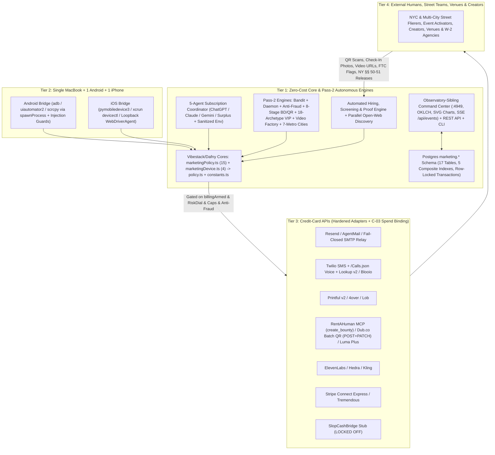

# Technical Product Requirements Document (PRD): `@thenetwork/marketing`

- **Application Path:** `apps/marketing` (`@thenetwork/marketing`)
- **Database Schema:** Isolated PostgreSQL schema `marketing.*` (**21 tables**, composite & GIN indexes, 2 guarded read-only `SECURITY DEFINER` RPCs `marketing.contact_fence` and `marketing.supply_demand_k5`, `apps/marketing/db/schema.sql`, applied via `packages/db/migrate.ts` as repeatable `9004_marketing_schema`)
- **Formal Verification:** Vibestack/Dafny specs `spec/marketingPolicy.md` (**23 proved obligations**) & `spec/marketingDevice.md` (**4 proved obligations**) -> generated TypeScript in `packages/core/src/generated/marketingPolicy.ts` & `packages/core/src/generated/marketingDevice.ts`, plus whole-flow Quint model `spec/models/marketing_campaign.md` and offline deterministic simulator gate `pnpm run sim --only marketing` (**12 blocking gates**, `<1.5s`)
- **Runtime Stack:** Node 26 + `tsx` + `pnpm` + Vitest (`@thenetwork/core/runtime/postgres.ts` `SQL`, `@thenetwork/core/runtime/process.ts` `spawnProcess`, `@thenetwork/core/runtime/http.ts` `serveHttp`)
- **Runtime Entrypoints:** `pnpm run marketing` (Observatory-sibling Global Growth Command Center + JSON REST API + live SSE hub on `127.0.0.1:4949`) and `pnpm run marketing:cli` (CLI controller)
- **Companion Docs:** [README.md](README.md) · [CITY-LAUNCH-PLAYBOOK.md](CITY-LAUNCH-PLAYBOOK.md) · [STRATEGY.md](STRATEGY.md) · [NYC-STREET-TEAMS-AND-AGENCIES.md](NYC-STREET-TEAMS-AND-AGENCIES.md) · [SLOP-CASH-INTEGRATION.md](SLOP-CASH-INTEGRATION.md)

---

## 1. Purpose, Boundaries & Non-Goals

`apps/marketing` is a runnable, formally verified marketing orchestration application inside The Network monorepo (`eliza-research/thenetwork`). It coordinates our five branded agents (`Chadwick`, `Sloane`, `Peon`, `Venn`, `The Operator / Eliza`), manages local physical phones attached to a single MacBook, discovers opportunities across seven metros from free open-web sources, hires and pays real NYC/multi-city street teams, event activators, agencies, and street-interview YouTubers/creators with zero internal human labor, runs continuous Contextual Bandit rebalancing, Anti-Fraud vesting & Sybil detection, Zero-Human 8-stage BD + serialized QR batching, 18-archetype VIP salon curation, and a 5-agent Short-Form Video Factory—while enforcing proved spend, age, consent, device, and proof invariants.

### 1.1 Hard System Boundaries

1. **Zero edits to the four public landing sites (2026-10-19 rule):** `apps/site` (`ntwrk.party`, `slop.date`, `peon.biz`, `friends.help`) remains untouched. The Marketing Command Center serves strictly on loopback (`127.0.0.1:4949`) or behind staff Zero-Trust access with Bearer authentication (`timingSafeEqual`, empty-token fallback to 48-char random hex) and strict CSP headers.
2. **Zero-cash `packages/capital` wall (2026-11-23 rule):** `apps/marketing` never reads or mutates `packages/capital` balances to issue cash or crypto. All marketing budgets, contractor escrow, and spend tracking live in `marketing.*`.
3. **`slop.cash` disabled in code (`MARKETING_SLOP_CASH_ENABLED=0`):** `apps/marketing` includes the `marketing.slop_cash_hooks` schema table and the typed `SlopCashBridge` stub, hard-blocked by `inv_slop_cash_disabled`, `canAuthorizeTaskSpend`, and `lawConsumerTaskNeverUsesSlopCash` until explicit written founder approval. See [SLOP-CASH-INTEGRATION.md](SLOP-CASH-INTEGRATION.md).
4. **Zero gimmicky hardware:** Street operations use real humans, serialized printed fliers with unique batch QR codes, in-person event activators, and creator street-interview videos only.
5. **Deterministic time, single-source constants, and formal safety:** All pure policy and device decisions live in `spec/marketingPolicy.md` and `spec/marketingDevice.md`, published by `pnpm run spec:sync` into `packages/core/src/generated/marketingPolicy.ts` and `packages/core/src/generated/marketingDevice.ts`, and wrapped once in `apps/marketing/src/policy.ts` and `apps/marketing/src/constants.ts`. Application code reads time only via injected `Clock` (`packages/core/src/clock.ts`) — never bare `Date.now()`, bare `new Date()`, or `Math.random()`.

---

## 2. 4-Tier Phased Implementation Architecture



### 2.1 Tier 1 — Zero-Cost Core & Pass-2 Autonomous Engines (Implemented Now)

Runs completely free on a developer MacBook using local Postgres (`:54339`, `pnpm run db:migrate`) or `MemoryMarketingStore`:
- **Canonical Foundation (`types.ts`, `constants.ts`, `policy.ts`, `validation.ts`, `sse.ts`):** Single-source operational defaults, canonical 5-agent roster, compliance clauses, 5 email templates, thin policy wrappers delegating 100% to generated cores, streaming 1 MiB JSON parser (`413` oversize, strict typed fields, prototype-pollution block, `validatePublicHttpsUrl` SSRF defense), and bounded 64-client `MarketingEventHub` SSE broadcaster.
- **5-Agent Subscription Coordinator (`agent-lifecycle.ts`):** Drives `Chadwick`, `Sloane`, `Peon`, `Venn`, and `The Operator` across `ChatGPT`, `Claude`, `Gemini`, and `Surplus` with allowlisted non-secret CLI env (`sanitizeCliEnv`), 30s `SIGTERM->SIGKILL` timeouts, 1 MiB bounded stream reads, non-bouncing failover (`triedProviders`), and contact-checking `LeakGuard`.
- **7-Metro Legal & Parallel Discovery Engine (`cities.ts`, `discovery.ts`):** Supports `nyc`, `sf`, `la`, `chicago`, `miami`, `austin`, and `london` with code-enforced CA AB5 W-2 hiring gates, London EPA 1990 Schedule 3A borough flier licence checks, city transit/locality matching, and free unauthenticated open-web feeds (DOHMH, NYS SLA, HN Algolia, GitHub, arXiv, Reddit, YouTube RSS, Luma, Eventbrite).
- **Contextual Thompson-Sampling Bandit (`bandit.ts`):** Deterministic seeded Beta-distribution weight allocation across campaign tracks with proved auto-kill bounds (`> 2.5x` CPA ceiling `$21.25` or `> 5%` STOP rate `500 bps`).
- **Continuous Autopilot Daemon (`daemon.ts`):** Non-overlapping `setTimeout` + mutex loop on injected `Clock`, automatic UTC midnight `resetDailyCounters()`, expired device lease sweeper, automatic `riskDial -> "lockdown"` + `billingArmed -> false` circuit breaker on STOP-rate spike (`> 500 bps`), scheduled Bandit rebalancing, and SSE event publication.
- **Anti-Fraud 4-Tier Vesting & Sybil Scanner (`antifraud.ts`):** Enforces 4-tier vesting (`$0` instant -> D7/D14 -> Organic-Anchor + 48h), VoIP block, `$2` prepaid/MVNO cap, `$20` lifetime consumer bonus cap, `$500/yr` W-9 gate, SHA-256 media-hash dedup, connected-component Sybil cluster quarantine, `https:` SSRF video validation, and `<= 15d` NY-FIFA / `<= 14d` OP-Q SLAs.
- **Zero-Human 8-Stage BD & Serialized QR Batch Engine (`bd-engine.ts`):** Manages `prospect -> enriched -> pitched -> negotiating -> contracted -> kit_shipped -> live -> audited` (plus `closed_lost`), DTMF business-phone callback challenges, SHA-256 6-year clickwrap contracts, Dub.co `PATCH` QR batch binding, and Day-14 RentAHuman mystery audits.
- **18-Archetype VIP Salon Engine (`vip-engine.ts`):** `ntwrk.party` prestige scoring, `< 75`-word plain-text invite validation (zero URLs/HTML/Calendly/spam words, `LeakGuard` clean), Table-Anchor matching, and Day-3/Day-7 follow-ups.
- **5-Agent Short-Form Video Factory (`video-factory.ts`):** 5 persona video bibles, 10 starter comedy scripts (`STARTER_COMEDY_SCRIPTS`), pre-render safety/FTC/brand-isolation linter, and 72h retention scorer (`scale` / `hold` / `kill_rewrite`).
- **Automated Hiring & Proof Engine (`crowdsourcing.ts`):** Generates city-compliant Craigslist gig copy, RentAHuman `create_bounty` MCP payloads, vetted agency RFPs, and creator briefs; screens replies (`>= 75` auto-hire, `>= 50` standby bench, youngest-age-wins `minAgeReading`, fixed `18+` regex); verifies proofs (`canApproveCreatorProof`) and dispatches email/payouts via `PaidAdapterRegistry`.

### 2.2 Tier 2 — Single MacBook + 1 Dedicated Android + 1 Dedicated iPhone (`devices/bridge.ts`)

- **Starter Hardware:** 1 MacBook host + 1 unlocked retail Android (locked bootloader, USB debugging ON, Wi-Fi OFF, prepaid cellular SIM) + 1 unlocked retail iPhone (iOS 18+, prebuilt loopback `WebDriverAgent`, Wi-Fi OFF, prepaid cellular SIM).
- **Proved Safety Envelope (`spec/marketingDevice.md`, `inv_device_safety_envelope`):**
  - Battery within **`35% <= batteryPct <= 80%`** and temperature **`0°C <= tempC <= 41°C`**.
  - Monotone daily warm-up cap (`warmupDailyCap`): `< 1` -> `0`, `<= 3` -> `5`, `<= 7` -> `12`, `<= 14` -> `25`, `<= 30` -> `50`, else `80`.
  - Expiring single-owner lease (`isDeviceLeaseHeldByOther` checks `leaseExpiresAt > nowMs`).
  - **Proved CAPTCHA / 2FA Halt (`canDispatchDeviceStep`, `lawTakeoverBlocksDeviceStep`):** Whenever `needsTakeover` is true, dispatch fails closed with `status: "needs_takeover"` for human intervention—never bypassed.
  - **Subprocess & SSRF Hardening:** Validates serials, Android `packageName`/`activity`, `scrcpy` allowlisted flags, output paths, and loopback-only WDA URLs; enforces 15s `SIGTERM->SIGKILL` timeout, 1 MiB bounded output reads, and ephemeral WDA session `DELETE`.

### 2.3 Tier 3 — Paid Credit-Card APIs (`adapters/paid.ts`)

Every billable external service sits behind `PaidAdapterRegistry` in `apps/marketing/src/adapters/paid.ts` with strict **C-03 spend binding** (rejects any call where explicit input charge mismatches `context.spend.amountCents`), `AbortSignal.timeout(15_000)` on all HTTP fetches, ledger recording hooks, and fail-closed `canAuthorizeSpend` checks:

| Adapter ID | Service / Provider | Required Env Keys | Role in `apps/marketing` |
| :--- | :--- | :--- | :--- |
| `email` | Resend / AgentMail / SMTP Relay | `RESEND_API_KEY`, `AGENTMAIL_API_KEY`, or `SMTP_RELAY_URL` | Transactional notifications, two-way applicant/creator/agency threads, clickwrap delivery (fail-closed if no `SMTP_RELAY_URL`) |
| `sms_voice` | Twilio SMS + Voice + Lookup v2 / Blooio | `TWILIO_ACCOUNT_SID`, `TWILIO_AUTH_TOKEN`, or `BLOOIO_API_KEY` | Carrier-type & `sms_pumping_risk` lookup, DTMF BD callbacks (`/Calls.json`), opted-in updates only (never cold SMS) |
| `rentahuman` | RentAHuman.ai MCP | `RENTAHUMAN_API_KEY` | Dispatches `create_bounty` tasks (`https://rentahuman.ai/api/mcp`) with HTTP-200 JSON-RPC error checking |
| `print_fliers` | Printful v2 / 4over / Lob | `PRINTFUL_API_KEY`, `FOUROVER_API_KEY`, or `LOB_API_KEY` | Prints serialized QR fliers, postcards (`variant_id` / Lob `size`+`use_type`), and venue coaster kits |
| `qr_links` | Dub.co | `DUB_API_KEY` | Mints (`POST`) and updates (`PATCH` via `linkId`) serialized `go.<brand>/<batch>` short links and QRs |
| `events` | Luma Plus | `LUMA_API_KEY` | Publishes curated city event pages and anti-flake deposit RSVPs |
| `media_video` | ElevenLabs / Hedra / Kling | `ELEVENLABS_API_KEY`, `HEDRA_API_KEY`, `KLING_API_KEY` | AI voiceovers (base64 MP3 artifacts) and short-form video renders for the 5-agent Video Factory |
| `payouts` | Stripe Connect Express / Tremendous | `STRIPE_SECRET_KEY` or `TREMENDOUS_API_KEY` | Direct USD bank or gift-card payouts (`input.rail` strict routing, Tremendous `payment.funding_source_id` & `reward.products`) |
| `slop_cash` | `SlopCashBridge` Stub | `MARKETING_SLOP_CASH_ENABLED` (default `0`) | **Hard-disabled stub** (`inv_slop_cash_disabled`). Fails closed with `SlopCashDisabledError`. |

### 2.4 Tier 4 — Automated External Human, Street-Team, Creator & Agency Pipeline

```mermaid
stateDiagram-v2
    [*] --> drafted: "Campaign creates city shift / creator brief / agency RFP"
    drafted --> posted_or_emailed: "City compliance passed; Craigslist / RentAHuman / email sent"
    posted_or_emailed --> applicant_screened: "Reply scored (>=75 auto_hire, >=50 standby_bench, minAgeReading >= 18)"
    applicant_screened --> contract_sent: "SHA-256 6-year NYLL 191-d clickwrap + brief + serialized QR batch"
    contract_sent --> hired: "Worker accepts terms + payout rail verified"
    hired --> shift_active: "Start-of-shift timestamped GPS check-in received"
    shift_active --> proof_submitted: "End-of-shift photos, https:// video URL, FTC flag, NY 50-51 releases"
    proof_submitted --> proof_verified: "canApproveCreatorProof + AntiFraudEngine pass"
    proof_submitted --> disputed: "Missing proof, missing FTC/release, underage, or duplicate media hash"
    proof_verified --> payout_queued: "Row-locked FOR UPDATE canAuthorizeTaskSpend passes"
    payout_queued --> paid: "Stripe Connect / Tremendous settlement + single atomic ledger commit"
    disputed --> cancelled: "Resolved unpaid within 14-day OP-Q SLA"
    disputed --> proof_verified: "Corrected proof verified within SLA"
```



---

## 3. PostgreSQL Schema (`marketing.*` — 17 Tables & 5 Composite Indexes)

Defined idempotently in `apps/marketing/db/schema.sql` (applied by `packages/db/migrate.ts` as repeatable `9004_marketing_schema`), with `REVOKE ... FROM PUBLIC`, `GRANT ... TO network_service`, row-level `SELECT ... FOR UPDATE` transaction locking in `PgMarketingStore`, `budget_ledger.from_reserve` accounting, `chk_attribution_verified_adult`, and native `'macbook'` device platform support.

### 3.1 Core Operational Tables (1–11)

| # | Table | Purpose & Key Invariant Constraints |
| :-: | :--- | :--- |
| 1 | `marketing.campaigns` | Multi-city campaigns (NYC `$10,000` default); enforces `reserved_cents + spent_cents <= monthly_budget_cents`, `billing_armed = false` & `slop_cash_enabled = false` defaults; immutable budget fields on `PATCH`. |
| 2 | `marketing.agents` | 5 subscription-connected branded agents (`chadwick`, `sloane`, `peon`, `venn`, `operator`) across `chatgpt | claude | gemini | surplus`, daily turn caps, cooldowns, and failover providers. |
| 3 | `marketing.devices` | Tier 2 local hardware slots (`macbook`, `android`, `ios`) with battery %, temp °C, warm-up stage/day, action caps, and single-owner expiring leases. |
| 4 | `marketing.channels_and_accounts` | Social, email, gig-platform, QR, and print accounts mapped to agents/devices with warm-up caps. |
| 5 | `marketing.humans` | External humans, applicants, workers, creators, agencies, venues, and VIPs with youngest-age-wins `lowest_age` and sticky global `STOP` / `banned` fence. |
| 6 | `marketing.tasks` | Street shifts, event activations, creator videos, agency bookings, print orders, and `oss_dev_bounty`. Enforces `assignee_age_years >= 18` when hired/paid, `proof_verified = true` before `paid`, single-payout lock (`TASK_ALREADY_PAID`), and `payout_rail = 'slop_cash'` restricted to `oss_dev_bounty`. |
| 7 | `marketing.proofs` | Submitted proofs (GPS check-in hashes, public `https://` video URL, QR scans, verified signups, FTC `#Ad` flag, NY §§ 50–51 `likeness_release_ok`, verified-first ordering). |
| 8 | `marketing.outreach_messages` | Outbound/inbound outreach with `tier`, `leak_check_pass`, and `blocked_stop` / `blocked_policy` audit. |
| 9 | `marketing.attribution_events` | Serialized QR scans, visits, video views, and verified 18+ signups (`count > 0`, `chk_attribution_verified_adult`). |
| 10 | `marketing.budget_ledger` | Append-only spend circuit-breaker ledger (`dry_run`, `reserve`, `commit`, `release`, `refund`), `from_reserve` flag (prevents double-counting `dailySpentCents`), and unique `idempotency_key`. |
| 11 | `marketing.slop_cash_hooks` | Disabled-by-default integration metadata enforcing `enabled = true or hook_state = 'disabled_stub'`. |

### 3.2 Autonomous Engine & Pass-3 Ecosystem Tables (12–21) + Guarded RPCs

| # | Table / RPC | Purpose & Key Invariant Constraints |
| :-: | :--- | :--- |
| 12 | `marketing.bandit_arms` | Contextual Thompson-Sampling arm state (`arm_key`, `track`, `desire_lane`, `alpha`, `beta`, `weight`, `spend_cents`, `signups`, `verified_outcomes`, `stop_events`, `total_contacts`, `status = active | killed | paused`). |
| 13 | `marketing.bd_deals` | Zero-human 8-stage BD venue/event deals (`stage`, `desire_lane`, `offered_cents`, `phone_callback_verified`, `contract_hash`, `qr_batch_id`). |
| 14 | `marketing.qr_batches` | Serialized QR print/link batches (`batch_code`, `destination_url`, `dub_link_id`, `print_qty`, `assigned_to_type`, `scans`, `verified_signups`). |
| 15 | `marketing.vip_prospects` | 18-archetype `ntwrk.party` VIP salon pipeline (`archetype`, `desire_lane`, `prestige_score`, `invite_draft`, `status`). |
| 16 | `marketing.video_assets` | 5-agent Short-Form Video Factory assets (`title`, `hook`, `script`, `desire_lane`, `stage`, `video_url`, `platform`, `views`, `retention_3s_pct`, `signups`, `ftc_disclosed`). |
| 17 | `marketing.antifraud_claims` | 4-tier vesting & Sybil defense claims (`person_key`, `phone_line_type`, `media_hash`, `cluster_id`, `vesting_tier`, `amount_cents`, `status`). |
| 18 | `marketing.llm_trajectories` | Append-only LLM prompt/token/cost trajectory ledger powering `getDailyLlmUsage()` and Dafny-proved `llmBudgetWithinCaps`. |
| 19 | `marketing.contact_suppression` | Sticky global opt-out / do-not-contact / minor-flag suppression table keyed by HMAC contact hash. |
| 20 | `marketing.contact_touchpoints` | Cross-surface touchpoint history (`email`, `vip`, `bd`, `creator`, `street`, `event`) enforcing 14-day cold cooldowns and daily operational caps. |
| 21 | `marketing.city_packs` | Runtime JSON `CityPack` overrides & launch-stage tracking (`researching -> waitlist_kindling -> liquidity_seeding -> live_matching -> scaling`). |
| RPC | `marketing.contact_fence(phone_hash, email_hash, as_of)` | Owner-only `SECURITY DEFINER` read-only fence checking core opted-out/banned/minor status + `marketing.contact_suppression` without leaking PII. |
| RPC | `marketing.supply_demand_k5(city)` | Owner-only `SECURITY DEFINER` `k >= 5` anonymized city/app queue & supply/demand snapshot driving `queuePressurePaused`. |

### 3.3 Composite Query Indexes (5 Hot-Path Indexes)

1. `idx_budget_ledger_campaign_day` on `marketing.budget_ledger (campaign_id, created_at desc)` — powers daily spend CTEs and `from_reserve` reconciliation.
2. `idx_tasks_campaign_status` on `marketing.tasks (campaign_id, status)` — powers campaign overview and open-task autopilot ticks.
3. `idx_proofs_task_verdict` on `marketing.proofs (task_id, verifier_verdict, created_at desc)` — powers verified-first payout checks.
4. `idx_outreach_status_created` on `marketing.outreach_messages (status, created_at asc)` — powers pending outreach dispatch queues.
5. `idx_attribution_campaign_created` on `marketing.attribution_events (campaign_id, created_at desc)` — powers funnel KPIs and Bandit CPA calculations.

---

## 4. Package Layout, REST API, Observatory-Sibling UI & CLI

### 4.1 Workspace Layout (`apps/marketing/` + `spec/`)

```text
spec/
├── marketingPolicy.md                       # Vibestack/Dafny policy spec (15 proved obligations)
├── marketingDevice.md                       # Vibestack/Dafny device spec (4 proved obligations)
└── models/
    └── marketing_campaign.md                # Whole-flow Quint model (9 invariants, 11 witnesses, 9 runs)

packages/core/src/generated/
├── marketingPolicy.ts                       # Published by `pnpm run spec:sync` (do not hand-edit)
└── marketingDevice.ts                       # Published by `pnpm run spec:sync` (do not hand-edit)

apps/marketing/
├── package.json                             # @thenetwork/marketing
├── db/
│   └── schema.sql                           # Repeatable 9004_marketing_schema DDL (17 tables, 5 composite indexes)
├── src/
│   ├── index.ts                             # Clean public barrel exports
│   ├── types.ts                             # Shared domain types (re-exports Clock, 6 Pass-2 types, FetchFn)
│   ├── constants.ts                         # Single-source defaults, proved constants, 5-agent roster, legal clauses, 5 templates
│   ├── policy.ts                            # Canonical thin policy/device wrappers delegating to generated cores
│   ├── validation.ts                        # Streaming 1 MiB JSON parser, strict typed validators, SSRF HTTPS URL guard
│   ├── sse.ts                               # Bounded 64-client MarketingEventHub SSE broadcaster
│   ├── store.ts                             # MemoryMarketingStore + row-locked PgMarketingStore (all 17 tables, CTE overview)
│   ├── agent-lifecycle.ts                   # 5-agent coordinator, sanitized CLI env, non-bouncing failover, LeakGuard
│   ├── cities.ts                            # 7-metro configs, CA AB5 W-2 & London Schedule 3A hiring compliance
│   ├── discovery.ts                         # Parallel $0 open-web multi-city discovery
│   ├── nyc-seed.ts                          # NYC Month-1 seed (campaign, 5 agents, devices, tasks, bandit, BD, VIPs, videos)
│   ├── crowdsourcing.ts                     # Automated hiring, screening, proof verification & paid adapter dispatch
│   ├── bandit.ts                            # Contextual Thompson-Sampling Bandit with auto-kill bounds
│   ├── antifraud.ts                         # 4-tier vesting, carrier/lifetime/W-9 checks, media dedup & Sybil cluster scan
│   ├── bd-engine.ts                         # 8-stage BD FSM, DTMF callbacks, SHA-256 clickwrap, Dub.co QR batches & audits
│   ├── vip-engine.ts                        # 18-archetype VIP salon scorer & <75-word plain-text invite validator
│   ├── video-factory.ts                     # 5-agent video bibles, 10 comedy scripts, safety linter & 72h retention scorer
│   ├── daemon.ts                            # Continuous Autopilot Daemon (UTC day reset, STOP lockdown breaker, lease sweep)
│   ├── slop-cash-bridge.ts                  # Disabled slop.cash stub (MARKETING_SLOP_CASH_ENABLED=0)
│   ├── devices/
│   │   └── bridge.ts                        # Local MacBook Android & iOS bridge (injection/SSRF hardened, needsTakeover)
│   ├── adapters/
│   │   └── paid.ts                          # 8 Tier-3/4 credit-card adapters + C-03 spend binding + dry-run fallback
│   ├── ui/                                  # Observatory-sibling Command Center (OKLCH tokens, Host Grotesk, SVG charts, SSE)
│   ├── server.ts                            # Loopback HTTP Command Center + REST API + graceful shutdown (:4949)
│   └── cli.ts                               # pnpm run marketing:cli
└── test/
    └── marketing.integration.test.ts        # Comprehensive Postgres (:54339) + HTTP Vitest integration suite
```

### 4.2 HTTP Command Center UI & JSON REST API (`http://127.0.0.1:4949`)

- **Command Center Assets (Public UI Shell + Strict CSP):**
  - `GET /health` — public service health check (`{ ok: true, service: "marketing", ... }`)
  - `GET /`, `GET /assets/app.css`, `GET /assets/app.js`, `GET /fonts/host-grotesk.woff2` — Observatory-sibling Command Center styled with shared `packages/design-system` OKLCH tokens, inline SVG charts (budget burn, funnel, bandit weights, device telemetry), and live SSE updates.
- **Authenticated Streaming & REST Endpoints (`Authorization: Bearer <token>`):**

| Route Group | Endpoints | Core Guard / Engine |
| :--- | :--- | :--- |
| **Live Stream & Overview** | `GET /api/events` (SSE), `GET /api/overview`, `POST /api/seed/nyc` | `MarketingEventHub`, single-CTE `getOverview()`, idempotent 17-table NYC seed |
| **Campaigns & Risk Dial** | `GET/POST /api/campaigns`, `PATCH /api/campaigns/:id`, `POST /api/campaigns/:id/risk-dial` | `evaluateSpendAuth`, immutable budget fields on `PATCH`, `inv_tier_billing_gate` |
| **5-Agent Fleet** | `GET/POST /api/agents`, `POST /api/agents/:id/tick`, `POST /api/agents/:id/pause`, `POST /api/agents/:id/resume`, `POST /api/agents/:id/provider` | `evaluateAgentTurnPolicy` (`canDispatchAgentTurn`), `sanitizeCliEnv`, `LeakGuard` |
| **Tier-2 Device Bridge** | `GET/POST /api/devices`, `POST /api/devices/scan`, `POST /api/devices/:id/action` | `evaluateDeviceActionPolicy` (`canDispatchDeviceStep`), `preserveCounters`, `recordDeviceAction` |
| **Humans & Hiring** | `GET/POST /api/humans`, `POST /api/humans/:id/stop`, `POST /api/hiring-packet` | `minAgeReading`, `checkCityHiringCompliance` (CA AB5 / London Schedule 3A), global STOP |
| **Tasks, Proofs & Anti-Fraud** | `GET/POST /api/tasks`, `GET/POST /api/proofs`, `GET/POST /api/antifraud`, `POST /api/antifraud/scan-sybil` | `canApproveCreatorProof`, `antiFraudPayoutAllowed`, `validatePublicHttpsUrl`, `FOR UPDATE` single-payout lock |
| **Contextual Bandit** | `GET/POST /api/bandit`, `POST /api/bandit/rebalance` | `banditArmEligible` (`<= $21.25` CPA & `<= 500 bps` STOP), seeded Thompson Sampling |
| **Zero-Human BD & QRs** | `GET/POST /api/bd`, `POST /api/bd/:id/stage`, `POST /api/bd/:id/callback`, `POST /api/bd/:id/contract`, `GET/POST /api/qr-batches` | `bdDealWithinBounds`, DTMF verification, SHA-256 clickwrap, Dub.co batch QRs |
| **VIP Salon & Video Factory** | `GET/POST /api/vips`, `POST /api/vips/:id/invite`, `GET/POST /api/videos`, `POST /api/videos/:id/stage`, `POST /api/videos/lint` | `< 75`-word plain-text VIP gate, 5-agent video safety/FTC/brand-isolation linter |
| **Outreach, Discovery & Info** | `GET/POST /api/outreach`, `POST /api/outreach/dispatch`, `POST /api/discovery/nyc`, `GET/POST /api/attribution`, `GET /api/adapters`, `GET /api/cities`, `GET /api/directory` | `evaluateOutreachPolicy`, multi-city discovery, attribution funnel |
| **`slop.cash` Stub** | `GET /api/slop-cash/status`, `POST /api/slop-cash/preview`, `POST /api/slop-cash/settle` | `inv_slop_cash_disabled` (`403 SLOP_CASH_DISABLED` by default) |
| **Autopilot Daemon** | `GET /api/daemon/status`, `POST /api/daemon/start`, `POST /api/daemon/stop`, `POST /api/autopilot/tick` | `MarketingAutopilotDaemon` UTC day reset, lease sweep, STOP-spike `lockdown` breaker |

### 4.3 CLI (`pnpm run marketing:cli -- <command> [options]`)

Supports `--db <postgres-url>` and `--city <nyc|sf|la|chicago|miami|austin|london>`:
- `seed-nyc` — idempotently seeds the `$10,000` NYC campaign, 5 agents, Tier-2 devices, agencies, 5 Bandit arms, 4 BD deals, 4 VIPs, and 10 Video assets.
- `status` — prints campaign overview, budget burn, `RiskDial`, agent quotas, devices, adapters, daemon state, and `slop.cash` (`DISABLED`).
- `scan-devices` — probes USB-attached Android & iPhone devices on this MacBook.
- `discover` — runs Tier-1 `$0` open-web discovery for `--city`.
- `tick` — executes one autonomous agent orchestration tick.
- `bandit` — runs a deterministic Thompson-Sampling Bandit rebalance report.
- `hire-batch` — generates a city-compliant Tier-4 hiring packet (`--role`, `--city`, `--budget`).
- `bd-list` — inspects BD venue/event deal pipeline and QR batches.
- `vip-invite` — scores and validates a `< 75`-word plain-text VIP invite draft.
- `video-lint` — runs the 5-agent short-form video safety/FTC linter across starter or custom scripts.
- `slop-cash-preview` — previews the disabled `slop.cash` manifest schema without settling.
- `serve` — starts the local HTTP Command Center, REST API, and SSE hub (`--port 4949`).

---

## 5. Formal Verification Specification (27 Dafny Obligations + Quint Invariants + Offline Sim)

Compliant with [AGENTS.md](../../AGENTS.md) and [SPEC.md](../../SPEC.md), safety-critical decisions are formally proved at two levels and stress-tested in a deterministic offline simulator:

### 5.1 Vibestack / Dafny Proved Obligations (27 Total — `pnpm run spec:sync`)

- **`spec/marketingPolicy.md` (23 Dafny-Proved Laws -> `packages/core/src/generated/marketingPolicy.ts`):**
  1. `lawSpendRespectsCaps` (`canAuthorizeSpend`)
  2. `lawSlopCashBlockedWhenDisabled` (`canAuthorizeSpend`)
  3. `lawLockdownBlocksTier3And4` (`canAuthorizeSpend`)
  4. `lawConsumerTaskNeverUsesSlopCash` (`isOssDevBounty`, `canAuthorizeTaskSpend`)
  5. `lawUnderageNeverPaid` (`adultParticipantAge`, `canApproveProof`)
  6. `lawProofRequiresEvidenceAndAdult` (`canApproveProof`)
  7. `lawCreatorProofRequiresLikenessRelease` (`likenessReleaseOk`, `canApproveCreatorProof`)
  8. `lawVoipNeverPaid` (`antiFraudPayoutAllowed`)
  9. `lawMvnoBonusCappedAt200` (`mvnoBonusCapCents = 200`, `antiFraudPayoutAllowed`)
  10. `lawConsumerLifetimeCapNeverExceeded` (`consumerLifetimeBonusCapCents = 2000`, `antiFraudPayoutAllowed`)
  11. `lawW9RequiredOver500Usd` (`w9AnnualThresholdCents = 50000`, `antiFraudPayoutAllowed`)
  12. `lawDuplicateOrQuarantinedBlocked` (`antiFraudPayoutAllowed`)
  13. `lawBdDealRequiresBoundsCallbackAndContract` (`bdDealWithinBounds`)
  14. `lawBanditKillsHighCpaOrStopRate` (`banditMaxStopRateBps = 500`, `banditArmEligible`)
  15. `lawStopFenceBlocksAgentAndOutreach` (`canDispatchAgentTurn`, `canSendOutreach`)
  16. **LLM Daily Budget & Cap Laws (2 laws, `llmBudgetWithinCaps`)** — daily token and cost micro-dollar caps fail closed before provider dispatch.
  17. **Core Queue Backpressure Laws (2 laws, `queuePressurePaused`)** — restricted line, overdue reviews, or open review/outbound queue backlog pause cold acquisition automatically.
  18. **Unified Contact Hygiene & Cooldown Laws (4 laws, `contactSafetyEligible`, `contactCooldownAllowed`)** — sticky STOP/ban/minor/lockdown block plus 14-day cold cooldown, max 2 cold touches/30d, max 2 unanswered cold touches, max 3 operational touches/day, and quiet-hours block.
- **`spec/marketingDevice.md` (4 Dafny-Proved Laws -> `packages/core/src/generated/marketingDevice.ts`):**
  - `lawWarmupCapMonotone` (`warmupDailyCap`)
  - `lawHotOrLowBatteryBlocked` (`deviceBatterySafe`, `canExecuteDeviceAction`)
  - `lawLeasedOrStoppedDeviceBlocked` (`canExecuteDeviceAction`)
  - `lawTakeoverBlocksDeviceStep` (`canDispatchDeviceStep`)

### 5.2 Whole-Flow Quint Model (`spec/models/marketing_campaign.md`)

Verified with `pnpm run quint:check marketing_campaign` across **9 safety invariants**, **11 non-vacuity reachability witnesses**, and **9 deterministic `run` trace tests**:

| # | Invariant in `val safety` | Meaning |
| :-: | :--- | :--- |
| 1 | **`inv_adult_only_paid`** | No person under age 18 (or unknown age) is ever hired or paid in any marketing task. |
| 2 | **`inv_budget_never_exceeded`** | Per-task (`<= $1,500`), daily (`<= $1,000`), and monthly (`<= $10,000`) spend ceilings never overrun. |
| 3 | **`inv_slop_cash_disabled`** | No task ever settles via `slop_cash` while `slopCashEnabled == false`. |
| 4 | **`inv_proof_required_before_payout`** | No Tier-4 human/creator task transitions to `paid` without verified media URL, FTC disclosure, shift/scan evidence, and commercial likeness release. |
| 5 | **`inv_tier_billing_gate`** | Tier 3 and Tier 4 dispatches require `billingArmed == true` and `riskDial != "lockdown"`. |
| 6 | **`inv_agent_subscription_cap`** | No agent dispatches past its daily turn cap or while paused, rate-limited, unhealthy, or in `lockdown`. |
| 7 | **`inv_device_safety_envelope`** | No phone executes outside `35..80%` battery, `0..41°C`, daily warm-up cap, exclusive lease (`<= 1`), `!needsTakeover`, and `!lockdown`. |
| 8 | **`inv_stop_fence_respected`** | No outreach message or agent turn targets a contact with `stopped == true`. |
| 9 | **`inv_antifraud_caps_respected`** | No consumer bonus pays VoIP, exceeds `$2` on MVNO/prepaid, exceeds `$20` lifetime cap, or passes duplicate media / quarantined Sybil clusters. |

### 5.3 End-to-End Integration Proof

`apps/marketing/test/marketing.integration.test.ts` runs against a real migrated Postgres `:54339` instance and real loopback `createMarketingServer` proving all 17 tables, concurrency `FOR UPDATE` double-payout locking, `from_reserve` accounting, input/SSRF/injection hardening, Bandit rebalancing, Anti-Fraud & Sybil quarantine, BD/QR flows, VIP `< 75`-word gate, Video linter, Autopilot Daemon + live SSE `/api/events`, multi-city legal gates, `slop.cash` `403`, and live HTTP paid adapters.

---

## 6. Budget Circuit Breakers & 4-Tier Cost Model

1. **Campaign Monthly Hard Cap:** Default `$10,000` (`1_000_000` cents) for Month-1 NYC.
2. **Single-Task Ceiling:** Default `$1,500` (`150_000` cents) max per single task/booking.
3. **Daily Outflow Cap:** Default `$1,000/day` (`100_000` cents) across Tier 3 + Tier 4 combined (`from_reserve` commits do not double-count daily outflow).
4. **Master Billing Arm & `RiskDial` Kill Switch:** `billingArmed = false` or `riskDial = "lockdown"` drops all paid execution to `$0` instantaneously.

| Tier | One-Time Hardware / Setup | Monthly Recurring Cost | Variable Spend Ceiling | Notes |
| :--- | ---: | ---: | ---: | :--- |
| **Tier 1 (Zero-Cost Core + Pass-2 Engines)** | `$0` | `$0` | `$0` | Uses existing dev machine, local Postgres `:54339`, free public data feeds, and existing ChatGPT/Claude/Gemini/Surplus subscriptions. |
| **Tier 2 (MacBook + 1 Android + 1 iPhone)** | `$0` *(existing)* or `~$300` *(used Pixel + iPhone SE3)* | `~$30 / mo` | `$0` | 2 dedicated prepaid cellular SIMs (`Tello` / `US Mobile` @ `$15/mo` each, Wi-Fi OFF). |
| **Tier 3 (Paid Credit-Card APIs)** | `$0` | `$90–$250 / mo` *(optional SaaS)* | Metered inside monthly cap | Every adapter stays dry-run until env keys + `MARKETING_LIVE_BILLING=1` + `billingArmed = true`. |
| **Tier 4 (NYC Street Teams, Creators, Activators & Print)** | `$0` | `$0` fixed | **`$10,000` Month-1 NYC cap** | `$3,200` street fliering + `$3,300` street-interview creators + `$1,700` event activators + `$800` serialized flier/rush print + `$1,000` W-2 agency surge reserve ([NYC-STREET-TEAMS-AND-AGENCIES.md](NYC-STREET-TEAMS-AND-AGENCIES.md)). |
