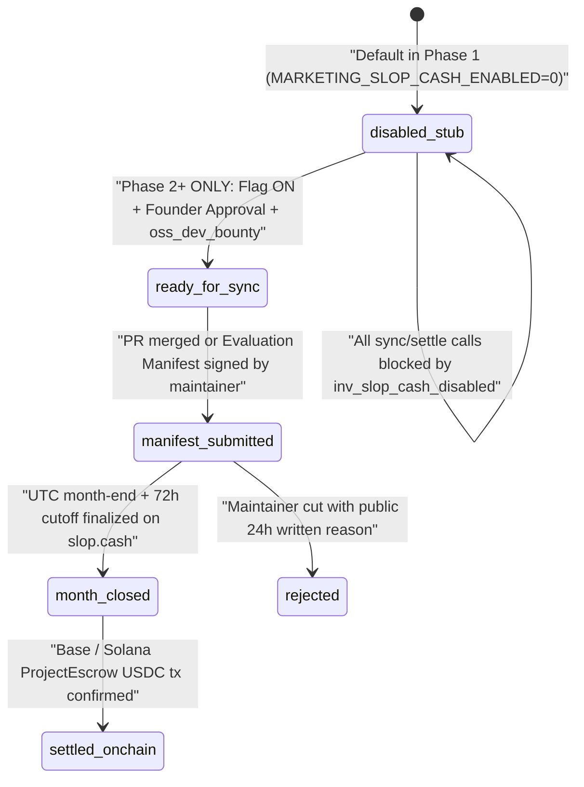

# `slop.cash` Future Integration Specification

- **Current Status:** **RESEARCHED & DESIGNED — STRICTLY DISABLED IN CODE (`MARKETING_SLOP_CASH_ENABLED=0`)**
- **Enforcing Invariant:** `inv_slop_cash_disabled` in `spec/models/marketing_campaign.md` and `spec/marketingPolicy.md` (`packages/core/src/generated/marketingPolicy.ts`)
- **Scope:** Defines the exact future technical, economic, and legal integration contract between `apps/marketing` (`@thenetwork/marketing`) and `slop.cash` once approved by the founder in a later phase.

> [!IMPORTANT]
> **Do NOT enable `slop.cash` settlement in Phase 1.** By founder direction, `apps/marketing` ships only the `marketing.slop_cash_hooks` schema table and a disabled `SlopCashBridge` stub (`apps/marketing/src/slop-cash-bridge.ts`). Every call to settle a marketing task via `slop_cash` fails closed with `SlopCashDisabledError` (`SLOP_CASH_DISABLED`) until explicit written founder sign-off and formal-model update.

---

## 1. Executive Summary

`eliza-research/thenetwork` is already a registered `slop.cash` bounty repository (`1,000 USDC/month` pool, noted in [AGENTS.md](../../AGENTS.md)). `slop.cash` provides mainnet escrow vaults, outcome-based points scoring, anti-spam refundable deposits, and an automated `$SLOP` buyback-and-burn fee mechanism.

However, `apps/marketing` intentionally **separates** two very different classes of contributors:
1. **NYC Street Teams, Flier Distributors, Event Activators, Agencies & US Social Creators (Tier 4 Consumer/IRL Growth):** Paid **strictly in USD fiat** from corporate treasury (`Stripe Connect Express` or `Tremendous`)—**never** routed through `slop.cash`, never requiring GitHub accounts or wallets, and never using `$SLOP` token payouts or upfront cash buy-in deposits.
2. **Open-Source Software, MCP Connectors, `SKILL.md` Integrations, Scrapers & Dev-Agent Growth Tooling (Future Phase `slop.cash` Track):** Eligible to route through `slop.cash` `ProjectEscrow` vaults on **Base** or **Solana** (USDC) once `MARKETING_SLOP_CASH_ENABLED=1` is approved.

This specification documents how `slop.cash` works today, why the legal/UX boundary is mandatory, and the exact schema, TypeScript stub interface, and activation checklist for Phase 2+.

---

## 2. Ground-Truth `slop.cash` Architecture (Verified From Codebase)

Based on direct inspection of the `slop.cash` codebase and deployed mainnet contracts (November 2026):

| Subsystem | Verified `slop.cash` Implementation | Integration Implication for `apps/marketing` |
| :--- | :--- | :--- |
| **Core Principle** | *"Score accepted outcomes, not commits, comments, token use, or test counts."* Supports both humans and AI coding agents with model/client attribution. | Matches our proof-first philosophy: never pay for activity volume; pay only for verified merged/accepted outcomes. |
| **Identity & Auth** | **GitHub OAuth only** (permanent numeric `github_id`). Destination EVM/Solana wallets bind via dual proof (GitHub session + wallet signature) attested by `Identity Attester`. | Ideal for open-source developers and coding agents; fatal UX friction for non-technical NYC street workers and TikTok/YouTube creators. |
| **Active Mainnet Chains & Assets** | **Base** (USDC), **Solana** (USDC/SOL/SPL), **Robinhood Chain (chain 4663)** (Paxos `USDG` `0x5fc5360D0400a0Fd4f2af552ADD042D716F1d168` and `$SLOP` `0xfeb4e36fa4a2a494ff25ae4a63491e4c584a67ae`). | Future `apps/marketing` hook defaults to **Base USDC** (`vault_chain = 'base'`) or **Solana USDC** (`vault_chain = 'solana'`). |
| **Escrow Vaults** | `EscrowFactory` + `ProjectEscrow` (ERC-1967 UUPS proxies on EVM + Solana vault program). Supports pre-funded monthly UTC pools, optional 1-12 month immutable on-chain `pledges`, and zero-expiry reserved awards for walletless winners. | Cleanly caps monthly dev-bounty spend with zero unbounded overrun risk. |
| **Anti-Spam Bonds** | `SubmissionDeposits` (non-upgradeable, live on Base and Chain 4663 `0xDe40B32A4156ABC2A05987367966d994BcFbf8D8`): `$1-$10` USDC/USDG (default `$2`) or 50%-off `$SLOP` refundable deposit per outside PR, plus `$10 $SLOP` Standing Deposits (`0x446604d5c3Cc99c60CCE3d5C4357BC60f5b45993`). Refunded on merge or 14d timeout; kept/burned on rejected spam. Maintainer receives `$0` from kept bonds. | Effective anti-spam defense for open-source PRs and dev agents, **must NOT be used on US consumer referral/street-team tracks** (avoids pay-to-play / anti-pyramid / MSB triggers). |
| **Scoring & Monthly Close** | Discrete size bands: `Micro (10)`, `Small (30)`, `Medium (90)`, `Large (240)`, `XL (450)`, `Exceptional (750)`; review bands `10..240`. UTC monthly close + 72h cutoff; `0-30%` maintainer share; pro-rata largest-remainder integer math. Public cut notices require written reason + 24h notice. | Supports both automated GitHub PR scoring and **PRD §7 Reviewed Evaluation Manifests** for approved non-PR developer/agent deliverables. |
| **Protocol Fee & `$SLOP` Flywheel** | `2%` ordinary payout/withdrawal fee (`ceil(gross / 50)`); `25%` private security split. `50%` of stablecoin fee revenue bridges via `deBridge DLN` -> swaps via `KyberSwap` into `$SLOP` on Chain 4663 -> `50%` burned to `0x..dEaD` (`1%` of ordinary payout buys `$SLOP`, `0.5%` burns). | Routing open-source and dev-agent growth tooling through `slop.cash` supports the `$SLOP` buyback/burn flywheel at a clean `2%` fee without paying `$SLOP` directly to US consumers. |
| **Referral Distributor** | `ReferralDistributor` Merkle contract on Chain 4663 (`0x6A24E993E59cbA950C6F91A964BEF2A5F91227CC`), funded with `2,000,000 $SLOP` (currently `dry_run`), accruing `3 $SLOP` per `1 USDC` of finalized gross project payout. | Useful technical reference for Merkle batching; never used for US consumer marketing payouts. |
| **Current Build Phase** | Undergoing a strict specification-first **Vibestack** rebuild (Quint models + Dafny proofs + acceptance locks). | Another reason to keep `slop.cash` decoupled behind a disabled stub today so `apps/marketing` ships immediately without waiting on upstream schema churn. |

---

## 3. Mandatory Legal & UX Segregation Matrix

Every payout path in The Network follows a three-way wall:

| Track / Contributor Type | Settlement Rail | Currency | Upfront Bond? | Why This Boundary Is Mandatory |
| :--- | :--- | :--- | :---: | :--- |
| **1. NYC Street Teams, Flierers, Event Activators, Agencies & US Creators** | **Direct Corporate Treasury Push** (`Stripe Connect Express` / `Tremendous`) inside `apps/marketing` | **USD Fiat** | **NO (`$0` buy-in)** | 1. **Zero UX friction:** Non-technical NYC workers and YouTubers do not use GitHub or EVM wallets.<br>2. **Securities & tax safety:** Avoids *Howey*/*Tomahawk* token-distribution risk and IRS crypto FMV tracking on consumer pay.<br>3. **NYLL § 191-d & FinCEN safety:** Direct two-party principal settlement (`FIN-2019-G001`), clean `<= 15d` NY-FIFA payout SLA, automated `$500/yr` W-9/1099-NEC gate, and zero pay-to-play deposit risk. |
| **2. Open-Source Code, MCP Connectors, `SKILL.md` Skills, Scrapers & Dev-Agent Tooling** *(Future Phase)* | **`slop.cash` `ProjectEscrow`** (connected via `SlopCashBridge` when enabled) | **Base USDC / Solana USDC** | **Optional (`$2` refundable `SubmissionDeposits`)** | 1. **GitHub-native contributors & AI coding agents** already work via PRs and wallets.<br>2. **Anti-slop spam control** prevents AI coding agents from flooding repos.<br>3. **Protocol alignment:** Feeds the `2%` fee / `$SLOP` buyback-and-burn loop cleanly on software outcomes. |
| **3. Internal Member Goodwill (`packages/capital`)** | **None (Non-Transferable Internal Ledger)** | **Zero Cash (`$0.00`)** | **NO** | Enforces the **2026-11-23 founder wall**: internal Network Capital governs vouch capacity and organizing reach only and never converts to cash, USDC, or `$SLOP`. |

---

## 4. Tight Data & State Mapping (`apps/marketing` <-> `slop.cash`)

When enabled in a future phase, `apps/marketing` maps **only** tasks with `task_kind = 'oss_dev_bounty'` and `payout_rail = 'slop_cash'` to `slop.cash`:

### 4.1 Entity Mapping Table

| `apps/marketing` Entity | `slop.cash` Counterpart | Mapping & Synchronization Contract |
| :--- | :--- | :--- |
| `marketing.campaigns` (`slop_cash_enabled = true`) | `slop.cash` Project Monthly Vault (`ProjectEscrow`) | Maps `campaign.id` -> `{ repo_slug: "eliza-research/thenetwork", vault_chain: "base" | "solana", month_utc: "YYYY-MM", cap_usdc_cents }`. Campaign budget checks mirror vault headroom. |
| `marketing.tasks` (`task_kind = 'oss_dev_bounty'`, `payout_rail = 'slop_cash'`) | GitHub `slop-wanted` Issue OR PRD §7 Evaluation Manifest Item | Stores `issue_number` and `estimated_usdc_cents` in `marketing.slop_cash_hooks`. Strict DB `CHECK` rejects consumer tasks (`street_fliering`, `creator_video`, `event_activation`, `agency_booking`) from ever setting `payout_rail = 'slop_cash'`. |
| `marketing.proofs` (`proof_kind = 'oss_pr_merge'`) | `slop.cash` Points Journal Entry / Reviewed Evaluation Manifest | Requires merged commit SHA, GitHub PR URL, green CI/formal check receipt, and maintainer approval before transitioning `proof_verified = true`. |
| `marketing.slop_cash_hooks` | On-Chain Settlement Event (`ProjectEscrow` payout tx) | Tracks hook lifecycle from `disabled_stub` -> `ready_for_sync` -> `manifest_submitted` -> `month_closed` -> `settled_onchain` (storing `external_tx_hash` on Base or Solana). |
| `marketing.budget_ledger` | Monthly Vault Close Reconciliation | Records gross USDC allocation (including `2%` `slop.cash` fee) under `adapter_id = 'slop_cash'` with deterministic `idempotency_key = slopcash:<month>:<taskId>`. |

### 4.2 Future Hook Lifecycle State Machine



---

## 5. Exact Disabled Stub Interface & Feature-Flag Gate

In Phase 1, `apps/marketing/src/slop-cash-bridge.ts` compiles cleanly as a strict **disabled stub** backed by `packages/core/src/generated/marketingPolicy.ts` and `spec/models/marketing_campaign.md`:

```ts
export type SlopCashVaultChain = "base" | "solana" | "robinhood_4663";

export type SlopCashHookState =
  | "disabled_stub"
  | "ready_for_sync"
  | "manifest_submitted"
  | "month_closed"
  | "settled_onchain"
  | "rejected";

export interface SlopCashHook {
  id: string;
  taskId: string;
  repoSlug: string;
  issueNumber: number | null;
  vaultChain: SlopCashVaultChain;
  estimatedUsdcCents: number;
  hookState: SlopCashHookState;
  externalTxHash: string | null;
  createdAt: string;
}

export class SlopCashDisabledError extends Error {
  readonly code = "SLOP_CASH_DISABLED" as const;
}
```

### 5.1 Three-Layer Feature-Flag Lock (All Three Must Agree)

1. **Environment Flag:** `MARKETING_SLOP_CASH_ENABLED` defaults to `"0"` (`false`). Any unset or non-`"1"` value keeps the bridge locked off.
2. **Database Campaign & Hook Fence:** `marketing.campaigns.slop_cash_enabled` defaults to `false`, and `marketing.slop_cash_hooks` enforces `CHECK (enabled = true OR hook_state = 'disabled_stub')`.
3. **Vibestack & Quint Formal Guard (`inv_slop_cash_disabled`):**
   - `spec/marketingPolicy.md` (published to `packages/core/src/generated/marketingPolicy.ts`) proves `lawSlopCashBlockedWhenDisabled` (`useSlopCash && !slopCashEnabled => !canAuthorizeSpend(...)`).
   - `spec/models/marketing_campaign.md` includes `inv_slop_cash_disabled` inside `val safety`, mathematically proving that no reachable execution trace settles any task via `slop_cash` while `slopCashEnabled == false`.

---

## 6. Future Activation Checklist (Phase 2+ Prerequisites)

Do **not** flip `MARKETING_SLOP_CASH_ENABLED=1` or implement live RPC/manifest writes until all seven gates are complete:

1. **Written Founder Approval:** Explicit sign-off specifying the monthly USDC cap and confirming scope stays restricted to `oss_dev_bounty` tasks (`eliza-research/thenetwork` code, MCP connectors, `SKILL.md` skills, and dev-agent tooling).
2. **Upstream `slop.cash` Contract Freeze:** Confirm the `slop.cash` Vibestack rebuild exposes a stable API or signed evaluation-manifest schema for external project sync.
3. **Strict Task-Kind Wall:** Keep the database `CHECK` constraint (`payout_rail <> 'slop_cash' OR task_kind = 'oss_dev_bounty'`) and Vibestack guard preventing `street_fliering`, `event_activation`, `creator_video`, and `agency_booking` tasks from ever using `payout_rail = 'slop_cash'`.
4. **Vault Funding & Fee Accounting:** Fund the `eliza-research/thenetwork` `ProjectEscrow` vault on Base or Solana and reconcile the `2%` protocol fee inside `marketing.budget_ledger`.
5. **Formal Model Update:** Update `spec/models/marketing_campaign.md` and `spec/marketingPolicy.md` to model the enabled state transitions (`manifest_submitted -> month_closed -> settled_onchain`), then run `pnpm run spec:sync`, `pnpm run spec:check-generated`, `pnpm run quint:check marketing_campaign`, and `pnpm run check`.
6. **Dry-Run & Testnet Verification:** Run Vitest + Postgres integration tests (`pnpm run test:integration`) against a dry-run/testnet manifest submission verifying idempotency, 72h cutoff handling, and zero double payouts.
7. **Security Audit of Signing Keys:** Ensure `apps/marketing` never holds private vault-withdrawal or `Identity Attester` keys; it may only submit advisory manifests or read public settlement receipts.
