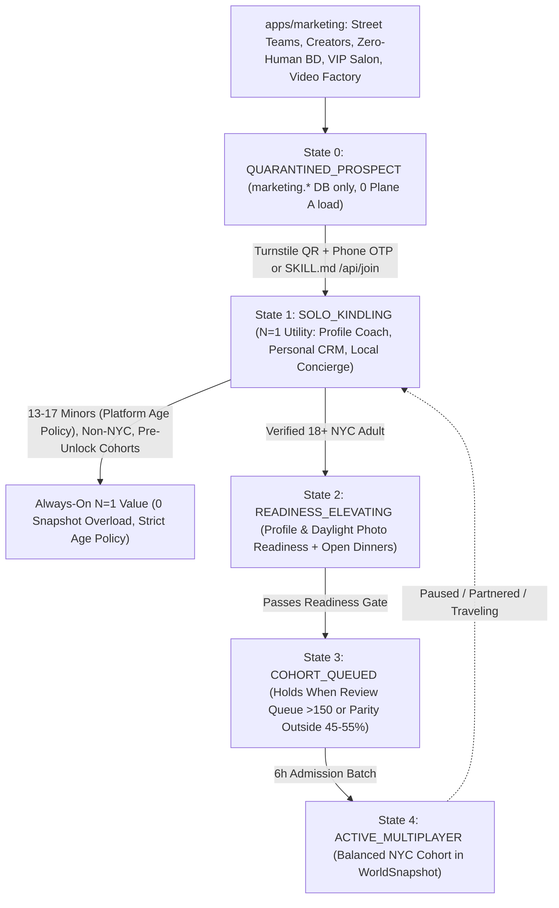

# The Network Global City-by-City Growth, Street-Team, Creator & Automated Marketing Strategy

- **Scope:** City-by-city global autonomous acquisition and Business Development (BD) strategy launching in New York City (`nyc`) first across all four core apps (`slop.date`, `ntwrk.party`, `peon.biz`, `friends.help`) and `eliza.app`, powered by declarative `CityPack` configs (`nyc`, `sf`, `la`, `chicago`, `miami`, `austin`, `london`, plus runtime `registerCityPack()`) and the Universal `DesireLane` taxonomy (`money_work`, `ideal_friends`, `soulmate_dating`, `elite_serendipity`, plus 8 extensible life-desire lanes).
- **Operating Principle:** Put in a credit card and it runs — safely. All hiring, vendor outreach, creator sourcing, proof verification, contextual bandit rebalancing, anti-fraud vetting, BD contracting, VIP outreach, short-form video scripting, and payout release execute automatically inside `apps/marketing` with zero internal street labor, bounded by Dafny-proved spend/LLM/contact-hygiene caps, core platform backpressure (`queuePressurePaused`), and offline simulation gates (`pnpm run sim --only marketing`).
- **Companion Documents:** [README.md](README.md) · [CITY-LAUNCH-PLAYBOOK.md](CITY-LAUNCH-PLAYBOOK.md) · [PRD.md](PRD.md) · [NYC-STREET-TEAMS-AND-AGENCIES.md](NYC-STREET-TEAMS-AND-AGENCIES.md) · [SLOP-CASH-INTEGRATION.md](SLOP-CASH-INTEGRATION.md)

---

## 1. Executive Thesis & The NYC-First Playbook

### 1.1 Why Legacy Growth Playbooks Fail in 2026

Three structural shifts make conventional ad-driven consumer growth unprofitable:

1. **Paid social auctions destroy consumer unit economics.** Consumer dating and social cost-per-install rates exceed `$4.50–$7.00` (`$40–$100+` per retained adult), and zero enduring local social networks built their initial city density from paid ad feeds.
2. **Low-effort digital spam fails on quality and compliance.** Pay-per-reply social farming is banned by platform policies, fake profiles and dating-app bots trigger instant device bans and FTC impersonation liability (`16 CFR Part 461`), and cold SMS blasts trigger statutory TCPA penalties (`$500–$1,500` per message).
3. **Single-vertical paid connectors suffer from paywall friction and voice fatigue.** Charging `$100/month` attracts sellers instead of peers, while mandatory 15-minute phone calls create high drop-off in public settings.

**Our Counter-Position:**
- **100% free consumer membership across four compounding apps** (`slop.date`, `friends.help`, `peon.biz`, `ntwrk.party`) on one verified `platform.people` graph, funded later by self-liquidating event anti-flake deposits (`$15–$25`) and post-unlock `peon.biz` employer placement fees.
- **Zero-download dual onboarding doors:** Every flier, creator video, venue coaster, and outreach email routes to either (a) the agent-first prompt (`Read https://<domain>/SKILL.md and follow it to sign me up for <app>.` in ChatGPT, Claude, Gemini, Grok, Perplexity, Cursor, OpenClaw, or Hermes) or (b) the shared Blooio iMessage/SMS line (`join slop`, `join peon`, `join friends`, `join network`) protected by a Cloudflare Turnstile short link (`go.<brand>`).
- **Real humans in NYC + verifiable video proof + autonomous software orchestration:** Instead of buying expensive ads or gimmicky hardware, we deploy a `$10,000` Month-1 NYC budget into crowdsourced street teams, hand-to-hand fliering, charismatic event activators, and YouTuber/TikTok/IG street-interview creators—100% hired, verified, dynamically rebalanced by a Contextual Bandit, and paid automatically by `apps/marketing`.

### 1.2 Solving the Growth-vs-Capacity Paradox (5-State Admission Funnel)

The Network's v1 matching engine (`loadSnapshot()` in `packages/network/service/snapshot.ts`) and mandatory automated/staff match review (`spec/automatedReview.md`) support a curated active pool of roughly `2,500` adults per city until v2 sharded matching ships. In addition, `slop.date` launches live in NYC first, `ntwrk.party` stays invite-only on the web, and `peon.biz` and `friends.help` ramp in controlled cohorts.

To let marketing acquire `10,000+` prospects without overloading matching or review capacity, every prospect enters a **5-State Admission Funnel**:

This separation lets street teams, creators, and viral tools run continuously while protecting match quality, 45%–55% reciprocal parity, and review SLAs.

### 1.3 Stacked Multi-Loop Viral Compounding (`K_total >= 1.15`)

No single channel must reach `K > 1.0` alone. Four compounding loops stack on top of our paid NYC street-team and creator seed:

1. **Ticket-Funded Dinners + T-24h Eliza Venue Reveal (`K_1 = 0.56`):** Guests pay a `$15–$25` anti-flake deposit on Luma/Partiful and onboard via Eliza to unlock the secret NYC venue 24 hours prior (net negative CAC).
2. **Double-Opt-In Open-Web & Date-Me-Doc Introductions (`K_2 = 0.30`):** Transparent agent pitches to public GitHub/arXiv/HN builders and Date-Me-Doc authors convert on direct relevance.
3. **Nominate-a-Friend Vouch Cards (`K_3 = 0.27`):** Coupled and well-connected friends send an ego-flattering green-flag card to their best single friend, driving balanced female hard-side intake lawfully.
4. **Street-Interview Videos, 5-Agent Comedy Shorts & `SKILL.md` Transcript Flex (`K_4 = 0.15`):** On-camera onboarding clips, persona comedy shorts, and screenshots of a person's own ChatGPT/Claude drafting their dating or work profile create organic secondary sharing.

---

## 2. Canonical 5-Agent Brand Fleet (Subscription-Connected)

`apps/marketing` coordinates five openly AI-branded agents defined canonically in `apps/marketing/src/constants.ts`. Each agent connects through **ChatGPT, Claude, Gemini, or Surplus user subscriptions** (via CLI with sanitized non-secret env, MCP, OAuth, API, or supervised local browser sessions) managed by a single lifecycle coordinator with daily turn caps, cooldowns, and non-bouncing provider failover.

| Persona | App & Surface | Primary -> Failover | Voice & Visual Identity | Owned Growth Loops | Hard Safety Rules |
| :--- | :--- | :--- | :--- | :--- | :--- |
| **Chadwick** | `slop.date` (`soulmate_dating`) | `chatgpt` -> `claude` | Acid Chartreuse `#dcf24a` on `#141414`; blunt anti-swipe wingman | City launches, street-interview briefs, singles-bar activations, `nycmarketcap.lol`, dating-app comedy shorts | Never reveals Clef scores; 18+ only for hiring/dating; mandatory AI disclosure |
| **Sloane** | `slop.date` | `claude` -> `chatgpt` | Acid Chartreuse `#dcf24a` on stark B&W; sharp LES bestie | Female-audience creator briefs, Nominate-a-Friend cards, forensic red-flag video shorts, Sunday dinner curation | 100% gender-neutral pricing/bounties; zero facial-geometry scans |
| **Peon** | `peon.biz` | `gemini` -> `claude` | Safety Orange `#f59a3c`; deadpan anti-LinkedIn fixer | GitHub/arXiv/Form-D/HN builder outreach, VC portfolio pacts, Ghost-Job video parodies, MCP/ClawHub registries | Strict `slop` != `peon` data air-gap (zero dating/Clef signal access) |
| **Venn** | `friends.help` | `claude` -> `gemini` | Forest & bright green Venn rings; energetic NYC social director | Ticket-funded neighborhood dinners, Luma host `afterparty` matching, 3+3 clique videos, run-club & newcomer intercepts | `ROMANCE_FRAMING` filter active; public commercial venues only |
| **The Operator / Eliza** | `ntwrk.party` + `eliza.app` | `chatgpt` -> `claude` | Pure monochrome Host Grotesk; calm high-trust concierge | 18-archetype VIP salon outreach (`< 75` words), conference Side-Event Survival Maps, applicant screening, NYLL § 191-d contracting & agency RFPs | Zero cash vouch bounties; invite scarcity managed via `packages/capital` |

---

## 3. `$10,000` Month-1 NYC Street-Team, Fliering, Event Activation & Creator Video Strategy

Month 1 focuses **100% on New York City** (Manhattan below 96th St and core Brooklyn neighborhoods: SoHo, West Village, East Village, Lower East Side, Williamsburg, Greenpoint, Cobble Hill, Union Square, Washington Square Park, Bryant Park).

### 3.1 Core Design Principles

1. **Zero gimmicky hardware:** Street operations use real humans, crisp printed fliers with unique batch QR codes, high-energy in-person conversation, and authentic social video—converting better, costing less, and avoiding hardware maintenance failures.
2. **Zero internal human labor:** `apps/marketing` automatically posts Craigslist NYC gigs, dispatches RentAHuman tasks (`create_bounty`), emails vetted NYC street-team agencies and street-interview creators, screens applicants over email (`>= 75` auto-hire, `>= 50` standby bench), issues clickwrap NYLL § 191-d contractor agreements, verifies proof of work, enforces anti-fraud vesting, and triggers fiat payouts via Stripe Connect or Tremendous.
3. **Proof-first execution:** Every dollar paid to an external human requires auditable proof (`inv_proof_required_before_payout`): unique per-worker/per-shift QR batch tracking, timestamped start/mid/end location check-in photos, live public `https://` video links with verified FTC disclosure, NY Civil Rights Law §§ 50–51 commercial likeness releases, and minimum unique QR scans or verified onboarding completions for bonuses.

### 3.2 Reconciled `$10,000` Month-1 NYC Budget Allocation

All figures reconcile dollar-for-dollar with the vendor dossier in [NYC-STREET-TEAMS-AND-AGENCIES.md](NYC-STREET-TEAMS-AND-AGENCIES.md) and the canonical seed in `apps/marketing/src/nyc-seed.ts`:

| Allocation Bucket | Sourcing Channel (Automated) | Month-1 Budget | Concrete Volume & Unit Basis | Target Proof & Outcomes |
| :--- | :--- | ---: | :--- | :--- |
| **1. Street-Team Fliering & On-Street Onboarding** | Craigslist NYC (`evg`/`lbg`/`tlg` gigs @ `$10/post`) + RentAHuman.ai MCP | **`$3,200`** | 9 CL posts (`$90`) + 25 × 4-hr shifts @ `$22/hr` (`$2,200`) + `$2/signup` bonus pool (`$320`) + RentAHuman couriers & spot drops (`$590` incl. 18% fee) | `18,000` direct fliers (`21,500` total incl. agency reserve); `2,200` live conversations; `450` target verified 18+ NYC signups (`$7.11` CPA) |
| **2. YouTuber, TikTok & IG Street-Interview Creators** | YouTube RSS/public feeds, Collabstr, Passionfroot, Backstage, NYU/Columbia/Parsons/SVA film students | **`$3,300`** | Casting (`$100`) + 8 micro-creators @ `$250` (`$2,000`) + 1 mid-tier NYC vox-pop anchor (`$750`) + `$2.50` verified-signup bonus pool (`$450`) | `27` social videos (9 main vox-pop interviews + 18 vertical cutdowns); `180k–420k` local views; `435` target verified 18+ NYC signups (`$7.59` CPA) |
| **3. In-Person Event & Venue Activators** | Craigslist NYC, Trusted Herd, Backstage, RentAHuman.ai, Luma co-host recruiting | **`$1,700`** | 14 curated NYC events × 3-hr shifts @ `$30/hr` (`$1,260`) + entry/drink stipends (`$240`) + quality onboarding bonus pool (`$200`) | `420` high-trust conversations; `190` target verified 18+ NYC signups (`$8.95` CPA) |
| **4. Serialized Flier Printing, QR Batching & NYC Rush Print** | 4over4 (Astoria), Printleaf (Midtown), Bestype (SoHo) + GotPrint/MOO + Dub.co unique batch QRs | **`$800`** | `25,000` serialized 4×6" 14pt postcards across 5 QR batches (`$550`) + NYC same-day rush print reserve (`$200`) + rigid laminated QR hand-cards (`$50`) | Unique QR attribution per shift, per creator, and per partner venue; zero raw Blooio phone numbers printed |
| **5. W-2 Agency Surge Reserve** | 15 vetted NYC street-team agencies (Oppizi, Kinetic Events, Street Teams Co, Broadway Crew, Victory, PUSH, Mustard Lane, etc.) | **`$1,000`** | Held unspent until Day 15; books 1 × 4-person × 4-hr W-2 weekend blitz if direct no-show >15%, else reallocates in Week 4 via Contextual Bandit to lowest-CPA track | `3,000` backup fliers; `90` target verified 18+ NYC signups (`$11.11` CPA) |
| **TOTAL MONTH-1 NYC BUDGET** | **100% Automated via `apps/marketing`** | **`$10,000`** | **Hard-enforced in `spec/marketingPolicy.md` (`monthlyCapCents = 1_000_000`, `dailyCapCents = 100_000`, `maxTaskCents = 150_000`)** | **`21,500` fliers, `~3,060` live convos, `27` creator proof videos, `920–1,410` verified 18+ NYC joins (`$8.58` target CPA at `1,165` joins)** |

### 3.3 Dynamic Capital Allocation: Contextual Thompson-Sampling Bandit (`bandit.ts`)

Instead of static Month-1 track budgets, `apps/marketing/src/bandit.ts` runs deterministic seeded Thompson Sampling across all five NYC tracks (persisted in `marketing.bandit_arms`):
- **Deterministic seeded Beta sampling** reallocates weekly spend toward arms delivering the lowest verified 18+ CPA.
- **Proved auto-kill bounds (`spec/marketingPolicy.md`, `banditArmEligible`, `lawBanditKillsHighCpaOrStopRate`):** Any arm whose observed CPA exceeds `2.5x` target (`$21.25` = `2,125c`) OR whose STOP rate exceeds `5%` (`banditMaxStopRateBps = 500`) is automatically marked `killed` and receives `0%` future allocation.

### 3.4 Proof-First Street-Interview & 5-Agent Short-Form Video Factory (`video-factory.ts`)

Video serves two compounding jobs:
1. **External Street-Interview Creators (Track 2):** Vox-pop shoots in Washington Square Park, SoHo, Williamsburg, and East Village deliver 1 main video (60–90s), 2 vertical cutdowns (20–35s), raw B-roll, pinned `go.<brand>` QR/link, mandatory FTC `#Ad` + spoken disclosure, and signed NY Civil Rights Law §§ 50–51 commercial likeness releases (`canApproveCreatorProof`).
2. **In-House 5-Agent Short-Form Video Factory (`apps/marketing/src/video-factory.ts`):** Maintains 5 brand-isolated persona video bibles and **10 ready-to-film starter comedy scripts** (`STARTER_COMEDY_SCRIPTS`, seeded into `marketing.video_assets`), an automated pre-render safety linter (rejecting minor depictions, PII leaks, missing `#Ad` on sponsored clips, romance framing for Venn, and cross-app domain bleed), and a 72-hour retention scorer (`scale` / `hold` / `kill_rewrite`).

### 3.5 NYC Street Law & Contractor Compliance (Enforced in Code)

Every street shift and creator brief automatically embeds and checks these rules via `apps/marketing/src/cities.ts` and `crowdsourcing.ts`:
- **Legal hand-to-hand sidewalk distribution only:** First Amendment protected on public sidewalks when maintaining at least half the sidewalk width (minimum 8 feet clear). Zero taping, stapling, pasting, or placing fliers on lamp posts, utility poles, trees, mailboxes, parked cars, or street furniture (`NYC Admin Code § 10-119`, `18 U.S.C. § 1725`).
- **MTA subways, NYC Parks, and private venues:** Commercial fliers are strictly banned inside MTA subway stations, platforms, and mezzanines (`21 NYCRR § 1050.6`). Stay under NYC Parks permit thresholds (`56 RCNY § 1-05`: no tables, no amplified sound, small teams < 20 people).
- **NY Freelance Isn't Free Act (`NYLL § 191-d`):** Every hired worker receives a SHA-256-hashed written clickwrap agreement retained 6 years detailing scope, proof criteria, rate, and payout date (`<= 15 days` internal SLA, target `48 hours` after verified proof).
- **18+ strict age floor (`inv_adult_only_paid`):** Applicants must confirm age 18+ before contracting; hiring and payouts fail closed if `minAgeReading(...) < 18` or unknown.
- **Commercial filming releases (`NY Civil Rights Law §§ 50–51`):** Brand-sponsored street interviews require prior written consent via our 10-second mobile release form for every recognizable interviewee (`likenessReleaseOk` proved in `spec/marketingPolicy.md`).

---

## 4. 3-Zone Risk Dial, Autopilot Circuit Breakers & Anti-Fraud Vesting

### 4.1 Three-Zone Blast-Radius Compartmentalization

### 4.2 The Four `RiskDial` Modes & Continuous Autopilot Daemon (`daemon.ts`)

The Marketing Command Center, CLI, and `MarketingAutopilotDaemon` (`apps/marketing/src/daemon.ts`) enforce the four proved `RiskDial` modes (`spec/models/marketing_campaign.md` and `spec/marketingPolicy.md`):

| `RiskDial` Mode | Allowed Operations | Automatic Trigger / Use Case |
| :--- | :--- | :--- |
| **`conservative`** | Tier 1 dry-run & discovery; Tier 2 passive warm-up; human review before Tier 3/4 dispatch. | Default boot state and Week 1 warm-up. |
| **`balanced`** | Tier 1–4 active inside monthly/daily spend caps; automated Craigslist/RentAHuman/creator hiring, Bandit rebalancing, and proof-gated fiat payouts. | Normal NYC Month-1 operating mode. |
| **`blitz`** | Full NYC weekend street surges, agency backup dispatch, and conference/event hijacks within hard budget ceilings. | Peak NYC tentpole weeks (Tech Week, Marathon, sunny holiday weekends). |
| **`lockdown`** | **Immediate hard stop** on all Tier 3 paid APIs, Tier 4 human dispatches, agent turns, and device actions (`inv_tier_billing_gate`); preserves Zone 1 member conversations untouched. | Auto-trips in `MarketingAutopilotDaemon` when campaign STOP rate exceeds `5%` (`500 bps`), sets `billingArmed = false`, or 1-click operator trigger. |

The Autopilot Daemon runs a non-overlapping `setTimeout` + mutex loop on the injected `Clock`, performing automatic UTC midnight counter resets (`store.resetDailyCounters()`), expired device lease sweeps (`store.sweepExpiredDeviceLeases()`), STOP-spike lockdown trips, deterministic Bandit rebalancing, and live SSE broadcasts to the Command Center.

### 4.3 Anti-Fraud 4-Tier Vesting & Sybil Defense (`antifraud.ts`)

Every consumer referral bonus and contractor payout claim passes `apps/marketing/src/antifraud.ts` backed by proved `antiFraudPayoutAllowed` (`spec/marketingPolicy.md`) and `inv_antifraud_caps_respected` (`spec/models/marketing_campaign.md`):
- **4-Tier Vesting Schedule:** `$0` instant cashout at T0/T1 signup -> Day-7/Day-14 active retention check at T2 -> Organic-Anchor verification + 48-hour hold at T3 (hard-bounded by `<= 15d` NY-FIFA payout SLA and `<= 14d` OP-Q adjudication SLA).
- **Carrier & Cap Walls (Dafny-Proved):**
  - **VoIP lines (`isVoip`):** Permanently blocked (`$0` payout, `lawVoipNeverPaid`).
  - **Prepaid / MVNO lines (`isPrepaidOrMvno`):** Hard-capped at **`$2.00`** (`mvnoBonusCapCents = 200`, `lawMvnoBonusCappedAt200`).
  - **Lifetime Consumer Cap:** Hard-capped at **`$20.00`** cumulative per person across consumer tiers `< 4` (`consumerLifetimeBonusCapCents = 2000`, `lawConsumerLifetimeCapNeverExceeded`).
  - **IRS W-9 Gate:** Cumulative annual worker payouts exceeding **`$500.00`** (`w9AnnualThresholdCents = 50000`) fail closed without a verified W-9 (`lawW9RequiredOver500Usd`).
- **Duplicate Media & Sybil Ring Quarantine (`lawDuplicateOrQuarantinedBlocked`):** SHA-256 media hashing rejects reused proof photos/videos (`store.hasMediaHash`), and connected-component cluster scanning (`detectSybilCluster`) automatically quarantines high-density referral rings.

### 4.4 The 12 Non-Negotiable Firewalls

1. **No public website portals (2026-10-19):** Zero login, settings, or campaign dashboards on the four landing sites.
2. **Zero-cash `packages/capital` wall (2026-11-23):** Internal Network Capital never pays cash, USDC, or tokens.
3. **18+ hire, event, filming, and payout floor (`inv_adult_only_paid`):** No person under 18 (or with unknown age) is ever hired, filmed for ads, or paid (`$0` payout). Youngest age reading always wins.
4. **Single-owner `STOP` fence (`inv_stop_fence_respected`):** Any `STOP` or opt-out blocks all outreach immediately across every agent and channel.
5. **No unsolicited cold SMS or AI robocalls (TCPA `47 U.S.C. § 227`):** Never print the raw Blooio phone number on public fliers; route all scans through `go.<brand>` Turnstile gates.
6. **Mandatory FTC disclosure (`16 CFR Parts 255, 461, 465`):** Creator video payouts require verified disclosure (`#Ad` / native toggle / spoken mention) and never condition pay on positive sentiment.
7. **100% gender- and age-neutral terms (`NYCHRL § 8-107`):** Zero demographic-based bounty multipliers or differential pricing.
8. **Zero facial-geometry embeddings (`IL BIPA / TX CUBI`):** Deduplicate media with non-biometric cryptographic/perceptual hashes only.
9. **Strict `slop` != `peon` air-gap:** Dating preferences and Clef appearance scores are unreadable by `peon.biz` and `apps/marketing`.
10. **Logged-off public web only & zero CAPTCHA bypass:** Discovery queries public unauthenticated data only; any CAPTCHA/2FA on Tier 2 phones immediately sets `needsTakeover = true` (`canDispatchDeviceStep`) and halts for human takeover.
11. **Direct two-party fiat payouts for US humans:** Street teams, activators, and US creators are paid directly in USD via Stripe Connect Express or Tremendous (with `$500/yr` W-9/1099-NEC gate), keeping `slop.cash` disabled for consumer tracks (`lawConsumerTaskNeverUsesSlopCash`).
12. **Hard spend & proof gates (`inv_budget_never_exceeded`, `inv_proof_required_before_payout`):** No payout releases without verified proof and likeness releases, and total authorized plus paid spend never exceeds the monthly campaign cap.

---

## 5. Zero-Human BD Engine, 18-Archetype VIP Salon & Organic Viral Arsenal

### 5.1 Zero-Human 8-Stage BD & Serialized QR Batch Engine (`bd-engine.ts`)

`apps/marketing/src/bd-engine.ts` automates partner venue, cafe, supper-club, and event-host deals across six verticals using an 8-stage finite state machine (`prospect -> enriched -> pitched -> negotiating -> contracted -> kit_shipped -> live -> audited`, plus `closed_lost`), backed by `marketing.bd_deals` and `marketing.qr_batches`:
- **Proved Deal Bounds (`bdDealWithinBounds`, `lawBdDealRequiresBoundsCallbackAndContract`):** No deal progresses to `contracted` or `kit_shipped` unless `offeredCents <= maxVenueCents`, a deterministic DTMF business-phone callback challenge passes (`verifyDtmfPin`), and a SHA-256 6-year clickwrap contract is signed (`generateClickwrapContract`).
- **Serialized QR Batch Binding:** Every contracted partner receives a unique `batchCode` and Dub.co `PATCH` shortlink update (`buildQrBatchPlan`), verified on Day 14 via an automated RentAHuman mystery-shopper photo audit (`buildDay14MysteryAuditPayload`).

| Vertical | Lead Agent | Free Public Discovery Feed | Autonomous Offer & Fulfillment |
| :--- | :--- | :--- | :--- |
| **1. NYC Bars, Cafes, Gyms & Third Places** | `Venn` + `The Operator` | NYS SLA Liquor Licenses (`data.ny.gov`), NYC DOHMH Grade A (`data.cityofnewyork.us`), public venue hours | Guaranteed slow-Tuesday/Wednesday 8–12p table bookings (`$450–$800` guest-paid tab) in exchange for serialized QR coasters or tabletop cards. |
| **2. Event Organizers & Supper Clubs** | `Venn` | Unauthenticated Luma Discover, Eventbrite, Reddit local meetup feeds | Free post-event double-opt-in matching link for guests who missed meeting great people in the room; host gets anonymized attendance insights. |
| **3. Newsletters, Podcasts & 18+ Grad Clubs** | `Sloane`, `Chadwick`, `Peon` | Public Substack/Beehiiv directories, YouTube RSS feeds, NYC grad clubs | Weekly live anonymized NYC Personals / Startup Needs snippet + cross-school 18+ blind mixers. |
| **4. Employers, VCs & Layoff Networks** | `Peon` + `The Operator` | Public GitHub/arXiv/HN Algolia feeds, SEC EDGAR Form D (`data.sec.gov`), public ATS boards, NYS WARN filings | Free VC portfolio `peon.biz/SKILL.md` welcome kit + 6-hour Layoff Rescue Sprints; post-unlock `10%–15%` employer placement revenue funds consumer apps. |
| **5. AI Ecosystem, MCP & Skill Registries** | `Peon` | GitHub public assistant repos, Official MCP Registry, ClawHub, Glama, PulseMCP | Zero-cost verified `SKILL.md` and MCP directory listings across every major agent client. |
| **6. NYC Conferences & Tentpole Weeks** | `The Operator` + `Peon` | Public Luma/Eventbrite/X side-event lists (`T-21d` before NY Tech Week, AI Eng, Climate Week, NYFW) | Auto-published Side-Event Survival Map offering hosts a verified badge in exchange for guest matching + street activators outside badge pickup. |

### 5.2 18-Archetype `ntwrk.party` VIP Salon Engine (`vip-engine.ts`)

`apps/marketing/src/vip-engine.ts` curates high-trust `ntwrk.party` salon invitations across 18 distinct NYC archetypes (founders, frontier AI/bio researchers, Michelin/hospitality directors, film/design directors, institutional investors, journalists, musicians, architects, etc.) stored in `marketing.vip_prospects`:
- **Deterministic 0–100 Prestige Scoring:** Ranks public-web prospects (HN Show HN, GitHub, arXiv, DOHMH hospitality, Luma) without private scraping.
- **Strict `< 75`-Word Plain-Text Invite Gate (`buildAndValidateVipInvite`):** Rejects any draft over 75 words, any URL/HTML/Calendly link, spam-trigger words, or `LeakGuard` contact/canary violations; pairs complementary Table-Anchor seats and generates Day-3/Day-7 follow-ups.

### 5.3 High-Leverage Organic & Interactive Plays

All plays run with zero gimmicky hardware and feed directly into `SOLO_KINDLING` or active NYC cohorts:
- **Ticket-Funded `Eliza's Table` Dinners (`friends.help`, `slop.date`):** Weekly 8–12 seat licensed-venue NYC dinners (`$20–$25` anti-flake deposit, `>= 60%` graph-disjoint strangers, T-24h Eliza venue reveal) achieving negative CAC.
- **Nominate Your Single Friend (`slop.date`) & Bring 2 Friends (`friends.help`):** Shareable green-flag vouch cards and 3+3 clique seating (`K = 1.2–2.0`).
- **`SKILL.md` One-Prompt Transcript Flex & Stateless Zone 2/3 Micro-Toys:** `nycmarketcap.lol`, `roastmybio.party`, `tablemath.help`, and `startupcompat.com`.
- **Empirical Public-Data PR Studies & High-Intent Life-Transition Intercepts:** Public Date-Me Docs, pay-transparency ATS ranges, k-anonymous (`k >= 25`) neighborhood flake heatmaps, GitHub relocations, and `< 24h` Form D NYC seed founders.

---

## 6. City-by-City Global Expansion & Universal Desire Graph (`city-registry.ts`, `desire-lanes.ts`)

Once NYC proves repeatable unit economics (`>= 450` verified 18+ NYC adults in Month 1, direct CPA trending `<= $12`, `0` safety/minor/leak violations, `STOP < 3%`), `apps/marketing/src/city-registry.ts` and `city-launch-engine.ts` replicate the launch into any metro via declarative `CityPack` configs (7 built-in metros: `nyc`, `sf`, `la`, `chicago`, `miami`, `austin`, `london`, plus any new city registered via `registerCityPack()` or `marketing.city_packs` with zero code forks — see [CITY-LAUNCH-PLAYBOOK.md](CITY-LAUNCH-PLAYBOOK.md)):

1. **5-Stage Launch Readiness & Core Platform Sync (`evaluateCityStageReadiness`):** Cities progress through `researching -> waitlist_kindling -> liquidity_seeding -> live_matching -> scaling`. `platformActive` derives automatically from `packages/core/src/cities.ts`, and `NetworkCoreBridge` (`supply_demand_k5` + `queuePressurePaused`) pauses cold acquisition automatically if core review or outbound queues build backlog.
2. **Universal Desire & Experience Taxonomy (`desire-lanes.ts`):** Every campaign, discovery lead, BD partner, VIP prospect, bandit arm, video script, and attribution event tags a `DesireLane` — starting with the 4 launch pillars (`money_work`, `ideal_friends`, `soulmate_dating`, `elite_serendipity`) and expanding seamlessly into 8 life-desire lanes (`cofounder_venture`, `investors_patrons`, `mentorship_mastery`, `creative_collab`, `sport_wellness_crew`, `shared_living_home`, `travel_expedition`, `bespoke_irl_experience`) while preserving the `slop != peon` air-gap.
3. **Code-Enforced Local Legal Guardrails (`checkCityHiringCompliance`):**
   - **San Francisco (`sf`) & Los Angeles (`la`):** **CA AB5 W-2 hard gate** — blocks direct `1099_direct` hourly street-team hiring automatically; auto-routes starter tasks to `agency_booking` plus `CA Civ Code § 3344` commercial releases.
   - **London (`london`):** **UK EPA 1990 Schedule 3A hard gate** — blocks street fliering automatically unless a valid borough Free Printed Matter Distribution Licence reference (`boroughLicenceRef`) is provided and UK PAYE/agency compliance is met.
   - **Chicago (`chicago`), Miami (`miami`), Austin (`austin`):** Enforces IL Freelance Worker Protection Act & `765 ILCS 1075`, Miami Beach Ch. 46 commercial handbill restrictions & `FL Stat. § 540.08`, and Austin right-of-way rules.
4. **Uniform Formal Governance & Offline Simulation:** Every city inherits the exact same **27 Dafny-proved obligations** (`spec/marketingPolicy.md` + `spec/marketingDevice.md`), whole-flow Quint invariants (`spec/models/marketing_campaign.md`), cross-schema `contact_fence` + contact-hygiene cooldowns, LLM `PromptCache` + daily token/cost caps, and the offline 30-day deterministic simulator gate (`pnpm run sim --only marketing`).
