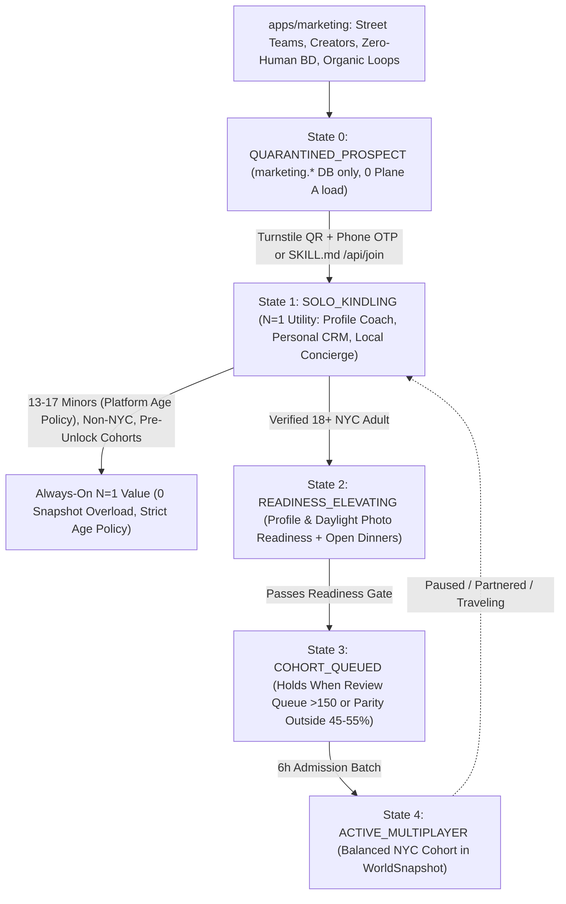
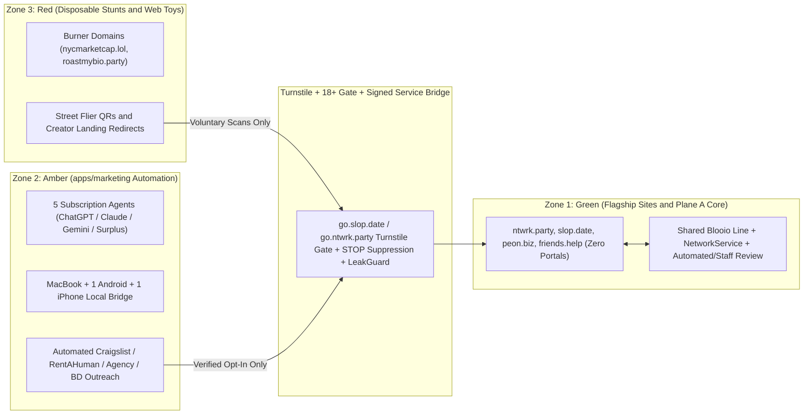

# The Network Growth, Street-Team, Creator & Automated Marketing Strategy

- **Scope:** NYC-first autonomous acquisition and Business Development (BD) strategy for `slop.date`, `ntwrk.party`, `peon.biz`, `friends.help`, and `eliza.app`, engineered to replicate across every supported metro (`nyc`, `sf`, `la`, `chicago`, `miami`, and future cities).
- **Operating Principle:** Put in a credit card and it runs. All hiring, vendor outreach, creator sourcing, proof verification, BD contracting, and payout release execute automatically inside `apps/marketing` with zero internal team street labor.
- **Companion Documents:** [README.md](README.md) · [PRD.md](PRD.md) · [NYC-STREET-TEAMS-AND-AGENCIES.md](NYC-STREET-TEAMS-AND-AGENCIES.md) · [SLOP-CASH-INTEGRATION.md](SLOP-CASH-INTEGRATION.md)

---

## 1. Executive Thesis & The NYC-First Playbook

### 1.1 Why Legacy Growth Playbooks Fail in 2026

Three structural shifts make conventional ad-driven consumer growth unprofitable:

1. **Paid social auctions destroy consumer unit economics.** Consumer dating and social cost-per-install rates exceed `$4.50-$7.00` (`$40-$100+` per retained adult), and zero enduring local social networks built their initial city density from paid ad feeds.
2. **Low-effort digital spam fails on quality and compliance.** Pay-per-reply social farming is banned by platform policies, fake profiles and dating-app bots trigger instant device bans and FTC impersonation liability (`16 CFR Part 461`), and cold SMS blasts trigger statutory TCPA penalties (`$500-$1,500` per message).
3. **Single-vertical paid connectors suffer from paywall friction and voice fatigue.** Charging `$100/month` attracts sellers instead of peers, while mandatory 15-minute phone calls create high drop-off in public settings.

**Our Counter-Position:**
- **100% free consumer membership across four compounding apps** (`slop.date`, `friends.help`, `peon.biz`, `ntwrk.party`) on one verified `platform.people` graph, funded later by self-liquidating event anti-flake deposits (`$15-$25`) and post-unlock `peon.biz` employer placement fees.
- **Zero-download dual onboarding doors:** Every flier, creator video, venue coaster, and outreach email routes to either (a) the agent-first prompt (`Read https://<domain>/SKILL.md and follow it to sign me up for <app>.` in ChatGPT, Claude, Gemini, Grok, Perplexity, Cursor, OpenClaw, or Hermes) or (b) the shared Blooio iMessage/SMS line (`join slop`, `join peon`, `join friends`, `join network`) protected by a Cloudflare Turnstile short link (`go.<brand>`).
- **Real humans in NYC + verifiable video proof + autonomous software orchestration:** Instead of buying expensive ads or gimmicky hardware, we deploy a `$10,000` Month-1 NYC budget into crowdsourced street teams, hand-to-hand fliering, charismatic event activators, and YouTuber/TikTok/IG street-interview creators—100% hired, verified, and paid automatically by `apps/marketing`.

### 1.2 Solving the Growth-vs-Capacity Paradox (5-State Admission Funnel)

The Network's v1 matching engine (`loadSnapshot()` in `packages/network/service/snapshot.ts`) and mandatory automated/staff match review (`spec/automatedReview.md`) support a curated active pool of roughly `2,500` adults per city until v2 sharded matching ships. In addition, `slop.date` launches live in NYC first, `ntwrk.party` stays invite-only on the web, and `peon.biz` and `friends.help` ramp in controlled cohorts.

To let marketing acquire `10,000+` prospects without overloading matching or review capacity, every prospect enters a **5-State Admission Funnel**:

This separation lets street teams, creators, and viral tools run continuously while protecting match quality, 45%-55% reciprocal parity, and review SLAs.

### 1.3 Stacked Multi-Loop Viral Compounding (`K_total >= 1.15`)

No single channel must reach `K > 1.0` alone. Four compounding loops stack on top of our paid NYC street-team and creator seed:

1. **Ticket-Funded Dinners + T-24h Eliza Venue Reveal (`K_1 = 0.56`):** Guests pay a `$15-$25` anti-flake deposit on Luma/Partiful and onboard via Eliza to unlock the secret NYC venue 24 hours prior (net negative CAC).
2. **Double-Opt-In Open-Web & Date-Me-Doc Introductions (`K_2 = 0.30`):** Transparent agent pitches to public GitHub/arXiv/HN builders and Date-Me-Doc authors convert on direct relevance.
3. **Nominate-a-Friend Vouch Cards (`K_3 = 0.27`):** Coupled and well-connected friends send an ego-flattering green-flag card to their best single friend, driving balanced female hard-side intake lawfully.
4. **Street-Interview Videos & `SKILL.md` Transcript Flex (`K_4 = 0.15`):** On-camera onboarding clips and screenshots of a person's own ChatGPT/Claude drafting their dating or work profile create organic secondary sharing.

---

## 2. Canonical 5-Agent Brand Fleet (Subscription-Connected)

`apps/marketing` coordinates five openly AI-branded agents. Instead of requiring separate expensive enterprise model contracts for every marketing loop, each agent connects through **ChatGPT, Claude, Gemini, or Surplus user subscriptions** (via CLI, MCP, OAuth, API, or supervised local browser sessions) managed by a single lifecycle coordinator with daily turn caps, cooldowns, and automatic provider failover.

| Persona | App & Surface | Voice & Visual Identity | Owned Growth Loops | Hard Safety Rules |
| :--- | :--- | :--- | :--- | :--- |
| **Chadwick** | `ntwrk.party` / `slop.date` (Male) | Acid Chartreuse `#dcf24a` on `#141414`; chaotic NYC wingman | Male-audience street-interview briefs, singles-bar activations, `nycmarketcap.lol`, voice bio roasts | Never reveals Clef scores; 18+ only for hiring/dating; mandatory AI disclosure |
| **Sloane** | `slop.date` (Female) | Acid Chartreuse `#dcf24a` on stark B&W; sharp LES bestie | Female-audience creator briefs, Nominate-a-Friend cards, profile fix series, Sunday dinner curation | 100% gender-neutral pricing/bounties; zero facial-geometry scans |
| **Peon** | `peon.biz` | Safety Orange `#f59a3c`; deadpan anti-LinkedIn fixer | GitHub/arXiv/Form-D/HN builder outreach, VC portfolio pacts, Ghost-Job scorecard, MCP/ClawHub registries | Strict `slop` != `peon` data air-gap (zero dating/Clef signal access) |
| **Venn** | `friends.help` | Forest & bright green Venn rings; energetic NYC social director | Ticket-funded neighborhood dinners, Luma host `afterparty` matching, run-club & newcomer intercepts | `ROMANCE_FRAMING` filter active; public commercial venues only |
| **The Operator / Eliza** | `ntwrk.party` + `eliza.app` | Pure monochrome Host Grotesk; calm high-trust concierge | 18-archetype VIP salon outreach, conference Side-Event Survival Maps, press `#JournoRequest` desk, hiring & proof ops | Zero cash vouch bounties; invite scarcity managed via `packages/capital` |

---

## 3. `$10,000` Month-1 NYC Street-Team, Fliering, Event Activation & Creator Video Strategy

Month 1 focuses **100% on New York City** (Manhattan below 96th St and core Brooklyn neighborhoods: SoHo, West Village, East Village, Lower East Side, Williamsburg, Greenpoint, Cobble Hill, Union Square, Washington Square Park, Bryant Park).

### 3.1 Core Design Principles

1. **Zero gimmicky hardware:** Street operations use real humans, crisp printed fliers with unique batch QR codes, high-energy in-person conversation, and authentic social video—converting better, costing less, and avoiding hardware maintenance failures.
2. **Zero internal human labor:** `apps/marketing` automatically posts Craigslist NYC gigs, dispatches RentAHuman tasks, emails vetted NYC street-team agencies and street-interview creators, screens applicants over email, issues clickwrap NYLL § 191-d contractor agreements, verifies proof of work, and triggers fiat payouts via Stripe Connect or Tremendous.
3. **Proof-first execution:** Every dollar paid to an external human requires auditable proof (`inv_proof_required_before_payout`): unique per-worker/per-shift QR batch tracking, timestamped start/mid/end location check-in photos, live social video links with verified FTC disclosure, and minimum unique QR scans or verified onboarding completions for bonuses.

### 3.2 Reconciled `$10,000` Month-1 NYC Budget Allocation

All figures reconcile dollar-for-dollar with the concrete vendor rates, agency contacts, and templates in [NYC-STREET-TEAMS-AND-AGENCIES.md](NYC-STREET-TEAMS-AND-AGENCIES.md):

| Allocation Bucket | Sourcing Channel (Automated) | Month-1 Budget | Concrete Volume & Unit Basis | Target Proof & Outcomes |
| :--- | :--- | ---: | :--- | :--- |
| **1. Street-Team Fliering & On-Street Onboarding** | Craigslist NYC (`evg`/`lbg`/`tlg` gigs @ `$10/post`) + RentAHuman.ai MCP | **`$3,200`** | 9 CL posts (`$90`) + 25 × 4-hr shifts @ `$22/hr` (`$2,200`) + `$2/signup` bonus pool (`$320`) + RentAHuman couriers & spot drops (`$590` incl. 18% fee) | `18,000` direct fliers (`21,500` total incl. agency reserve); `2,200` live conversations; `450` target verified 18+ NYC signups (`$7.11` CPA) |
| **2. YouTuber, TikTok & IG Street-Interview Creators** | YouTube RSS/public feeds, Collabstr, Passionfroot, Backstage, NYU/Columbia/Parsons/SVA film students | **`$3,300`** | Casting (`$100`) + 8 micro-creators @ `$250` (`$2,000`) + 1 mid-tier NYC vox-pop anchor (`$750`) + `$2.50` verified-signup bonus pool (`$450`) | `27` social videos (9 main vox-pop interviews + 18 vertical cutdowns); `180k–420k` local views; `435` target verified 18+ NYC signups (`$7.59` CPA) |
| **3. In-Person Event & Venue Activators** | Craigslist NYC, Trusted Herd, Backstage, RentAHuman.ai, Luma co-host recruiting | **`$1,700`** | 14 curated NYC events × 3-hr shifts @ `$30/hr` (`$1,260`) + entry/drink stipends (`$240`) + quality onboarding bonus pool (`$200`) | `420` high-trust conversations; `190` target verified 18+ NYC signups (`$8.95` CPA) |
| **4. Serialized Flier Printing, QR Batching & NYC Rush Print** | 4over4 (Astoria), Printleaf (Midtown), Bestype (SoHo) + GotPrint/MOO + Dub.co unique batch QRs | **`$800`** | `25,000` serialized 4×6" 14pt postcards across 5 QR batches (`$550`) + NYC same-day rush print reserve (`$200`) + rigid laminated QR hand-cards (`$50`) | Unique QR attribution per shift, per creator, and per partner venue; zero raw Blooio phone numbers printed |
| **5. W-2 Agency Surge Reserve** | 15 vetted NYC street-team agencies (Oppizi, Kinetic Events, Street Teams Co, Broadway Crew, Victory, PUSH, Mustard Lane, etc. in [NYC-STREET-TEAMS-AND-AGENCIES.md](NYC-STREET-TEAMS-AND-AGENCIES.md)) | **`$1,000`** | Held unspent until Day 15; books 1 × 4-person × 4-hr W-2 weekend blitz if direct no-show >15%, else reallocates in Week 4 to lowest-CPA track | `3,000` backup fliers; `90` target verified 18+ NYC signups (`$11.11` CPA) |
| **TOTAL MONTH-1 NYC BUDGET** | **100% Automated via `apps/marketing`** | **`$10,000`** | **Hard-enforced in `spec/marketingPolicy.md` (`monthlyCapCents = 1_000_000`)** | **`21,500` fliers, `~3,060` live convos, `27` creator proof videos, `920–1,410` verified 18+ NYC joins (`$8.58` target CPA at `1,165` joins)** |

### 3.3 Proof-First Street-Interview Video Engine

Street-interview videos (*vox pop* style in Washington Square Park, SoHo, Williamsburg, and East Village) serve two jobs at once:
1. **Irrefutable proof of work:** You cannot fake real New Yorkers on camera debating modern dating, job hunting, or making friends and pasting `SKILL.md` into ChatGPT/Claude or texting Eliza live on their phone.
2. **Compound social distribution:** Each creator delivers 1 main video (60-90s), 2 vertical cutdowns (20-35s for TikTok/Reels/Shorts), raw B-roll clips, a pinned `go.<brand>` QR/link, mandatory FTC disclosure (`#Ad` / native Paid Partnership toggle + spoken mention), and documented NY Civil Rights Law §§ 50-51 written commercial likeness releases stored in `marketing.proofs`.

### 3.4 NYC Street Law & Contractor Compliance (Enforced in Code)

Every street shift and creator brief automatically embeds and checks these rules:
- **Legal hand-to-hand sidewalk distribution only:** First Amendment protected on public sidewalks when maintaining at least half the sidewalk width (minimum 8 feet clear). Zero taping, stapling, pasting, or placing fliers on lamp posts, utility poles, trees, mailboxes, parked cars, or street furniture (`NYC Admin Code § 10-119`, `18 U.S.C. § 1725`).
- **MTA subways, NYC Parks, and private venues:** Commercial fliers are strictly banned inside MTA subway stations, platforms, and mezzanines (`21 NYCRR § 1050.6`). Stay under NYC Parks permit thresholds (`56 RCNY § 1-05`: no tables, no amplified sound, small teams < 20 people) and enter private bars/events only with venue consent or a valid guest ticket.
- **NY Freelance Isn't Free Act (`NYLL § 191-d`):** Every hired worker receives an auto-generated written clickwrap agreement detailing scope, proof criteria, rate, and payout date (`<= 15 days` internal SLA, target `48 hours` after verified proof).
- **18+ strict age floor (`inv_adult_only_paid`):** Applicants must confirm age 18+ before contracting; hiring and payouts fail closed if `workerAge < 18` or unknown.
- **Commercial filming releases (`NY Civil Rights Law §§ 50-51`):** Brand-sponsored street interviews are commercial advertising and require prior written consent via our 10-second mobile release form for every recognizable interviewee (anyone who does not sign is blurred or cut before upload).

---

## 4. 3-Zone Risk Dial, Statutory Firewalls & Anti-Fraud

### 4.1 Three-Zone Blast-Radius Compartmentalization

To run high-tempo NYC street activations and cold BD outreach without endangering our core domains or shared Blooio line, infrastructure is partitioned into three zones:

### 4.2 The Four `RiskDial` Modes

The Marketing Command Center and CLI expose a global `RiskDial` state proved in `spec/models/marketing_campaign.md` and `spec/marketingPolicy.md`:

| `RiskDial` Mode | Allowed Operations | Automatic Trigger / Use Case |
| :--- | :--- | :--- |
| **`conservative`** | Tier 1 dry-run & discovery; Tier 2 passive warm-up; human review before Tier 3/4 dispatch. | Default boot state and Week 1 warm-up. |
| **`balanced`** | Tier 1-4 active inside monthly/daily spend caps; automated Craigslist/RentAHuman/creator hiring and proof-gated fiat payouts. | Normal NYC Month-1 operating mode. |
| **`blitz`** | Full NYC weekend street surges, agency backup dispatch, and conference/event hijacks within hard budget ceilings. | Peak NYC tentpole weeks (Tech Week, Marathon, sunny holiday weekends). |
| **`lockdown`** | **Immediate hard stop** on all Tier 3 paid APIs and Tier 4 human dispatches (`inv_tier_billing_gate`); preserves Zone 1 member conversations untouched. | Auto-trips on spend anomaly, opt-out spike (`> 3% STOP`), or 1-click operator trigger. |

### 4.3 The 12 Non-Negotiable Firewalls

1. **No public website portals (2026-10-19):** Zero login, settings, or campaign dashboards on the four landing sites.
2. **Zero-cash `packages/capital` wall (2026-11-23):** Internal Network Capital never pays cash, USDC, or tokens.
3. **18+ hire, event, filming, and payout floor (`inv_adult_only_paid`):** No person under 18 (or with unknown age) is ever hired, filmed for ads, or paid (`$0` payout).
4. **Single-owner `STOP` fence (`inv_stop_fence_respected`):** Any `STOP` or opt-out blocks all outreach immediately across every agent and channel.
5. **No unsolicited cold SMS or AI robocalls (TCPA `47 U.S.C. § 227`):** Never print the raw Blooio phone number on public fliers; route all scans through `go.<brand>` Turnstile gates.
6. **Mandatory FTC disclosure (`16 CFR Parts 255, 461, 465`):** Creator video payouts require verified disclosure (`#Ad` / native toggle / spoken mention) and never condition pay on positive sentiment.
7. **100% gender- and age-neutral terms (`NYCHRL § 8-107`):** Zero demographic-based bounty multipliers or differential pricing.
8. **Zero facial-geometry embeddings (`IL BIPA / TX CUBI`):** Deduplicate media with non-biometric 64-bit perceptual hashes (`pHash`) only.
9. **Strict `slop` != `peon` air-gap:** Dating preferences and Clef appearance scores are unreadable by `peon.biz` and `apps/marketing`.
10. **Logged-off public web only & zero CAPTCHA bypass:** Discovery queries public unauthenticated data only; any CAPTCHA/2FA on Tier 2 phones pauses for live human takeover.
11. **Direct two-party fiat payouts for US humans:** Street teams, activators, and US creators are paid directly in USD via Stripe Connect Express or Tremendous (with `$500/yr` W-9/1099-NEC gate), keeping `slop.cash` disabled for consumer tracks.
12. **Hard spend & proof gates (`inv_budget_never_exceeded`, `inv_proof_required_before_payout`):** No payout releases without verified proof, and total authorized plus paid spend never exceeds the monthly campaign cap.

---

## 5. Zero-Human Business Development & Organic Viral Arsenal

Alongside the `$10,000` NYC street-team and creator engine, `apps/marketing` automates six zero-human BD verticals and high-leverage organic plays:

### 5.1 Six Automated BD Verticals (Zero Hardware Gimmicks)

| Vertical | Lead Agent | Free Public Discovery Feed | Autonomous Offer & Fulfillment |
| :--- | :--- | :--- | :--- |
| **1. NYC Bars, Cafes, Gyms & Third Places** | `Venn` + `The Operator` | NYS SLA Liquor Licenses (`data.ny.gov`), NYC DOHMH Grade A (`data.cityofnewyork.us/resource/43nn-pn8j.json`), public venue hours | Guaranteed slow-Tuesday/Wednesday 8-12p table bookings (`$450-$800` guest-paid tab) in exchange for clean QR coasters or tabletop cards. |
| **2. Event Organizers & Supper Clubs** | `Venn` | Unauthenticated Luma NYC Discover, Eventbrite, Reddit NYC meetup feeds | Free post-event double-opt-in matching link for guests who missed meeting great people in the room; host gets anonymized attendance insights. |
| **3. Newsletters, Podcasts & 18+ Grad Clubs** | `Sloane`, `Chadwick`, `Peon` | Public Substack/Beehiiv directories, YouTube RSS feeds, NYU/Columbia/Cornell Tech grad clubs | Weekly live anonymized NYC Personals / Startup Needs snippet + cross-school 18+ blind mixers. |
| **4. Employers, VCs & Layoff Networks** | `Peon` + `The Operator` | Public GitHub/arXiv/HN Algolia feeds, SEC EDGAR Form D (`data.sec.gov`), public ATS boards (Ashby/Greenhouse/Lever), NYS WARN filings | Free VC portfolio `peon.biz/SKILL.md` welcome kit + 6-hour Layoff Rescue Sprints; post-unlock `10%-15%` employer placement revenue funds all consumer apps. |
| **5. AI Ecosystem, MCP & Skill Registries** | `Peon` | GitHub public assistant repos, Official MCP Registry, ClawHub, Glama, PulseMCP | Zero-cost verified `SKILL.md` and MCP directory listings across every major agent client. |
| **6. NYC Conferences & Tentpole Weeks** | `The Operator` + `Peon` | Public Luma/Eventbrite/X side-event lists (`T-21d` before NY Tech Week, AI Eng, Climate Week, NYFW) | Auto-published Side-Event Survival Map offering hosts a verified badge in exchange for guest matching + street activators outside badge pickup. |

### 5.2 High-Leverage Organic & Interactive Plays

All plays below run with zero gimmicky hardware and feed directly into `SOLO_KINDLING` or active NYC cohorts:

- **Ticket-Funded `Eliza's Table` Dinners (`friends.help`, `slop.date`):** Weekly 8-12 seat licensed-venue NYC dinners (`$20-$25` anti-flake deposit, `>= 60%` graph-disjoint strangers, T-24h Eliza venue reveal) achieving negative CAC.
- **Nominate Your Single Friend (`slop.date`):** Coupled friends generate a shareable green-flag vouch card for a single friend (zero third-party phone scraping).
- **Bring 2 Friends to Unlock a Clique (`friends.help`):** 3+3 trio matching that cuts first-meetup awkwardness in half (`K = 1.2-2.0`).
- **`SKILL.md` One-Prompt Transcript Flex (All 4 Apps):** Users share screenshots of the funny, sharp profile their own ChatGPT, Claude, or Gemini wrote during onboarding.
- **Stateless Zone 2/3 Web Micro-Toys:**
  - *NYC Dating Market Cap (`nycmarketcap.lol`):* US Census ACS microdata filter calculator rendering shareable Bloomberg-style odds cards (`<$0.05` CPA).
  - *12-Second Voice Bio Autopsy (`roastmybio.party`):* Paste 3 dating prompts or a job bio (zero photos/logins) -> receive a spoken Sloane or Peon roast + rewrite via `SKILL.md`.
  - *Group-Chat Vibe Topology (`tablemath.help`):* 4-8 friend group-chat quiz diagnosing their missing seat archetype.
  - *Co-Founder Pre-Nup Simulator (`startupcompat.com`):* Blind two-player alignment test for prospective co-founders routing solo builders to `peon.biz`.
- **Empirical Public-Data PR Studies (OkTrends Revival):** Bi-weekly studies over public Date-Me Docs, public NYC pay-transparency ATS ranges, and k-anonymous (`k >= 25`) neighborhood flake heatmaps pitched to NYC journalists and `#JournoRequest`.
- **High-Intent Life-Transition Intercepts:** Public GitHub `location -> NYC` relocations, NYS Unified Court System newly admitted attorneys (`data.ny.gov`), `Show HN` / GitHub `v1.0` launches, and `<24h` SEC Form D NYC seed founders.

---

## 6. Multi-City Replication Playbook

Once NYC proves repeatable unit economics (`>= 450` verified 18+ NYC adults in Month 1, direct CPA trending `<= $12`, `0` safety/minor/leak violations, `STOP < 3%`), `apps/marketing` clones the exact campaign template to every additional city supported in `packages/core` (`sf`, `la`, `chicago`, `miami`, and future metros like Austin and London):

1. **Pre-Activation Waitlist Trigger:** City traffic accumulates in `SOLO_KINDLING` until the city reaches `>= 150` Stage-2-ready 18+ local adults.
2. **Zero-Code Parameter Clone:** Create a new row in `marketing.campaigns` (`city = 'sf'`, `monthly_budget_cents = 750000`) referencing the same Vibestack generated `marketingPolicy.ts` caps, Craigslist/RentAHuman city slug, local agency email list, and local YouTuber/creator search neighborhoods (e.g., Mission/Marina/Hayes Valley in SF; Silver Lake/Venice/West Hollywood in LA).
3. **Localized Phone & Venue Seed:** Pair 10 local partner bars/cafes and a local SIM/device node so social videos and street-interview clips land natively in that city's local feed.
4. **Uniform Governance:** Every new city inherits the exact same Vibestack generated rules (`spec/marketingPolicy.md`, `spec/marketingDevice.md`) and 8 Quint safety invariants (`spec/models/marketing_campaign.md`) automatically.
